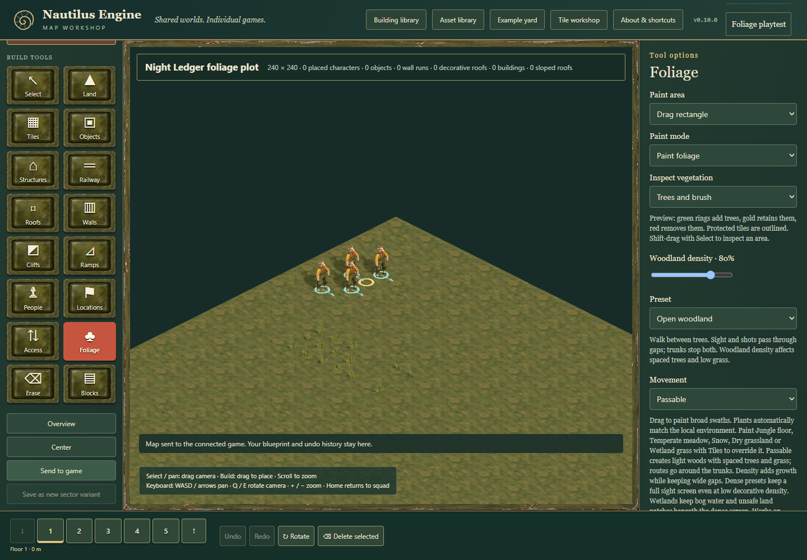
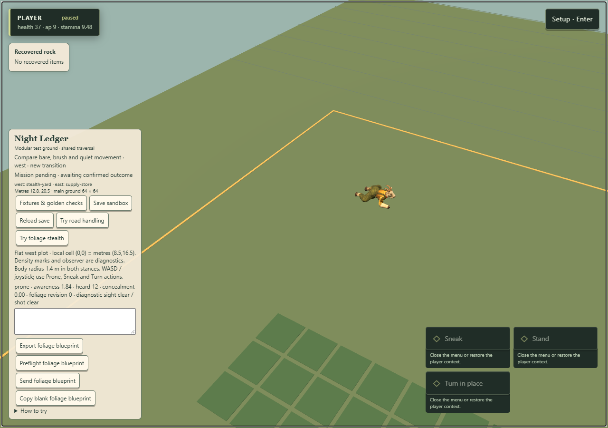
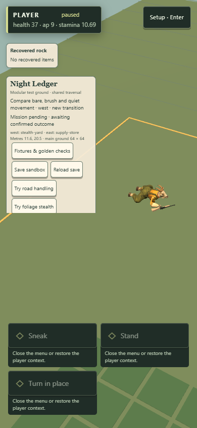

# Foliage editor handoff proof

Implementation: `5c60c131a5753c8189be64df477e4e00e6062b16` (tree `5e7537f4c65e73068379d98e040b7de9150ea599`), based on `bbf4f8adfebfd80ae7afe3744b5fab52b8a78366`. SDK archive SHA-256: `d756c04d2e8ec77fa99168dc200d1e9c9cfe45017da5e9a3b788d182ada8992c`. The source/built/installed reports identify the same clean checkpoint and consumer hashes. Every installed SDK payload byte was verified.

The actual Editor palette/options and pointer drag, undo/redo, IndexedDB save/open, JSON download, preflight and Send reach the Night Ledger plot. The open checklist becomes stale while its pause owner remains held. The comparison uses the authored map. Deterministic authority replay is separate from keyboard/touch input. Whole moving hands and rifle saves restore exactly; two visible-geometry frames compare at 1e-8 m precision. Corrupt/cancelled restore and blocked input preserve the accepted aggregate.

All four repository gates, 42 fixture checks and 19 strict type negative controls pass. See JSON for commands, source/package hashes, native cursor/clock/resource observations and helper closure. Original native pose modules are byte-identical to the accepted base; the 6,492-frame study was not repeated.

The first fresh local offline npm install reached its 120-second bound while fetching the valid archive manifest. A new consumer and isolated npm cache completed ordinary offline installation in 11.546 seconds at the same bound; every SDK payload byte verified. This recovery timing excludes the prior pack and failed attempt and is not a cold human-onboarding benchmark. See `install-recovery.json`.

## Human playtest

Serve `dist/`; the ordinary Editor is `/`, and standalone Night Ledger is `/apps/test-ground/?foliage=1`. Use the Editor popup button to bind the connected handoff. Architect owns the retained preview.

1. In **Foliage playtest**, choose **Open foliage test ground**, then **Load connected foliage blueprint** back in the Editor.
2. Paint on the ground floor in local cells 0–15. The reviewed corridor is `woodland-v1`, passable cover, density 80, rectangle x=5–11/y=10–12. Erase and repaint it to make a change.
3. **Preflight connected game**, then **Send to game**.
4. In Night Ledger close panels and move with WASD/arrows or the joystick. Use **Sneak**, **Prone** plus movement, and **Stand**. Open the map panel to read stance/awareness/heard/concealment; close it to move again.
5. Run **Foliage changes confirmed stealth outcomes** from **Fixtures & golden checks**. Its controlled comparison uses the authored map; clearing the brush can intentionally fail the brush-advantage expectation.
6. **Save sandbox / Reload save** retain accepted pose and spent resources.

See `human-playtest.json` for exact routes, controls and limits. Awareness/heard history remains durable; old hearing events do not disappear when Sneak is enabled.
