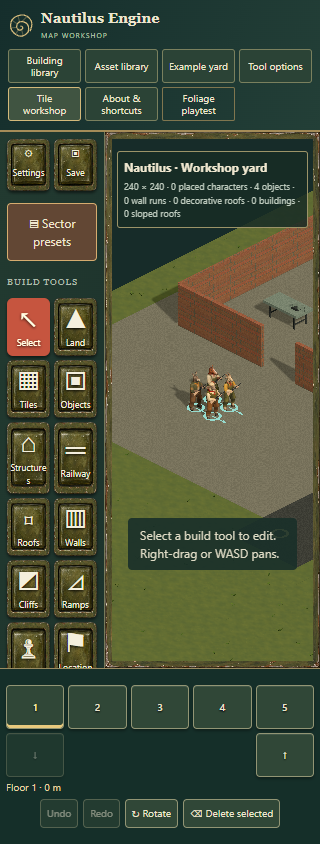
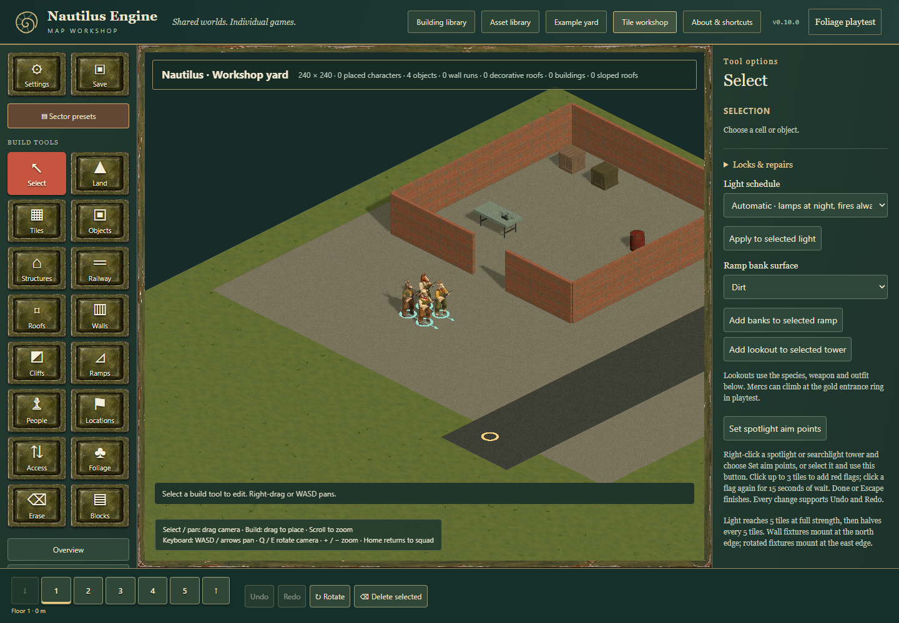

# Responsive Foliage toolbar regression

Fix source: `1eb842f906a17346ed2f327dcae0f681bff412d1` (tree `8b83a9394920edf6fda25cba2230c817b611e0c5`). Original gameplay/SDK acceptance stays pinned to `5c60c131a5753c8189be64df477e4e00e6062b16` and its separate foliage-night-ledger packet. No SDK payload source path changed; no native pose sweep was repeated.

The original review counted nested submenu buttons as primary toolbar actions. The corrected review retains every original primary ID, responsive visibility, reserved-header bound and no-overlap assertion, and separately verifies the three Foliage actions, keyboard order/open-close, viewport bounds and complete map retention. It caught real inherited sidebar details padding and third-row overflow at 320px. The scoped CSS reset, two-row responsive grid and viewport-contained popup fix those defects.

The exact staged tree tested by the entry run became the immutable fix commit. Both 1440px and 320px pass and open both tile workspaces. The production source/built/installed tile-stack matrix passes 19 checks and 11 captures per mode, including desktop/mobile touch, actual native rendering, history, resource retirement and installed no-fallback checks. Defined semantic projections match; this is not a physical-device or FPS claim. Full raw reports and failed logs are preserved in local artifacts, with hashes here and in the production matrix. All 24 recorded helper lifetimes have complete exit probes; recorded ports are released.

