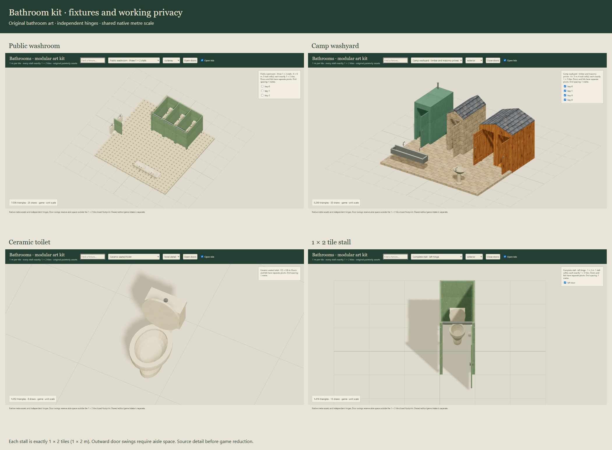

# Modular bathrooms

Original outhouses, seated toilets, urinals, washbasins and opening stalls at native Nautilus scale. The kit contains **21 reusable modules and two example layouts**, with detailed authoring meshes, reduced game meshes, standard glTF, tile plans and a painterly skin.



## Stall footprint and placement

**Every complete stall is exactly 1 × 2 tiles, or 1 × 2 metres.** The existing `MAP_CONTRACT.metresPerTile` is 1. The closed footprint includes partitions, posts, fittings and door frame. Left and right hinges use the same footprint. Three adjoining stalls occupy 3 × 2 tiles and share their internal partitions.

Use unit scale and whole-tile placement for stall cells. Fixtures have a 0.05 m authoring snap. The origin is the front-left ground corner; local negative z is the front. Rotate the complete module in quarter turns. Partition panels are 0.04 m thick, rising from 0.16 to 1.81 m; the front frame is 1.96 m high. Ordinary enclosing walls use the existing 2 m height / 0.16 m thickness, with 0.12 m slabs and 2.12 m floor intervals.

Stall doors swing **outward** into the aisle. Their open motion extends beyond the closed 1 × 2 tile footprint: use `motionBounds`, not just nominal dimensions, when reserving the aisle. The supplied examples keep clear space in front of each stall. The front frame has a 0.84 × 1.92 m rough aperture and a conservative 0.74 × 1.9 m fully-open passage. Outhouse frames have their own narrower documented apertures, including the thicker masonry walls.

These are authored game dimensions. Tile size and door pose are exact contracts; no accessibility, building-code, plumbing or structural certification is implied.

## Inventory

| Group | Modules |
| --- | --- |
| Seated toilets | Ceramic cistern, high-cistern period toilet, stainless toilet |
| Urinals | Wall-hung ceramic urinal, two-person stainless trough |
| Sinks | Pedestal, wall-mounted, double wash trough, stone wash bowl |
| Reusable partitions | 2 m side panel, 1 m front frame, left/right door leaves, urinal divider |
| Complete stalls | Left/right 1 × 2 tile bays and a three-bay row |
| Outhouses | Timber, two-bay timber, masonry privy, portable cabin |
| Examples | 6 × 6 m public washroom, 6 × 5 m camp washyard |

The [catalogue](../assets/bathrooms/catalogue.json) records all 23 exports, physical and reserved bounds, poses, source/game counts and hashes. The [dimension record](../art/bathrooms/dimensions.json) records each footprint and stall cell. Standalone rows own each internal partition once; use the complete row when repeating bays. Standalone panels and frames support custom arrangements with deliberate ownership at joints.

Toilets have real hollow bowls, open seat rings and independently hinged lids. Basins and counters contain actual bowl openings. Outhouse benches have cut-through oval seats above a dark recess. Fixtures are descriptive geometry: pipes and drains do not implement plumbing, excavation, sanitation or fluid simulation.

## Using the assets

```js
import {compileBathroom, bathroomRecipe} from './packages/bathrooms/index.js';
import {buildBathroomMesh} from './packages/bathrooms/mesh.js';
import {createBathroomModel} from './packages/bathrooms/three.js';

const blueprint = compileBathroom('bath-stall-left');
const mesh = buildBathroomMesh(blueprint); // Node; no DOM or renderer
const model = createBathroomModel(THREE, mesh, {atlas});
scene.add(model.root);
model.setDoorsOpen(true);
model.setLidsOpen(true);
const door = model.pivots.find(p => p.userData.kind === 'door');
model.setHingePose(door.name, 45); // any angle from 0 to 90
model.setView({roof: false, cutaway: true});
// End of this model's lifetime:
model.dispose();
```

The host supplies Three and the borrowed atlas; the adapter creates no renderer. Generated geometry/materials are owned and disposed idempotently. Supplied textures and other models remain valid. Recipes are immutable, saved blueprints rebuild identically, and every instance has separately named door/lid pivots. Layout rotation preserves local hinge axes, including horizontal toilet lids.

The [review viewer](reviews/bathrooms/scene.html) has a searchable asset dropdown, individual door checkboxes, all-door controls, a lid control, plans and painted/grey/wire/cutaway views. The independent review reader checks exported glTF buffers, textures and quaternion animations. It is a review tool, not the shared game importer. Each glTF door or lid has its own one-second opening clip; reverse it to close.

`lod: 'source'` selects the settled detailed authoring forms. The default is the reduced game form. `uvMode: 'metres'` uses compact repeating UVs and the host atlas shader; `uvMode: 'atlas'` bakes clipped UVs for ordinary glTF. All images and geometry buffers use relative paths.

## Accuracy, efficiency and narrative

**Accuracy:** metre tile footprints, actual cavities, separate pivots and explicit motion reservations are represented. Fixtures are original interpretations, with no branded products or measured reconstruction claims. Their openings and fixture access are visually and geometrically reviewed; game collision/navigation remain explicit future work.

**Efficiency:** detailed procedural authoring meshes are settled before reducing curved segments and small fittings for the game form. Both versions retain matching complete closed bounds. The catalogue supplies measured triangle/draw counts and the timing record supplies headless construction measurements. Prefer reduced native meshes for tactical maps. Baked atlas interchange can have extra triangles; no frame-rate claim is made.

**Narrative:** clean ivory porcelain and seafoam partitions suit public washrooms; high cisterns and timber seats support period interiors; timber/stone privies and portable cabins cover camps and fort compounds. The two door hands and shared stall grid let the same kit serve different plans. The detailed source is preferable for further sculpting and close-view refinement; the reduced version preserves the recognizable bowl/rim/door silhouettes for ordinary map views.

The original [bathroom atlas](../assets/bathrooms/painted-bathroom-materials-v1.png) was made with built-in ImageGen. The [full prompt history and selected output](../art/bathrooms/material-prompt.json) are saved. The selected image was copied byte-for-byte, without pixel editing or photographic inputs.

## Rebuild and intake

```sh
node tools/build-bathrooms.mjs
node --test tests/bathrooms.test.mjs
node docs/reviews/bathrooms/review.mjs
node docs/reviews/bathrooms/measure.mjs
npm run check
npm test
npm run test:upstream
npm run build
python art/bathrooms/package-art.py
```

Source rebuilds use Node ≥22 and the fixed artist foundation `65c06735396e14b8774ae1e7d5ad61969692963f`; browser review uses Playwright/Edge. Packaging requires a clean committed tree and verifies archive hashes and every relative glTF dependency. The unchanged surface primitive dependency is included in the bundle. The isolated review browser/server close after captures, with an actual ten-minute expiry as a fallback.

This is an additive artist intake candidate. Existing fort collections, public package exports, provider registration, saves and donor/consumer pins are unchanged. Shared editor promotion and game adoption remain separate steps.
