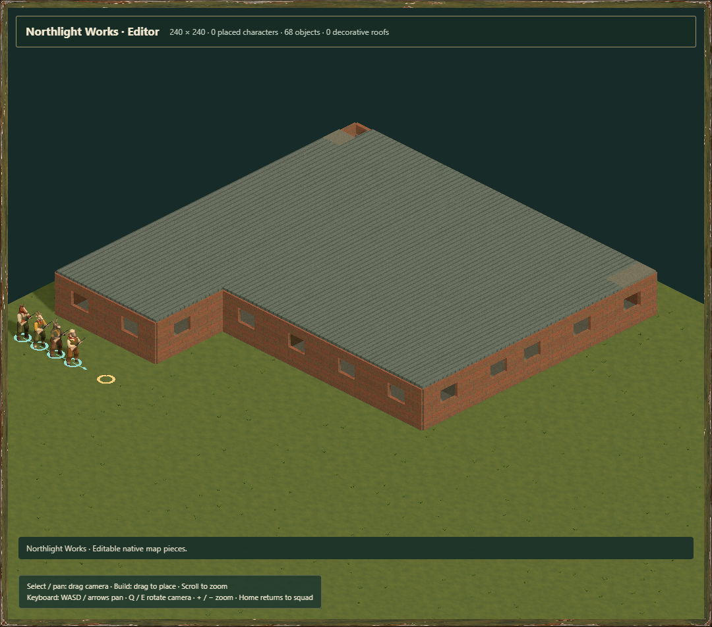
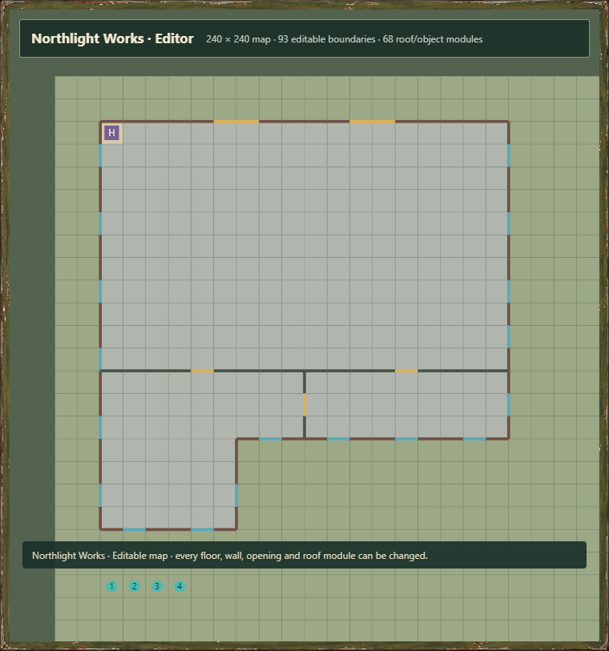

# Buildings constructed in the game map editor

All **48 architecture designs** now have editable native game maps. **48 also have reusable 24 × 24 blocks**. Dockside Warehouse retains its loading apron by using a one-metre plot border; no building is shrunk to fit.

The maps are constructed by the pinned game's `createEditor` / `applyBrush` implementation, using its normal floors, wall edges, windows, closed doors, stairs, ladders and two-metre roof modules. They contain ordinary `aft-map-v2` / `aft-block-v1` data, not a display mesh or an opaque prefab. The construction recipes record 27,318 brush operations. Native towers add occupied rooms and stair landings, bringing the collection to 85 occupied floor layers across the 48 buildings. Roof caps are separate from that occupied-floor count.

## Open, change and reuse

1. In the architecture catalogue, select a building and choose **Build in map editor**.
2. In the map workshop, **Buildings** opens the searchable native-building library. Choose **Editable map** to work on a whole building, **Edit reusable block** for a reusable version, or **Place building in current map** to replace one chosen sector in an existing full map. Placement is a single undoable operation and confirms the affected sector before replacing it.
3. Use the normal editor tools to change floors, walls, openings, stairs and roof pieces. Use the floor selector for upper storeys and roofs. Save a copy in the Nautilus design library or export portable JSON.

The complete native 3D editor is used when WebGL2 is available. Browsers without 3D, including the observed Codex in-app browser, get an editable plan presentation using the same `EditingDocument` controller, brush semantics, undo/redo and isolated native IndexedDB store. It supports pointer painting, floors, wall/window/door variants, stairs, ladders, roof modules, import/export and saved designs. The complete 3D editor retains its broader scenery, character, block-connection and generation tools. This is a presentation fallback, not a new map format or a claim that every 3D tool was duplicated.




## Authoring and data

`packages/building-catalog/editor.js` compiles the art recipes into native editor constructions. `assets/buildings/editor/index.json` records source hashes, file hashes, native bounds, view framing, adaptations and block availability. Each building has:

- `.map.json`: valid full map with the required four starts and travel marker outside the building.
- `.recipe.json`: the native editor brush commands used to construct it.
- `.report.json`: quantization, material mapping, supported bounds, circulation repairs and art limitations.
- `.block.json`: the reusable sector where the complete footprint fits.

The headless API is exported as `@nautilus-engine/map-core/buildings/editor`:

```js
import {buildEditorBuilding} from './packages/building-catalog/editor.js';
import {openDocument} from './packages/map-core/index.js';

const built = buildEditorBuilding('northlight-works');
const editable = openDocument(built.map);
editable.apply({
  tool: 'texture', start: {x: 7, y: 10, z: 0},
  options: {groundKind: 'ground-tiles'}
});
editable.undo();
```

The browser API adds `window.nautilus.openBuilding(id, {format: 'map' | 'block'})` and `placeBuilding(id, sectorX, sectorY)`, with zero-based sector coordinates. These APIs guard unsaved work or sector replacement. The `confirmReplace: false` option is for a host that has already made its replacement decision; UI actions keep the confirmation. Unsupported oversized blocks and invalid inputs reject before replacing a document. Other games still bind their explicit game-host adapter and choose a reviewed engine pin.

## Native adaptations

The one-metre editor grid preserves building size. Half-metre interior partitions snap by at most half a metre; connectivity is rechecked after snapping. Attached garages receive native garage room boundaries. Doors remain normal closed, unlocked game doors; circulation checks allow their standard opening action. Windows remain native window edges rather than traversable gaps.

Report offsets translate source tile indices to native tile centres: native `(i + offset.x, j + offset.y)` covers the source's metre square `[i, i+1] × [j, j+1]`. Aligning corner-based source art therefore uses an additional half-tile centre correction. No sculpt overlay is attached automatically; the editor's established layer-to-height helpers retain the native storey interval.

Every occupied floor and roof cap is reachable using cardinal movement, ordinary doors, explicit stairs and roof ladders. This check deliberately does not rely on skill-dependent wall/window climbing. It proves logical tile connectivity under the existing editor rules, not human egress, animation clearance or physical stair construction. Native stair and ladder portals use their established gameplay abstraction.

Complex gable, hip, gambrel, mansard and sawtooth sculpt profiles are adapted to the editor's flat/sloped 2 × 2 roof modules plus slab infill. Hatches reserve space for ladder access. Towers and turrets become supported grid rooms; round outlines become stepped walls. Dormers, cupolas, domes, chimneys, balusters and the mill wheel remain in the detailed art references. The native material palette currently maps walls to brick, concrete or corrugated metal; it does not replace collision/material identifiers with the sculpt's 16-swatch atlas. The detailed mesh collection remains available for later art/renderer work.

## Validation and reproduction

`node tools/build-editor-buildings.mjs` regenerates the collection. The normal build runs it, copies the maps and serves both workshop presentations. `node tools/check-editor-buildings.mjs` checks source/export hashes, native map/block validation and Git tracking in CI. Four new tests cover all 48 maps and their ordinary circulation, deterministic construction without source mutation, actual editor edits/undo/redo/JSON reload, and native block placement without losing roofs, stairs or boundaries.

`node tools/review-editor-buildings.mjs` opens a disposable isolated browser and verifies the actual native 3D workshop and plan presentation. Review includes model opening, wall-to-window editing, undo, unsaved cancellation, pointer painting, redo, persistent native-store saves and reloads, export/import, invalid-import preservation, reusable block opening/placement and a narrow viewport. See [the review](reviews/2026-10-28-editor-buildings.md). The browser helper has a five-minute expiry and closes its browser and HTTP server in `finally`.

`python tools/package-editor-buildings.py` creates `outputs/nautilus-editor-buildings-v1.zip` with the native maps, blocks, recipes, reports, index, headless construction sources and notes. It excludes third-party reference imagery and the separate glTF pack.
