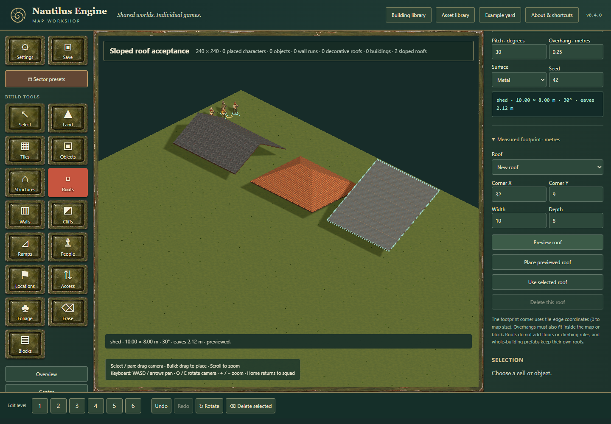

# Procedural sloped roofs in the workshop

Choose **Roofs → Procedural sloped roof**. Pick gable, hip or shed, the ridge/high-edge axis, pitch, eaves height, overhang, surface and seed. Shed roofs also show which direction rises. Drag a rectangle on the map: the actual sloped geometry appears before release, with a green edge overlay. Release commits one undo step; Escape cancels.

**Measured footprint · metres** accepts a rectangular corner, width and depth. Choose **Preview roof**, then **Place previewed roof**. Changing settings, changing the map, undoing, or replacing the document invalidates that preview. A roof selected from the list can be updated using the same preview/place steps or deleted. **Use selected roof** loads an inspected roof's settings. The regular selection, Rotate and Delete actions operate on the same document history.

## Coordinates and limits

The stored roof envelope is edge-based: `x=10,width=12` covers tile columns 10 through 21. It uses ground axes `(x,y)` in metres, with corners inside `[0,size]` including the full overhang. The renderer's native tile centres are integers. `RoofLayer` therefore applies `(-0.5,0,-0.5)` once to the shared roof group when projecting it into the map scene. Stored coordinates never acquire this offset.

A block quarter turn transforms the roof rectangle as `x'=24-y-depth,y'=x`, swaps width/depth and the ridge axis, and transforms a shed's signed cross-axis rise. Gable/hip roofs are symmetric; `direction` affects shed roofs. Generated editor descriptors always contain explicit `direction:1|-1`. Imported descriptors without it use the generator's default; the first shed rotation records the explicit direction. Four turns preserve geometry and opaque roof metadata. Block capture and placement translate by `24*sx,24*sy` directly.

The shared generator permits widths/depths from 0.5 to 240 m, pitch 5–75°, overhang 0–2 m and eaves layer integers 1–5. The complete roof must fit the current 24 m block or 240 m map. Eaves height is `z*2.12 m`; it is separate from the active editing plane. The editor extends the document's declared layers as necessary, without painting floors or creating stairs. The shared mesh supplies a closed 0.12 m shell.

Separate roofs on the same eaves layer may not overlap, including their overhangs. A separate roof may not overlap a whole-building prefab's reserved lot or access clearance, regardless of which was placed first. Prefabs retain their immutable roof assemblies. Ordinary walls and editable native structures can sit beneath a sloped roof.

## Portable extension and implementation stack

The inherited parent formats stay `aft-map-v2` / `aft-block-v1`. Roof-bearing documents add:

```json
{"slopedRoofs":{"version":1,"roofs":[{"id":"roof-1","x":10,"y":10,"width":12,"depth":8,"z":1,"style":"shed","axis":"x","direction":1,"pitch":30,"overhang":0.25,"material":"slate","seed":7}]}}
```

`packages/roof-core` owns shape generation, validation, materials and its host-Three adapter. The map editor adds the following engine-owned wrappers above the existing wall/prefab implementation:

| Module | Responsibility |
| --- | --- |
| `roof-data.js` | Additional occupancy, metadata merge, sector ownership, translated/scoped IDs |
| `roof-maps.js` | Parse/validate and explicit `nautilus-sloped-roofs-v1` capability rejection |
| `roof-document.js` | Atomic preview, mutation/history, selection, rotation, capture and placement |
| `roof-blocks.js` / `roof-rotation.js` | Portable block transformations and crossing-boundary refusal |
| `roof-generator.js` | Existing seeded solver with roof-aware assembly; unchanged no-roof delegation |
| `apps/editor/roof-scene.js` | Shared-Three geometry, native-coordinate projection, preview and resource disposal |
| `tools/editor-roof-adapter.mjs` | Guarded build-only wiring of donor controls/library imports |

Opaque finite JSON in `slopedRoofs.metadata` and each roof's `metadata` object survives editing, saves, exports, transforms and generation. Other unknown envelope/geometry fields reject explicitly. Missing metadata stays absent. Empty valid extensions survive deleting the final roof. Conflicting extension metadata rejects assembly before mutation. Capture or replacement rejects any roof/overhang crossing its sector boundary, including a roof surrounding a sector with both outer ends outside it. Whole roofs must fit one source block before reuse. Connected generation preserves each chosen roof and remaps IDs deterministically; aggregate generator limits reject the whole operation.

Future versions, malformed envelopes and unsupported values reject explicitly, including empty future envelopes. Game adapters must advertise the roof capability and translate this geometry deliberately before accepting a roof-bearing map. Public entrypoints, the machine-readable feature manifest and persistence facade are owned by the architect's integration. This implementation does not update those interfaces or any consumer pin by itself.

## Design assessment and validation

The [shared sculpt review](sloped-roofs.md) compares the physical slopes with native flat/stair-step roofs. For editor authoring, prefer the true rectangular slope: it preserves pitch, overhang and signed shed orientation without approximating them as floor/step geometry. The native options remain compatible. This improves geometric accuracy and the period-house silhouette (visual preference); the generator and renderer costs remain subject to the artist's measurements and combined-scene review. Roof data does not establish walking, climbing, sight, weather or fire integration.

Editor regressions cover nonmutating previews; map/block undo, redo and JSON round trips; invalid import/replace rollback; source-sized and rotated vertex equivalence; the half-metre projection; saved seeds and directions; opaque metadata; capture/replacement boundaries; prefab conflicts; feature rejection; deterministic connected generation; and retirement of obsolete scene/preview models. Run all four repository checks before delivery. The architect owns final combined isolated-browser and capability-manifest acceptance.

Local validation against geometry `41128c4acfb5ffe697d788205c6d863cbc4e49c2`, metadata follow-up `93727e61b271dc4634a7a206af84a7038b26dc10` and headless extraction `fd1c93e8da0062abd964e366c35478766cbb316d`: all 15 editor-roof tests, 165 complete-suite tests, 32 pinned upstream regressions, tracked integrity checks and the build passed. The 603 pinned files and original building export hashes remain intact. The static build excludes source-only documentation `.mjs` review tools, retaining their reports/images and preserving the tools in the repository.

The [isolated Edge workflow report](reviews/editor-roofs/acceptance.json) records successful painted previews for slate/gable, clay/hip and metal/shed, nonmutating/stale-preview checks, placement, update, rotation, undo/redo, JSON import/export and browser save/reload. Three roof models remain, with no preview objects, browser/resource errors or scene diagnostics. The 390 × 844 layout has no horizontal overflow. This review exercises the editor wrappers directly; public facade/package/consumer acceptance remains the architect's separate combined pass. Software rendering supplies visual correctness evidence, not a performance benchmark. Disposable browser/server process lifetimes and released ports were verified; no helper is retained.


