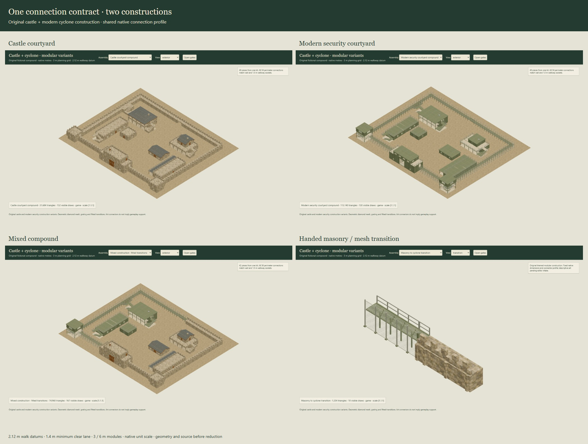
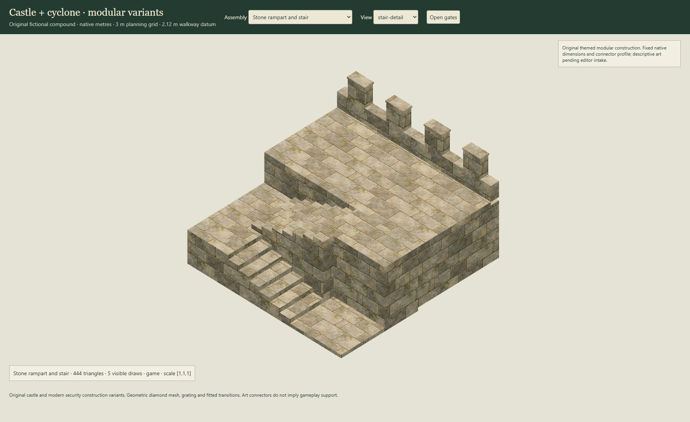
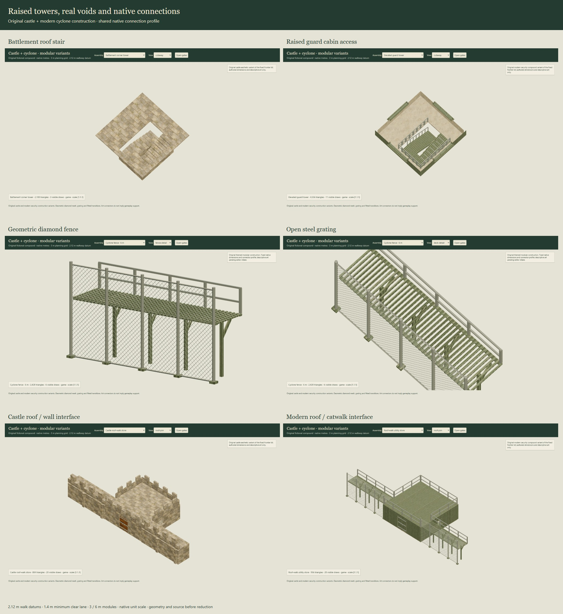

# Castle and cyclone fort variants

Two complete constructions extend the fixed Fort Apache artist kit: a castle family with masonry ramparts, battlements, stone arcades and slate roofs, and a modern family with geometric chain-link, steel catwalks, open-riser stairs and raised glazed guard cabins. Both retain the original connection profile. The collection contains **38 modules and five assembled examples**, including two handed transitions and a mixed compound.



## Inventory

| Role | Castle asset | Modern asset |
| --- | --- | --- |
| Main gateway | `castle-gatehouse` | `cyclone-security-gatehouse` |
| Corner tower | `castle-corner-tower` | `cyclone-guard-tower` |
| Headquarters | `castle-keep` | `cyclone-operations` |
| Quarters | `castle-commanders-house` | `cyclone-officers-quarters` |
| Barracks and shelter | `castle-barracks-arcade` | `cyclone-barracks-canopy` |
| Barracks and roof stair | `castle-barracks-roof-stair` | `cyclone-barracks-roof-stair` |
| Storehouse | `castle-stone-store` | `cyclone-utility-store` |
| Optional roof-walk store | `castle-roof-store` | `cyclone-roof-store` |
| 6 m run | `castle-curtain-6` | `cyclone-fence-6` |
| 3 m closure | `castle-curtain-3` | `cyclone-fence-3` |
| Corner | `castle-curtain-corner` | `cyclone-fence-corner` |
| U return | `castle-curtain-u` | `cyclone-fence-u` |
| Rear gateway | `castle-postern` | `cyclone-service-gate` |
| Platform and stairs | `castle-rampart-platform` | `cyclone-catwalk-platform` |
| Standard return stair | `castle-datum-stair` | `cyclone-datum-stair` |
| Repeatable shelter bay | `castle-arcade-bay` | `cyclone-canopy-bay` |
| Terminal pier/post | `castle-arcade-terminal` | `cyclone-canopy-terminal` |
| Separate paired gate | `castle-paired-gate` | `cyclone-paired-gate` |

`link-castle-to-cyclone` and `link-cyclone-to-castle` are 3 m transition pieces with different construction at their two ends and a fitted central junction. They preserve the same deck height and walking lane. The mixed example uses both hands. Their handed construction avoids rotating a wall backwards and moving its walk to the outside of the compound.

Each family has a 72 × 60 m courtyard example (40 instances / 34 perimeter connections) and a 60 × 48 m compact example (31 instances / 26 connections). `fort-variants-mixed` is 72 × 60 m with 42 instances and 36 connections. Every example forms one closed perimeter with an open central yard. Original frontier IDs and assets remain unchanged.

The [catalogue](../assets/fort-variants/catalogue.json) records all 43 exported assets, source/game counts, hashes and complete bounds. There are 16 buildings, 22 parts, five assemblies, **43 detailed authoring meshes, 43 reduced meshes, 43 glTF models**, 29 building floor plans and five assembly plans. The [parts manifest](../assets/fort-variants/parts.json), [connector manifest](../assets/fort-variants/connectors.json) and [dimension record](../art/fort-variants/dimensions.json) contain the serialized intake data.

## Shared placement contract

Use native metres and scale `[1,1,1]`. Ground coordinates are `(x,y)`; render positions and bounds are `[x,height,y]`. The perimeter planning grid is 3 m, with 3 m and 6 m wall spans and quarter-turn instance rotations. Ordinary room walls remain 2 m high and 0.16 m thick, slabs 0.12 m, and occupied levels use 2.12 m intervals.

The unchanged `nautilus-art-wall-walk-v1` socket has a wall-axis endpoint at ground datum and a walk center inset 0.91 m at height **2.12 m**. A nominal 1.5 m walk retains **at least 1.4 m clear width and 1.8 m clear height** at every declared interface. Match coincident wall endpoints, opposite outward tangents and coincident walk centers with equal widths and clearances. This profile is identical across the frontier, castle and cyclone modules. Use complete physical and reserved bounds for placement; buttresses, roof edges, hinge fittings and motion extend beyond nominal footprints.

Castle ramparts have an explicit 1.82 m-deep filled body beneath the deck and a 0.32 m front parapet; merlon caps reach 3.42 m. These are custom defensive pieces. The modern fence uses 0.055 m-radius posts, 9 mm-diameter authored wire and a 0.15 m diagonal-intercept pitch. The diamond openings are actual geometry. Catwalk crossbars likewise leave real grating gaps. These are authored game-scale dimensions, not historical or industrial specifications.

Matching post/collar envelopes may coincide at joints. Other solids must leave the walking lane and approach reservations clear. `validateLayout()` checks the closed connected perimeter, native scale, quarter turns, dimensions and socket compatibility; it does not perform arbitrary solid intersection or terrain fitting. U returns use their own turn sockets and cannot connect as collinear straight runs. Unequal heights, offsets, arbitrary angles and scaling require new adapters.

Roof-walk stores are capped by default. Set `openInterfaces: ['roof-west', 'roof-east']` on the cloned recipe or an assembly instance to remove the relevant guard/parapet sections. The mesh cache includes these options, so one opened instance does not alter another. Repeatable shelter bays own their left pier/post. Their front pier axis is inset 0.18 m from the footprint edge: place the terminal at local `[3,0,0.18]` for one bay, or `[3 * bayCount,0,0.18]` for a repeated run, then apply the assembly transform.

## Access, gates and layers

Castle corner towers have an accessible battlement deck at 4.24 m. The castle gatehouse extends its stair to a roof terrace at 6.36 m. The modern guard tower has an open ground support bay, an intermediate perimeter-access deck at 2.12 m and a glazed cabin at **4.24 m**, reached by two standard stair rises. Its braces occupy the front and west faces, leaving the east and south wall-walk entrances clear.

Each return stair rises 2.12 m in 14 equal risers, with 1.3 m nominal / 1.25 m minimum clear flight width. Exterior building side exits use the explicit 1.5 m landing-depth variant. Slab holes and landings are real geometry. Modern stairs use separate treads, stringers and steel railings. Castle flights and half-landings are solid masonry founded on the ground, with no railings. Castle wall walks have open inner edges; defensive stone parapets and battlements remain.

The castle rampart stair runs back and forth **parallel to the curtain wall**. Its lower flight climbs west, turns across a 1.2 m-deep half-landing, and returns east to the 2.12 m platform. The same construction is supplied as the standalone `castle-datum-stair`: a 6 × 3 m module with flights along local x, an open wall connection along local y=0 and explicit lower/upper attachments. Rotate the whole module to follow the wall. The complete rampart/platform is now 6 × 6 m. Their perimeter sockets remain identical to the frontier kit; the standalone stair's dimensions and attachments describe this new construction.



Main gates retain a 4 × 4.12 m rough aperture and at least **3.2 × 3.9 m** fully open clearance, including fittings. Rear gates retain a 3 × 2 m rough aperture and at least **2.5 × 1.9 m** open clearance. Leaves have independent named pivots and inward 0–90 degree motion. Main and rear gate glTF exports carry standard paired rotation animations; reverse time to close. Ordinary doors retain descriptive pivots and their default pose.

`roof-terrace` and `roof-guards` are separate render channels. A roof-off view removes the battlement roof slab and its guards to reveal the fighting room below. Selecting that terrace's level with `maxLevel` preserves its floor for stair/landing inspection. This works in both the native adapter and the independent glTF review reader.



## Data and renderer use

```js
import {compileVariant, variantRecipe, validateLayout}
  from './packages/fort-variants/index.js';
import {variantLayout} from './packages/fort-variants/layouts.js';
import {buildVariantMesh} from './packages/fort-variants/mesh.js';
import {createVariantModel} from './packages/fort-variants/three.js';

const layout = variantLayout('cyclone-fort-courtyard');
if (!validateLayout(layout).closed) throw Error('Incomplete perimeter');
const mesh = buildVariantMesh(layout);
const plan = compileVariant('castle-gatehouse');
const roofStore = variantRecipe('cyclone-roof-store');
roofStore.openInterfaces = ['roof-west', 'roof-east'];
const connectedStore = buildVariantMesh(roofStore);

// Host-supplied Three instance and borrowed textures; no renderer is created here.
const model = createVariantModel(THREE, mesh, {atlas, eraAtlas});
scene.add(model.root);
model.setDoorsOpen(true, {gatesOnly: true});
model.setView({roof: false, maxLevel: 1});
// At the end of the model's lifetime:
model.dispose();
```

The data compiler and mesh builders load without a DOM or Three. Stable asset IDs, cloned recipes, raw layouts, exported blueprints and saved mesh data provide the authoring paths. `lod: 'source'` selects the detailed authoring geometry; the default is the reduced game mesh. The adapter owns generated materials/geometries, releases them idempotently and preserves supplied textures and other models. The host owns its scene, renderer, Three instance and textures.

Compact metre UVs use the reviewed WebGL2 atlas shader. `uvMode: 'atlas'` bakes clipped tile coordinates for standard interchange. The glTF files use two relative images: the existing shared painterly atlas and the new era atlas. Opaque wire geometry uses a material color rather than an alpha texture. The review reader is an exporter-subset QA tool, not the shared game importer.

## Accuracy, efficiency and narrative

**Accuracy:** the families share plans and sockets from the fixed frontier kit, with genuinely different construction. Masonry depth, crenels, arches, wire voids, grated decks, open risers and raised cabins are explicit geometry. Ordinary room dimensions remain native. These are fictional aesthetic adaptations; they supply no structural, industrial, navigation, collision, ballistic or fire implementation.

**Efficiency:** use the reduced native meshes for runtime evaluation and detailed sources for continued art work. The castle courtyard has 31,684 game triangles against 121,108 in its detailed source; the modern courtyard has 113,140 against 345,816. Compact examples have 28,088 and 90,936 game triangles respectively. The mixed compound has 74,968. Actual wire costs more geometry than filled wall panels; the native game path is preferable to atlas-subdivided glTF for large tactical scenes. The [headless timing record](reviews/fort-variants/headless-cost.json) records initial and three subsequent construction samples, platform and catalogue hash. It measures construction, with no explicit GC/CPU isolation and no frame-rate claim.

**Narrative:** stone mass, battlements and arcades make the castle enclosure readable from above, while the modern family preserves sight through its fence and puts guards above the catwalk. The two hands of the transition support visibly retrofitted compounds. Prefer the masonry family for castle maps and the geometric wire family where close fence views or visibility through the boundary matter. Evaluate distant-view simplification before using many modern compounds together; no billboard/impostor substitute is included in this delivery.

The original built-in ImageGen [era atlas](../assets/fort-variants/painted-era-materials-v1.png) contains ashlar, slate, coated steel and concrete tiles. Its [full prompt and selected output](../art/fort-variants/material-prompt.json) are saved with the [provenance record](../art/fort-variants/provenance.json). It was copied byte-for-byte, with no photographic inputs or pixel editing. Existing original timber tiles supply castle oak surfaces; the prior frontier collection's images and models are unchanged.

## Verification and handoff

The [verification record](reviews/fort-variants/verification.json) ties the sealed catalogue to geometric tests, source/export hashes, visual evidence, timing and helper cleanup. Review covers all five layouts; all 43 glTF readbacks; painted, grey, wire, roof-off, plans and source views; independent gate leaves and intermediate animations; tower/stair access; diamond/grating voids; optional roof joins; and both transition hands. The isolated browser and loopback server close at review completion, with a real ten-minute expiry as a fallback. No preview service is retained.

```sh
node tools/build-fort-variants.mjs
node --test tests/fort-variants.test.mjs
node docs/reviews/fort-variants/review.mjs
node docs/reviews/fort-variants/measure.mjs
npm run check
npm test
npm run test:upstream
npm run build
python art/fort-variants/package-art.py
```

Source rebuilding/review requires the named Nautilus foundation, Node ≥22, the pinned Three runtime, Python for packaging, and Playwright/Edge for browser review. The bundle includes the unchanged frontier profile/recipe and measured-compiler source closure; portable glTF has complete relative image/buffer closure. Packaging requires a clean committed tree and verifies every archive hash and every glTF resource.

This additive collection is based on artist commit `6d9dfeca7e47a4bded6497472f46f49f8ce14a5b`, with engine baseline `12ad8c9b1c96637cd05c8e344692063bfde385f3` (tree-equivalent released commit `581258aa506798dca3909bfd41ec39d3ee23b550`). It is ready for architect intake as a separate artist candidate. Provider registration, public exports, save formats, donor/consumer pins and the v0.5.0 release are unchanged.
