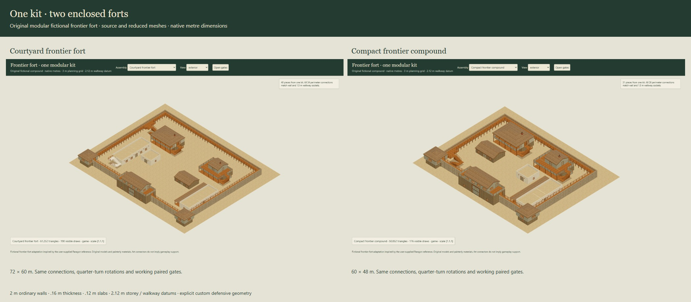
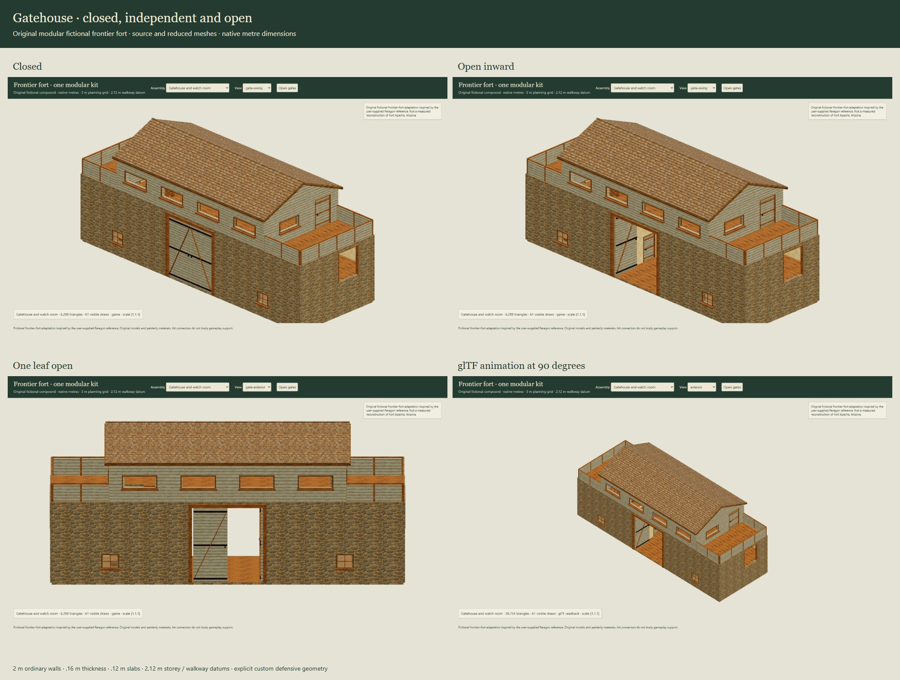

# Modular frontier fort art kit

Eighteen reusable modules form two complete enclosed forts: a 72 × 60 m courtyard configuration and a 60 × 48 m compact configuration. Both use the same native metre connections, working paired gates and accessible perimeter walks. The kit is an artist intake candidate in `nautilus-frontier-fort-v1`; promotion into the shared map editor remains the architect's integration step.



## Contents

| Module | Nominal footprint | Assembly purpose |
| --- | --- | --- |
| `frontier-gatehouse` | 18 × 6 m | Tall main passage, two guard lodges, upper watch room, guarded side platforms, working paired gates |
| `frontier-blockhouse` | 6 × 6 m | Projecting timber upper room over masonry, real stair hole and two perpendicular walk entrances |
| `frontier-headquarters` | 15 × 9 m | Office, hall, records room, porch, upper lookout, terrace and exterior stair |
| `frontier-commanders-quarters` | 15 × 9 m | Two occupied levels, front porch/balcony, internal and exterior stairs |
| `frontier-adobe-barracks-porch` | 18 × 9 m | Squad room, hall and day room with a 3 m deep porch |
| `frontier-adobe-barracks-stairs` | 21 × 6 m | Barracks rooms, reachable roof terrace and exterior return stair |
| `frontier-stone-storehouse` | 9 × 6 m | Gabled store with paired entry |
| `frontier-adobe-storehouse` | 6 × 6 m | Flat-roof store; optional roof-walk connections have explicit removable caps |
| `frontier-stockade-6` / `frontier-stockade-3` | 6 / 3 m run | Repeatable pointed timber wall and inset walk |
| `frontier-stockade-corner` / `frontier-stockade-u` | 6 m legs | L corner and U return, with dedicated connector orientations |
| `frontier-sally-port` | 6 m run | Rear paired gateway below a continuous walk |
| `frontier-rampart-platform` | 6 × 8 m | Deeper guarded platform and return stair |
| `frontier-datum-stair` | 3 × 5 m | Standard 2.12 m rise, return flight and upper landing |
| `frontier-porch-bay` | 3 × 3 m | Repeatable shelter bay owning its left post |
| `frontier-porch-terminal` | Post axis at origin | Final post and cap for the end of a porch run |
| `frontier-paired-gate` | 4 × 4.12 m rough aperture | Separate paired leaves, fittings and stable hinges |

The courtyard configuration has 40 placed modules and 34 paired perimeter connections. The compact configuration has 31 placed modules and 26 connections. Both form a single closed perimeter and retain an open central courtyard. The U return and free porch pieces are additional construction options; neither is required to close the supplied configurations.

The [catalogue](../assets/frontier-fort/catalogue.json) contains all 20 asset records, hashes, source/game counts and complete bounds. Each asset has an immutable recipe or assembly, a plain blueprint, a detailed compressed source mesh, a reduced compressed game mesh and standard indexed glTF with a relative binary buffer. There are 13 building floor plans and two assembly plans. The [parts manifest](../assets/frontier-fort/parts.json), [connector manifest](../assets/frontier-fort/connectors.json) and [dimension decisions](../art/frontier-fort/dimensions.json) are the intake contract.

## Placement and connections

Ground-plan coordinates are `(x,y)`; render positions, bounds, hinge pivots and attachments are `[x,height,y]`. Building origins are the front-left nominal footprint at ground datum. Part origins are explicit in each descriptor. Use the physical and reserved bounds rather than inferring extents from footprint width and depth: trim, log tips, fittings and door motion extend beyond nominal rectangles.

Place instances at scale `[1,1,1]`, using quarter-turn rotations and the 3 m perimeter grid. Ordinary walls are 2 m high and 0.16 m thick, slabs are 0.12 m, and occupied levels and wall walks use 2.12 m intervals. Tall gateway space deliberately omits its intermediate slab. Defensive logs are explicit custom geometry: 0.25 m diameter and pitch, 3.12 m body height, with pointed tops no higher than 3.42 m. The assembly ground is a cosmetic quad 5 mm below floor datum; it supplies no terrain or physics behavior.

A wall-walk socket describes both a wall-axis endpoint at ground datum and an inset walking-lane center at height 2.12 m. `out` is the outward tangent along the run at that endpoint, in ground axes. Compatible sockets have the same profile, coincident transformed endpoints, opposite tangents, coincident transformed walk centers and equal clearances. The walk is nominally 1.5 m wide with **at least 1.4 m clear width and 1.8 m clear height** after guard fittings. Guard collars may touch at matched connections. Unrelated geometry must stay outside the lane and approach reservations.

`validateLayout()` checks matching perimeter sockets, one closed connected component, native scale, quarter turns and the 240 m maximum map extent. It does not perform arbitrary solid intersection, terrain fitting or route finding. The geometric tests separately probe real decks, openings and clear walking cross sections. A U return has dedicated turn sockets; plugging it directly into a collinear straight-run socket is unsupported. Arbitrary rotations, scaling, mirroring, unequal datums and unequal offsets need authored adapters.

The adobe storehouse roof is capped on both sides by default. Set `openInterfaces: ['roof-west', 'roof-east']` on its cloned recipe or layout instance before connecting wall walks. The matching parapet gaps are then actual openings. Per-instance mesh caching includes these options, so opening one storehouse leaves other instances capped. A repeatable porch bay owns only its left post; use one terminal post at the final right attachment to finish a run without duplicate posts.

## Gates, stairs and cutaways

The main gate has a 4 × 4.12 m rough aperture and at least **3.2 × 3.9 m** fully open clearance, including fittings. The rear gateway has a 3 × 2 m rough aperture and at least **2.5 × 1.9 m** open clearance. Each leaf has its own stable named pivot and opens inward through 0–90 degrees. Closed, one-leaf-open, both-open and intermediate exported animation poses were reviewed. Public door reservations include the complete motion envelope, sampled every degree with a 2 mm allowance; keep these bounds and the named approach volumes free.

Return stairs rise 2.12 m in 14 equal risers. Flights are nominally 1.3 m wide with a 1.25 m minimum clear width, 2.8 m run, 1.2 m return and 1 m upper landing. Exterior side exits use a separate **1.5 m landing-depth variant**, omit the connecting-side guard and align with a real doorway or terrace gap. Upper-floor stair holes are real holes, with accessible landings and guards. Flat roofs used as terraces sit on native datums; ordinary pitched roof pitches and log tips do not create additional occupied levels.

The optional Three adapter exposes `setView({roof, maxLevel})`, `setDoorsOpen(open, {gatesOnly})` and `setDoorPose(id, degrees)`. Cutaways and review plans are art inspection layers. Gameplay collision, navigation, ballistics, fire and structural support remain separate consumer work.



## Code entry points

```js
import {compileFrontier, frontierRecipe, validateLayout}
  from './packages/frontier-fort/index.js';
import {frontierLayout} from './packages/frontier-fort/layouts.js';
import {buildFrontierMesh, buildFrontierLayout}
  from './packages/frontier-fort/mesh.js';

const plan = compileFrontier('frontier-gatehouse'); // plain rooms, walls, holes, portals, stairs
const layout = frontierLayout('frontier-fort-courtyard'); // independent serializable copy
const proof = validateLayout(layout);
if (!proof.closed) throw Error(proof.errors.join('\n'));
const game = buildFrontierLayout(layout);
const detailed = buildFrontierMesh('frontier-blockhouse', {lod: 'source'});

const terrace = frontierRecipe('frontier-adobe-storehouse');
terrace.openInterfaces = ['roof-west', 'roof-east'];
const openRoofModule = buildFrontierMesh(terrace);
```

The data entry and mesh builders do not require a DOM, renderer or Three instance. Their only external source dependency is the unchanged measured-building compiler closure (`packages/measured-buildings/index.js` and `designs.js`) at artist foundation `8631b0cfc6005f3004956afa50ec0e46e5f69278`.

```js
import {createFrontierModel} from './packages/frontier-fort/three.js';
const model = createFrontierModel(THREE, game, {atlas, postAtlas, barkTexture});
scene.add(model.root);
model.setDoorsOpen(true, {gatesOnly: true});
model.setView({roof: false, maxLevel: 1});
// After removing the model from use:
model.dispose();
```

The host owns its Three instance, renderer, scene and supplied textures. The adapter owns its generated materials and geometries; idempotent disposal preserves borrowed textures and other models. Compact `uvMode: 'metres'` uses the reviewed host atlas shader and WebGL2. Use `uvMode: 'atlas'` for baked atlas coordinates and standard material interchange. The glTF exporter uses those baked coordinates, standard texture origins and repeat/clamp samplers, plus paired standard TRS animation channels for the principal gates. The independent review reader is QA code, not the shared editor importer.

## Art decisions and performance

The visual reference is the user-supplied [Paragon Scenics Fort Apache](https://www.paragon-scenics.com/FORT_APACHE.html): an enclosed fictional frontier fort with pointed timber walls, projecting watch buildings, a dominant gate and low adobe service ranges. This collection uses original proportions, plans, construction details and metre dimensions. It is not a survey of the Arizona historic post. Product miniature sizes were not converted into construction measurements. The [reference register](../art/frontier-fort/references.json) records inspected images and hashes; reference photographs remain outside the repository and bundle.

Detailed source meshes establish bevels, log roundness, trim and fittings before the authored game-detail reduction. This is a reproducible pair of authored detail levels, not an automatic decimator. All 18 individual modules reduce by more than 1.5× while retaining identical complete bounds. The courtyard assembly reduces from **195,408 to 61,252 triangles**; the compact assembly reduces from **165,660 to 50,852 triangles**. Their standard baked glTF versions use 189,656 and 164,248 triangles because atlas tiling is physically subdivided. Use the compact native mesh path for runtime evaluation, glTF for portable interchange and the detailed sources for further art work.

The painterly palette combines grey-buff rough pine, pale clapboard, warm masonry, ivory adobe, timber floors and brown shingles. The new rough-log material avoids the appearance of horizontal boards on the stockade. Original bitmap outputs were copied byte-for-byte from built-in ImageGen; full prompts, selected outputs, tile layout and reuse history are recorded in [post-material prompts](../art/frontier-fort/skin-prompts.json) and [stockade prompt](../art/frontier-fort/stockade-skin-prompt.json). Stone, iron, floor and trim tiles reuse the existing original `painted-materials-v2.png` atlas. No reference photograph pixels are used in the skins.

The silhouette reads as an enclosed frontier compound before inspecting small detail. Broad openings remain real geometry in grey and wire views; the gatehouse, blockhouse and low service ranges retain different roles. The open courtyard and two sizes provide useful map composition options. Furnishings, inhabitants, weather variants and later eras are future additions.

The [headless timing sample](reviews/frontier-fort/headless-cost.json) records Node 24.15.0 on Windows x64 / Ryzen 7 5800X: median game mesh construction was approximately 107.2 ms for the courtyard assembly and 92.9 ms for the compact assembly. Each median uses three subsequent sequential samples in one imported process, after an initial sample. Layout timing includes module compilation. There was no explicit GC, CPU isolation, rendering or frame-rate measurement. These are construction costs, not gameplay performance guarantees.

Castle walls and chain-link fences with catwalks can reuse roles, origins, datums, pivots and clearance semantics. Their wall thicknesses, panels, corner forms, posts, gates, stairs and guard geometry require new authored pieces and transition adapters. The current delivery contains only the frontier kit.

## Verification and rebuild

The [verification record](reviews/frontier-fort/verification.json) identifies the sealed catalogue, evidence hashes, checks and cleanup result. Review evidence includes painted, grey, wire, roof-off, plan, source-detail, gate motion and access views; all 20 exported assets were loaded through the independent glTF reader. The two default configurations were checked at all four quarter turns. Geometry tests cover real openings, complete gate approaches and swept fittings, stair holes/landings/side exits, connector floors and clear lanes, roof closure, finite normals/UVs, source reduction, export hashes and borrowed-resource disposal.

```sh
node tools/build-frontier-fort.mjs
node --test tests/frontier-fort.test.mjs
node docs/reviews/frontier-fort/measure.mjs
node docs/reviews/frontier-fort/review.mjs
npm run check
npm test
npm run test:upstream
npm run build
python art/frontier-fort/package-art.py
```

Rebuild and review require the named Nautilus foundation, Node ≥22, the pinned Three runtime, and Python for packaging. Browser review additionally needs Playwright and an installed Edge (or the harness's supported browser override). It launches a hidden, isolated browser and random loopback server, records exact ownership/restart information, and closes both in `finally` or at the bounded ten-minute expiry. It never attaches to a user's browser. No preview service is retained after review. Packaging requires a clean committed tree and verifies every archive hash and glTF relative dependency.

The fixed engine baseline is `12ad8c9b1c96637cd05c8e344692063bfde385f3`; released main `581258aa506798dca3909bfd41ec39d3ee23b550` has an identical tree. This additive artist branch does not change provider registration, public exports, donor/consumer pins, saves or the v0.5.0 release. Earlier measured-building and H-plan collections remain unchanged; the superseded real-post research prototype remains checkpointed separately at `e375a1a0c42b6934467ff813c6aaa532f9cb970e`.
