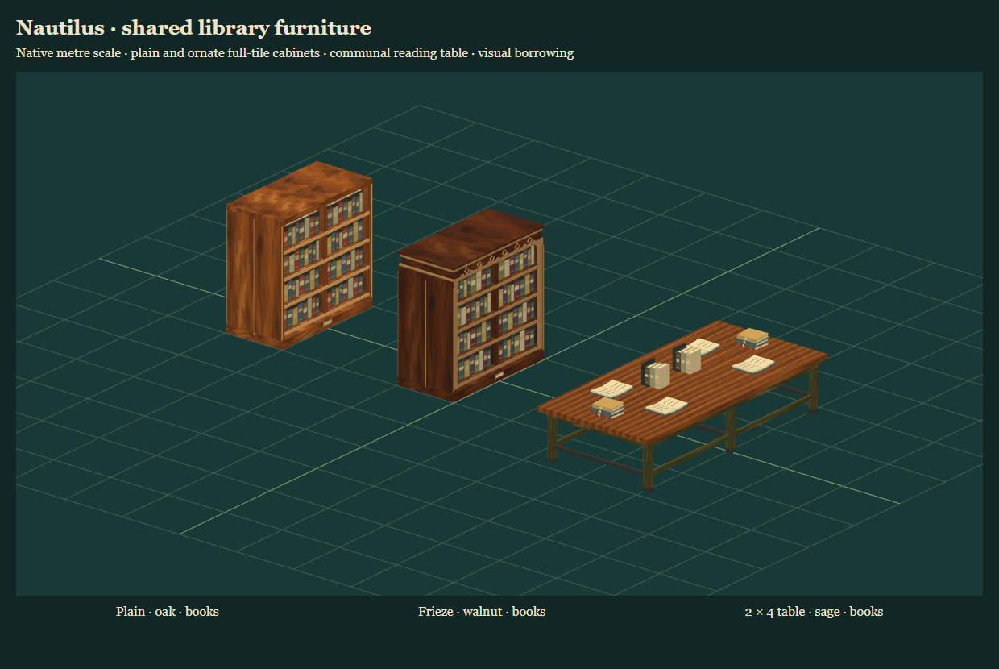

# Shared library furniture

The accepted tranche is `FC-fb6e20a-library-furniture`, Farmyard commit `fb6e20aa6e7d0cfe8793b4b7f693552d69a3a18b`, source version `library-furniture/3`. There are **eight forms and 96 finish/content variants**, not 96 independent sculpts. This tranche supplies reusable visuals and inspection geometry. Map placement, a portable save extension, authoritative inventory/fuel, game consumers and halo adaptation remain unsupported.

## Headless data

```js
import {listFurnitureAssets, furnitureAsset} from '@nautilus-engine/core/furniture';

const entries = listFurnitureAssets({form:'bookcase-double-thick', finish:'oak', contents:'books'});
const spec = furnitureAsset(entries[0].id, {rotation:90});
```

The compatibility package uses the same subpaths under `@nautilus-engine/map-core`. Filters are optional exact source form IDs, finish IDs (`oak`, `walnut`, `sage`, `ivory`, `oxblood`, `graphite`) and contents (`empty`, `books`). Unknown filters, IDs, options and rotations reject explicitly. Rotations are **0/90/180/270 degrees about renderer +Y**, not quarter-turn indices. Stable engine IDs are `furniture:library.<source-form>.<source-skin>.<source-contents>`. Every call returns new plain data, including nested arrays and support/source notes.

Records include `id`, `name`, `form`, `finish`, `contents`, `units:'metres'`, `rotation`, `size`, `tiles`, `navigationFootprint`, `placementOffset`, `frontAxis`, `sourceFrontAxis`, and the fixed source repository/commit/version/ID. Availability is `visual-only`, `mapPlacement` is false, and gameplay/halo support objects include explicit reasons. Importing this entrypoint reaches only the original plain-data catalogue; it does not import Three, a renderer, DOM, storage or network code.

Keep these concepts separate:

| Field | Meaning |
| --- | --- |
| `tiles:[w,d]` | Integer reservation for spacing, after the requested rotation |
| `navigationFootprint:[minX,minZ,maxX,maxZ]` | Declared actual body footprint in metres, not an opaque tile-sized wall |
| `size:[width,height,depth]` | Source body/maximum-contents envelope; conservative height, not exact rendered bounds |
| `placementOffset:[x,z]` | Add to the first reserved cell centre to position the centred root |
| Renderer instance `getBounds()` or `bounds` | Fresh actual visual world-space `THREE.Box3`, including labels and trim |
| `solidParts()` | Actual source solid geometry with copied **current** world matrices; decorative labels/trim omitted |

Full-tile bookcases and the small table reserve `[1,2]` at zero rotation with offset `[0,.5]`; the large table reserves `[2,4]` with offset `[.5,1.5]`. Odd quarter turns swap the axes and offsets exactly as the source. Full-tile cabinets are constructed facing +X; other forms face +Z at zero. `frontAxis` includes the requested rotation; `sourceFrontAxis` records the zero-angle front. Geometry is never resized to make these declarations agree.

Visual trim can extend beyond the declared body: full-tile cases render about .995 × 1.98 m versus a .98 × 1.98 m body; the ordinary double renders .895 m deep versus a .88 m body. Tall/wide/low cases render about .4675 m deep versus their .46 m body. Stocked tables render about 1.16 m high versus the declared conservative 1.18 m. Consumers must not substitute the declared size for measured visual or per-part bounds.

## Optional host-Three renderer

```js
import {loadFurnitureAssets, furnitureTextureURLs} from '@nautilus-engine/renderer/furniture/three';

const library = await loadFurnitureAssets(THREE, {
  // Optional. The default uses the host THREE.TextureLoader.
  loadTexture: (url, {kind, signal}) => myLoader(url, {kind, signal}),
  // Optional borrowed textures; missing keys are loaded. Keys are atlas/cargo/bookSkins.
  textures: {atlas: sharedPaintAtlas},
  signal: abortController.signal
});
const instance = library.create('furniture:library.library-table.sage.books', {rotation:0});
scene.add(instance.root);
const registration = registerGeometry(instance.solidParts());
// After moving/rotating the root or one of its parents, query solidParts again.
unregisterGeometry(registration);
instance.dispose();
library.dispose();
```

`furnitureTextureURLs()` returns fresh `{atlas,cargo,bookSkins}` package-relative absolute URL strings. `loadTexture(url,{kind,signal})` returns a texture or a promise for one. Returned textures transfer to the library; textures supplied through `textures` remain caller-owned. All textures must be Three textures with clone/dispose support. Injecting a loader supports deterministic tests without a DOM. No requests occur merely by importing the renderer entrypoint, and there is no private live Three import.

`loadFurnitureAssets()` returns a promise for `{create,dispose,stats,disposed}`. `create(id,{rotation=0}={})` synchronously returns `{root,spec,getBounds,bounds,solidParts,dispose,disposed}`. `spec` is a fresh data copy; `getBounds()` and the `bounds` getter return fresh current world-space boxes. Apply transforms to the root or its parents; editing individual internal batches is outside the contract. `solidParts()` returns `{role,geometry,matrixWorld}` records. Geometry is borrowed from the library, while each matrix is a new host-Three matrix. Consumers own registrations and must remove them before instance/library disposal. Under-table sight gaps and both cabinet faces retain the actual part geometry.

Instances own their instanced buffers; the library owns shared geometry/materials, cropped map clones and loader-returned source textures. Instance disposal detaches only that instance and is repeatable. Library disposal retires its remaining instances and owned resources and is repeatable. Separate libraries have independent resources. Caller textures, their images/Sources, the host renderer and other libraries stay caller-owned. Cloned maps share the source image but have independent crop/colour-space settings and disposal. Neither unload nor abort closes an image.

Load failure or an abort rejects promptly, releases completed owned loads, and releases any later successful completions exactly once. The injected loader can additionally honour the supplied signal. Aborting after a library has resolved does not dispose it; the caller must call `dispose()`. Rejected/late editor previews must dispose their library/instances or abort pending loads. Creation and geometry queries reject after disposal.

Roots use `InstancedMesh`. The existing halo/silhouette pipeline rejects them explicitly; this tranche does not introduce a hidden silhouette adapter. Finish colours/material labels and visible books do not define combustion, inventory, occlusion policy or gameplay searchability.

## Source and ownership

`tools/furniture-source.mjs --repo <read-only Farmyard checkout> [--write]` accepts only the fixed full commit above and reads Git objects. It preserves twelve exact source/evidence/texture/notice files under `vendor/farmyard-furniture/<pin>/`, with blob IDs, byte counts and SHA-256 hashes. The immutable snapshot keeps original static imports as reference source. It does not copy a second Three runtime or the transitive mission dependencies of `painted-furniture.js`, which is design evidence only.

The separate generated `factory.js`/`soft-box.js` adapters parameterize Three and retain the source geometry and part recipes. Cropped texture clones explicitly receive source sRGB/anisotropy settings without modifying caller atlases. The live PNGs reuse byte-identical existing AFT-pinned material/cargo paints; the original book-spine SVG comes from the new snapshot. Provenance records the reuse and comparison-only line-ending-normalized Three/notice hashes. Raw imported bytes are never normalized. `npm run check -- --tracked` also verifies indexed source bytes and adapter derivation.

The source README/catalogue/provenance preserve the undeclared/unspecified artwork licensing status and separate Three MIT notice. This import adds no license grant. The report used for intake is commit `f67439c9f848042d1647ea428e494bca2749dc32`, `docs/intake/2026-10-28-furniture-and-building-assets.{md,sources.json}`. No moving donor branch, donor worktree file, Site configuration or consumer pin is imported.

## Accuracy, efficiency and narrative

For normal tactical/isometric library scenes, prefer the painted shelf-row profile. Actual part solids preserve cabinet faces and table gaps; painted gaps between individual book spines are not physical holes. The declared dimensions are catalogue envelopes rather than surveyed historical furniture. A future close-interaction profile may justify individual books, independently of authoritative inventory or fire rules.

Measured source/adapted stocked geometry is: tall 252 triangles/9 batches, wide 312/9, low 216/8, double 528/9, full-tile 600/9, ornate 1,560/9, small table 2,568/12 and large table 4,572/12. Batches are per root, not global batching across a room. Shared geometry/materials reduce duplicate resources by code inspection; no FPS or CPU/GPU performance claim follows from these counts. A scene-level benchmark remains a separate adoption decision.

Subjective appearance recommendation: use plain full-tile cases as the common form and the ornate cornice/frieze variant for a room whose status should read at a distance. Empty/stocked variants support a room's visual story without implying a book simulation. Keep the richer detailed-book option deferred until close interaction needs it. Tinderbox may later choose aggregate shelf fuel through a separate reviewed material/game adapter; tactical games need not incur that simulation cost.

## Validation and integration handoff

On reviewed base `581258aa506798dca3909bfd41ec39d3ee23b550`, Node 24.15.0 passed all 216 engine tests (including thirteen new furniture tests), 32 pinned upstream regressions, integrity checks and the Engine 0.5.0 build. The furniture tests compare all 384 variants/rotations directly with the byte-preserved source factory, resolving its original Three imports to the existing engine host for that test only. They compare actual geometry/UV/index buffers, instance matrices, source part roles and bounds, and separately test front axes, copied metadata, dynamic parent/root transforms, cabinet faces, table sight gaps, resource ownership, mixed borrowed/owned loads, repeated disposal, failure/abort and late completions.

Both offline installed-package proofs pass: `npm run test:package` imports the headless furniture subpath, while `npm run test:furniture:package` builds all 96 variants using the installed optional renderer and reads/hash-verifies each real PNG/SVG resource URL without a network or DOM. The compatibility allowlist and renderer resource inventory explicitly include the two existing AFT paints and the new SVG. The base 0.5.0 release/tag remains unchanged; these are unreleased branch changes for architect integration.

The [isolated Edge 156 report](reviews/furniture-core/acceptance.json) records front/rear/overhead views and a cold WebGL context with the same borrowed source atlases. All 3,120,000 pixel channels match exactly after rebuilding the library/context; borrowed atlases have zero disposals until their caller releases them. Geometry counts match the source, all three source textures retire once, and browser/resource errors are empty. The report records the reviewed base plus runtime file hashes because it ran before the task commit. It uses software WebGL, so it establishes rendered correctness rather than hardware performance. The [cleanup receipt](reviews/furniture-core/cleanup-receipt.json), exact process identities and released port were verified; no helper is retained.

Reproduce the rendered check with `npm run build` then `node tools/review-furniture.mjs`, using the existing isolated Playwright/Edge harness. Only the fixture HTML is supplied by the test; model modules and all paints load from the actual built server. The architect owns the combined frozen editor/package acceptance and next-version decision. Editor/UI may consume these public APIs independently; this tranche does not change editor applications, generated asset discovery, map saves or game pins.


