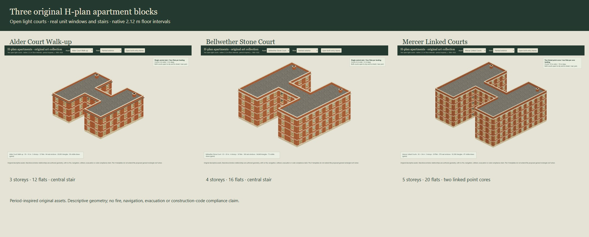

# H-plan apartment art collection

Three original period-inspired apartment assets, authored against Nautilus **v0.5.0**, frozen commit `12ad8c9b1c96637cd05c8e344692063bfde385f3`. This additive collection lives on `codex/h-plan-apartments`. It does not alter the 48 original buildings, their recipes/models/hashes, the separate native-map/block handoffs, donor snapshots, public schemas, package exports or editor controls. The architect owns subsequent shared-library integration.



## Family and plan

| Asset ID | Character | Footprint centreline dimensions | Storeys / flats | Two courts, each | Circulation |
| --- | --- | --- | --- | --- | --- |
| `alder-court` | Alder Court Walk-up; warm brick, restrained timber cornice, c. 1906 inspiration | 18 × 16 m | 3 / 12 | 6 × 6 m | One central U stair; four flats per landing |
| `bellwether-court` | Bellwether Stone Court; brick masonry, dressed-stone base/lintels and cornice, c. 1913 inspiration | 22 × 20 m | 4 / 16 | 8 × 8 m | One central U stair; four flats per landing |
| `mercer-courts` | Mercer Linked Courts; darker brick, longer wings and rear/service detail, c. 1919 inspiration | 26 × 24 m | 5 / 20 | 10 × 10 m | Two linked point cores; two flats per core landing |

The two full-depth residential wings join through a central connector. Both light courts remain open to the street/yard and to the sky through every floor and roof. Listed court sizes are between footprint centrelines; masonry and cornices project into their edges. They are substantial open courts, not narrow sealed shafts.

There are four apartments per floor. Alder's flats are 48 m², Bellwether's 70 m² and Mercer's 80 m², using the stylized engine dimensions. Every apartment has a living/dining room, entry/kitchen and washroom; Alder has one bedroom and the others have two. All **48 apartments and 132 habitable living/bedrooms** have associated real exterior window apertures. Windows face street/yard or a genuinely open court. No claim of daylight levels, ventilation performance or construction-code compliance follows from this association.

Apartment IDs encode asset, floor, wing and front/rear position. `floors[].apartments` records room IDs, one landing-entry opening, exterior-window IDs and serving core IDs. Rooms retain their authored rectangles and window associations. The plans distinguish shared landings from private units; Mercer's connector has no row of dwellings opening along its length. Mercer is labelled as two linked point cores rather than a single-stair building.

Typical plans: [Alder](../assets/h-plan-buildings/models/alder-court-floor-1.svg), [Bellwether](../assets/h-plan-buildings/models/bellwether-court-floor-1.svg), [Mercer](../assets/h-plan-buildings/models/mercer-courts-floor-1.svg). All twelve floor plans are exported. Blue lines denote exterior windows; door symbols illustrate swing clearance, with two outer-hinged leaves at the public entry. They do not represent a simulated door state or an evacuation analysis.

## Native dimensions and construction represented

One world unit is one metre. Ground axes are `(x,y)`; render positions are `(x,height,y)`. The origin is the front-left footprint corner at ground-floor surface height zero. Walls, slab, cornice and fittings extend beyond that footprint; use the measured `bounds` in the catalogue rather than the nominal rectangle for placement. The lowest slab underside is −0.12 m.

Walls are 2 m high and 0.16 m thick; floor surfaces repeat at **2.12 m**, with a 0.12 m slab interval. These deliberately retain the native stylized engine scale and are not surveyed period-building dimensions. U stairs rise one native interval with fourteen risers, two 0.95 m-wide flights, a 1.68 m run per flight and a 1 m intermediate landing. Upper slabs contain exact stair-core openings. Guard and handrail geometry is visual joinery, without a compliance or traversal claim.

Floor and roof slabs use a union of the actual H regions. Internal cell boundaries do not produce slab sides or separate roof caps. The flat membrane roof has a closed 0.12 m slab, a 0.16 m edge extension, and parapet/coping/cornice rings following the final twelve-corner perimeter. There are no parapets along internal wing/connector contacts and no rectangular caps over courts. The roof is flat; no drainage calculation is supplied.

The two roof flue stacks and rear rainheads/pipes are decorative service fittings. Their interior shafts, penetrations, water flow and fire behavior are not represented. No concealed cockloft is modelled; firestop/roof-void intent is explicitly recorded as source context only.

This is a dedicated **authored H-template / flat-roof collection**, separate from the proposed general rectangle building tool. It does not implement arbitrary H-shaped pitched roofs, extend the L-junction solver, or relax existing roof-overlap rules.

## Paired entrance

Each building has one public paired entry and one rear service door. The public entry cuts **one 2.00 × 1.85 m rough opening including its frame**. The jamb/head sections are 0.065 m; the frame is 0.18 m deep. Clear frame dimensions are 1.87 × 1.785 m. Each leaf is 0.931 m wide, 1.767 m high and 0.045 m thick, with a 0.008 m meeting gap and small vertical fitting clearances.

Two pivots sit at the outer jambs. Left/right leaves extend in opposite local directions and swing outward with opposite rotation signs. The meeting stile belongs to the left leaf. Recessed timber panels, handles and the separate masonry portal remain registered to those leaves/opening. The public entry can show closed, either leaf open, or both open; tests raycast both aperture halves in these states.

`h-plan-paired-door-art-v1` is an **art-local descriptor**, explicitly awaiting the planned shared paired-door component. `roughDimensionsIncludeFrame`, frame/leaf parameters, opening ownership and pivots are preserved for that handoff. Existing single-door saves are not changed or reinterpreted. `setEntryPose` changes the model pose only; it does not create saved game door states, navigation, locks or fire bindings. Closed apartment and service leaves are batched per floor/material; their descriptors remain in `fixedLeaves`.

## Source, sculpt and skins

Reproducible recipes are in `packages/h-plan-buildings/designs.js`. The headless compiler in `index.js` creates the floors, apartment/room associations, outside apertures, landings and stairs. `mesh.js` preserves a **source** detail mode with bevelled joinery, additional sash-back detail and cornice/dentil work, then derives the compact **game** mode. Source and game meshes share the same measured bounds and descriptive plan.

Actual detailed source mesh snapshots are preserved in `art/h-plan-buildings/sculpts/*.source-mesh.json.gz`; compact engine snapshots are in `assets/h-plan-buildings/models/*.game-mesh.json.gz`. These are gzip-compressed plain headless mesh data, not game saves. The generator can rebuild them without a renderer. It contains no Three.js import, DOM, storage or global random stream. Recipes and source references are copied before compilation.

The existing original painterly atlas remains unchanged. New original skins are [dressed limestone](../assets/h-plan-buildings/painted-limestone-v1.png) and [roof membrane](../assets/h-plan-buildings/painted-roof-felt-v1.png). They were generated with the built-in imagegen tool, inspected and registered on the actual reduced models. Exact prompts and selected output names are preserved in [skin-prompts.json](../art/h-plan-buildings/skin-prompts.json); image hashes are in the catalogue.

Brick, plaster, sash, wood and iron reuse registered atlas cells. Limestone repeats per metre and membrane per two metres; all mappings preserve physical surface distance. Broad color/value groups and the existing brushwork carry close detail. Per-asset tint and trim profiles distinguish the family; there are no bespoke per-face damage masks. The skin contains illustrated values, so dynamic lighting still requires a deliberate final-game review. Albedo tint multipliers saturate to the legal 0–1 material range.

## Runtime and interchange

The host supplies its existing Three.js and loaded textures:

```js
import {createHPlanModel} from './packages/h-plan-buildings/three.js';
// Host sets the standalone stone/membrane textures to sRGB + RepeatWrapping.
// The shared atlas uses its identity transform.
const model = createHPlanModel(THREE, 'alder-court', {
  atlas, stoneTexture, roofTexture, lod: 'game'
});
scene.add(model.root);
model.setEntryPose({left: 90, right: 0});
model.setView({roof: false, maxLevel: 0, cutaway: true});
model.dispose(); // owned geometry/materials; borrowed skins remain alive
```

The adapter uses the supplied Three instance and the reviewed WebGL2 map-fragment hook for compact metre-UV atlas repetition. It loads no resources itself. Missing skins produce inspection colors. `dispose()` is idempotent and removes the model from its parent; another instance and caller-owned textures survive.

Standard `.gltf` / `.bin` exports have indexed geometry, material/image references, hierarchy and separate entry pivots. They use atlas-clipped tessellation rather than custom shaders and therefore contain more triangles than the compact engine mesh. Texture V is reflected for [glTF's upper-left image-coordinate origin](https://registry.khronos.org/glTF/specs/2.0/glTF-2.0.html). The final review reads these exported buffers, indices and images back independently for all three assets.

The glTF files refer to the new skins and the unchanged `assets/buildings/painted-materials-v2.png`. Preserve that relative asset layout when copying them. Full glTFs, compact/source snapshots, assemblies and SVG plans have byte counts and SHA-256 values in [the additive catalogue](../assets/h-plan-buildings/catalogue.json).

No shared registry, package export, editor control, persistence schema or consumer pin is changed here. These source paths are ready for the architect's deliberate provider/package integration. A game must separately bind surfaces, opening states, navigation, collision and fire; the current bounded Tinderbox adapter must continue rejecting unsupported building content.

## Accuracy, efficiency and narrative

**Accuracy.** Prefer the authored union roof over three overlapping rectangular caps: it preserves both courts, removes buried roof intersections and places trim on the exposed perimeter. Actual room/apartment/window associations are stronger evidence of exterior exposure than the H silhouette alone. The buildings remain original stylized studies with simplified room services, joinery and construction, not historical reconstructions or structural/fire-rated assemblies.

**Efficiency.** These are measured geometry/submission counts, not estimates:

| Asset | Source triangles | Compact game triangles | Reduction | Ordinary full-model draws | Standard glTF triangles |
| --- | ---: | ---: | ---: | ---: | ---: |
| Alder | 72,012 | 20,092 | 72.1% | 58 | 76,348 |
| Bellwether | 126,640 | 34,648 | 72.6% | 72 | 131,172 |
| Mercer | 191,596 | 52,396 | 72.7% | 87 | 206,882 |

All three compact models total 107,136 triangles. Their source models total 390,248. Closed unit-door batching reduces submissions while keeping two live entry pivots. Roof-only underside views use six or seven draws. More passes, shadows, transparency and host effects add costs. The isolated Edge review uses software WebGL2 for correctness; it is not a frame-rate benchmark. A separate [headless cost record](reviews/h-plan-buildings/headless-cost.json) identifies CPU/runtime, initial/subsequent rebuild samples and method. Compile/cache assets at load or edit time; do not rebuild them each frame. Multi-building game performance and shared instance batching remain unmeasured.

**Narrative.** The smaller walk-up emphasizes a compact shared stair; the middle block has a more formal stone-trimmed public face; the large block emphasizes repeated dwellings and two linked point cores. These are artistic preferences. Prefer the compact painted meshes for tactical views, with floor/roof visibility controls. Tinderbox can use the same appearance and source descriptors as a starting point for a richer deliberate construction/fire adapter; visible brick or a stair count alone must not select a fire policy.

## Historical grounding

[Reference notes](../art/h-plan-buildings/references.json) separate municipal evidence, fire-service construction guidance and practitioner advocacy. Selected NYC report pages were read as text and rendered for visual inspection; their PDFs/images remain private reference artifacts and are not distributed as model assets.

- The [Greenwich Village LPC report](https://s-media.nyc.gov/agencies/lpc/lp/2366.pdf), report pages 18/268, grounds the 1907 Morton Street H/light-court context and brick/stone vocabulary. These assets use newly authored dimensions and residential plans.
- The [Dorrance Brooks Square LPC report](https://s-media.nyc.gov/agencies/lpc/lp/2651.pdf), pages 19/143, grounds the 1913 St Nicholas Avenue deep-court, sash and masonry direction. Mercer is not a copy of the neighbouring double-H building.
- The [Municipal Archives overview](https://www.archives.nyc/blog/2021/4/9/inside-the-manhattan-building-plan-collection) supplies historical light/ventilation/window and safeguard context.
- [FDNY Multiple Dwelling Fires, chapter 1 §4.2.6](https://www.nyc.gov/assets/fdny/downloads/pdf/join/probationary-firefighter-v2.pdf) concerns concealed roof voids, combustible construction and ineffective firestopping. Those are specific potential vulnerabilities; the reference does not establish universal inherent danger or disappearance of the entire H-plan/point-access type. No such void or fire behavior is modelled here.
- [Larch Lab's policy brief](https://www.larchlab.com/wp-content/uploads/2023/01/Larch-Lab-PAB_Policy-Brief.pdf) is practitioner advocacy, separate from municipal history. Its endpoint was unreadable in this review; the author's public introduction corroborates the core-based circulation terminology. No modern single-stair compliance or safety comparison is adopted.

## Reproduction and verification

```sh
node tools/build-h-plan-buildings.mjs
node --test tests/h-plan-buildings.test.mjs
node docs/reviews/h-plan-buildings/review.mjs
node docs/reviews/h-plan-buildings/measure.mjs
npm run check
npm test
npm run test:upstream
npm run build
```

The nine asset tests cover immutable source/deterministic serialization; all apartment/habitable-room exposure; one landing entry per unit and connected room openings; valid stairs and real slab holes; positive-volume closed H roofs without duplicate/interior caps; actual ray tests through both courts, every exterior window and stair aperture; paired-leaf pivots/opposite swings/clearance and plan symbols; source/game bounds, reduction, normals and physical UV density; instance resource ownership; and all recorded exports, glTF indices, material ranges and atlas orientation.

All **212 Nautilus tests and 32 pinned upstream regressions** pass, along with integrity and build gates. The integrity check preserves 603 pinned source files, 344 existing editor assets and all 48 original building export hashes. Existing editor/save/undo/roof workflows retain their regressions; this tranche does not add H placement or new save semantics to those controls.

The [browser report](reviews/h-plan-buildings/browser-checks.json) records 36 asset views/readbacks and 42 captures with no browser/resource errors. Evidence includes all three painted exteriors, both courts, overhead H silhouettes, labelled floor cutaways, plans, grey/wireframe, roof/trim close-ups, undersides, source/game comparison, exported glTFs and closed/one-open/both-open entry poses. Selected examples: [Mercer overhead](reviews/h-plan-buildings/mercer-courts-top.jpg), [Bellwether cutaway](reviews/h-plan-buildings/bellwether-court-cutaway.jpg), [roof join](reviews/h-plan-buildings/bellwether-court-junction.jpg), [entry poses](reviews/h-plan-buildings/entry-both-open.jpg).

Review commands launch only their own bounded browser/server and close them in `finally` or at the five-minute deadline. Exact process identities, restart source and cleanup receipts stay in the task's ignored artifacts. Final process exits and released ports are verified; no live helper is retained. Source PDF inspection is read-only and reproducible with the saved script; the large reports are not shipped.
