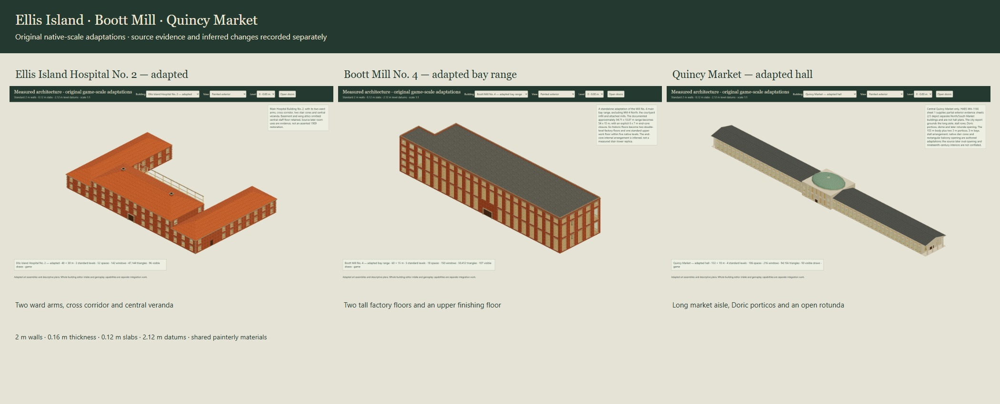

# Measured architecture art tranche

Three original game-scale adaptations and ten reusable parts, authored from the fixed Nautilus v0.5.0 baseline `12ad8c9b1c96637cd05c8e344692063bfde385f3` on `codex/measured-building-art`. Shared editor intake, public package registration and consumer adoption remain the architect's integration work.



## Buildings and dimensions

| Stable asset | Adapted plan | Native occupied datums | Plan and character |
| --- | --- | --- | --- |
| `ellis-hospital-two` | 48 × 30 m U footprint | 0, 2.12 m; central staff floor at 4.24 m | Hospital Building No. 2: two ward arms, cross corridor, two stair cores, service/clinical rooms and central veranda |
| `boott-mill-four` | 54 × 15 m factory range plus 6 × 7 m end core | Work floors 0, 4.24, 8.48 m; core landings also 2.12 and 6.36 m | Selected Mill No. 4 range; two tall work floors and one upper finishing floor, central cast-iron post row and timber beams |
| `quincy-market-hall` | 153 m body, two 3 m porticos; wings 15 m deep, pavilion 18 m | Ground market 0 m, upper galleries/balcony 4.24 m; standard core landings at 2.12 m | 88 original stall bays, long 4 m gross aisle, paired column rows, four-column end porticos, slate gables and elliptical copper dome |

All geometry remains at scale `[1,1,1]`. Walls use **2 m panels, 0.16 m thickness**, slabs are **0.12 m**, and every floor datum is an integer multiple of **2.12 m**. Principal bays are 3 m; room/service rectangles use the established 0.5 m footprint grid. Tall spaces omit intermediate slabs deliberately. Core landings still use standard datums; closed core walls prevent doors opening into absent factory floors. Stair return landings are intrinsic parts of a standard rise, not additional occupiable floor levels.

The origin is the front-left main-footprint corner at ground floor zero. Ground coordinates are `(x,y)`; rendering and attachments are `[x,height,y]`. The ground slab underside is −0.12 m. Cornices, roofing, quoins and porticos extend beyond nominal plans: placement must use **complete catalogue bounds**, never only `width`/`depth`. Quincy's complete width is 159.53 m including trim. All three complete footprints fit the 240 m full-map extent; authored levels remain within the supported range. Roof pitch, dome profiles, ornament and stair treads use deliberate physical dimensions without introducing different floor intervals.

[Dimension decisions](../art/measured-buildings/dimensions.json) retain the actual source dimension strings, metre conversions, snapped dimensions and omissions. These are adaptations, not exact measured replicas. Source masonry thickness, historic ceiling heights, basements and raised plinths are not silently transferred into the native engine scale.

## Source evidence

The [reference register](../art/measured-buildings/references.json) records selected sheet identities, URLs, item advisories, downloaded reference hashes and inspected scope. Source scans, photographs and PDFs remain in ignored local research artifacts; they are excluded from runtime assets and the art pack.

- **Ellis Island:** [HABS NY-6086-G](https://www.loc.gov/resource/hhh.ny1600.sheet/?sp=2), especially sheets 6, 9, 12, 16, 19, 21 and 22. Separate plans/elevations/sections support selection of Hospital Building No. 2. Surveyed labels also show later barracks, office and clinic uses. The adaptation retains the two ward floors and central staff floor, omits the basement and wing attics, rectifies arched heads, simplifies rooms and closes the omitted administration connection with native doors.
- **Boott:** [HAER MA-16](https://www.loc.gov/resource/hhh.ma1289.sheet/?sp=27), especially sheets 25, 27–33 and connector context 22–24. The selected main range is distinct from Mill 4 North, courtyard infill and attached mills. Six historic floors become three authored work floors within five standard levels. The end core occupies the documented range end, but its standalone closure, internal rooms and native U stair are inferred; this is not a measured tower replica. Machinery, canal/turbine systems and adjoining buildings are omitted.
- **Quincy:** [HABS MA-1166](https://www.loc.gov/resource/hhh.ma0469.sheet/?sp=1) is not three central-hall floor plans. Sheet 1 shows partial central-market portico/wing elevations; sheets 2/3 explicitly depict the separate North/South Market buildings. The [Boston Landmarks Commission report](https://www.boston.gov/sites/default/files/embed/q/quincy-market-study-report.pdf), PDF pages 7–11, grounds overall dimensions, aisle/stall arrangement, porticos, dome and later changes. Its inset 1841 plan is historical context rather than a complete dimensioned working plan. The report distinguishes the original separate upper Quincy Hall from the later open rotunda, oval balcony opening and 1990 flying stairs. Our native U cores and rectangular 13 × 8 m balcony opening are explicit adaptations of that later arrangement; no single-date reconstruction is asserted.

LOC item advisories state no known restrictions for US Government images while cautioning about images copied from other sources. Title blocks and item-specific context were reviewed. The municipal report includes credited historic material. No blanket image licence is asserted, and no reference pixels are redistributed.

## Sources, reduction and paint

`packages/measured-buildings/designs.js` preserves the settled original recipes. The headless compiler produces room rectangles, gross and slab areas, window associations, real openings, circulation and stair descriptors. `mesh.js` preserves the detailed **source** before deriving **game** meshes. Actual snapshots are in `art/measured-buildings/sculpts/*.source-mesh.json.gz`; compact meshes are alongside the exports as `*.game-mesh.json.gz`.

Reduction removes fine bevels, rear pane-grid duplication, dense veranda rails and curved-profile subdivisions while retaining silhouette bounds, front/back sash frames, apertures, stairs and entry pivots. Closed single-leaf interior doors are batched by floor/material; public and paired leaves retain live pivots. Open market stall fronts have no door leaves. An original counter insert retains a conservative 1.05 m side gap; the nominal 4 m aisle narrows locally near columns/counter lips.

The existing painterly atlas is unchanged. The new [granite skin](../assets/measured-buildings/painted-granite-v1.png) was generated with built-in imagegen. The quiet [roof membrane](../assets/measured-buildings/painted-roof-felt-v1.png) reuses original art from fixed reviewed artist commit `e5abac574ccf7c9d2cf3839b20f32dc6e09c525e`. [Exact prompts and provenance](../art/measured-buildings/skin-prompts.json) retain the selected output names, original prompt and hashes. No historical photograph is projected onto geometry.

Compact atlas UVs preserve one metre per repeat; standalone granite repeats per metre and membrane per two metres. The host sets standalone textures to sRGB + RepeatWrapping with identity repeat. The shared atlas keeps its identity transform. Paint carries broad brushwork/material values under dynamic lighting; final-game lighting remains a separate review.

## Reusable parts

[The parts manifest](../assets/measured-buildings/parts.json) provides stable `nautilus-measured-parts-v1` identities, nominal modules, complete source/game bounds, dimensions, repetition pitch, source status, origins, pivots and attachment points. It includes:

- Standard U stair with a real upper slab opening and landing.
- Paired timber entry in a native wall bay; hospital sash, two-level mill sash and rectified market sash bays.
- Two-level veranda bay and industrial post/transverse beam bay.
- Market counter/display insert, three-level Doric column and fourteen-metre timber roof truss.

The same generators produce these parts and the buildings. The truss, counter and much of the joinery are original interpretations rather than surveyed structural designs. Part `size` describes the nominal module; use measured `bounds` for geometry and `repeatPitch` for intended spacing. The truss attaches its relative datum to a standard roof level; its custom rise is roof pitch. These are reusable art modules, not a completed rectangle-authoring solver or automatically editable map assemblies.

## Optional host rendering and exports

```js
import {compileMeasured} from './packages/measured-buildings/index.js';
import {createMeasuredModel} from './packages/measured-buildings/three.js';
import {buildMeasuredPart} from './packages/measured-buildings/parts.js';

const blueprint = compileMeasured('boott-mill-four');
const model = createMeasuredModel(THREE, blueprint, {
  atlas, graniteTexture, roofTexture, lod: 'game'
});
scene.add(model.root);
model.setView({roof: false, maxLevel: 2});
model.setDoorsOpen(true);
// Individual leaf: model.setDoorPose(model.pivots[0].name, 90);
const part = createMeasuredModel(THREE, buildMeasuredPart('standard-u-stair-v1'), {
  atlas, graniteTexture, roofTexture
});
model.dispose();
part.dispose();
```

The optional adapter accepts the host's existing Three.js instance and borrowed textures. It imports no renderer, DOM, storage or resource loader. Headless data/mesh modules run independently in Node. The compact atlas shader requires the reviewed standard WebGL2 map fragment. Missing textures allow inspection colours. Disposal releases owned geometry/materials once, removes the root and preserves caller-owned textures and other instances.

Standard glTF 2.0, `.bin` and plain `.blueprint.json` exports exist for all three buildings and ten parts. Twelve floor SVGs include veranda/portico footprints, window/door symbols, real stair holes, explicit voids and the rotunda opening. Standard glTF bakes atlas UVs using clipped tessellation, so its triangle counts exceed compact runtime counts. V is reflected to the glTF upper-left image convention; readback validates indices, image paths, legal material factors and atlas-cell ranges. Preserve relative texture paths. glTF retains separate entry pivot nodes but supplies no animation clip or game save state.

No existing catalogue identity, original 48 asset, native-map/block handoff, donor snapshot, save schema, public package export or consumer pin is changed. The H-plan collection remains separately preserved. Navigation, collision, door persistence and Tinderbox fire support are **not implemented** by these art descriptors; consumers must deliberately adopt/reject the new content.

## Accuracy, efficiency and narrative

**Accuracy:** retain source adjacency, broad stair placement, open courts, major facade rhythm and characteristic roof/portico forms, while making the native dimensional adaptation inspectable. Prefer the mill's two-level volumes over squeezing industrial space into a special floor interval. Prefer explicitly inferred Quincy interiors over treating the neighbouring HABS elevations as hall plans. Rectangular balcony openings, rectified window heads, missing basements and simplified services are practical artistic abstractions, not measured construction evidence.

**Efficiency:** measured geometry counts follow; they are not frame-rate claims. Source and game building bounds match. Source curves, bevels and fine rails reduce while real apertures remain.

| Building | Detailed source triangles | Compact game triangles | Compact ordinary draws | Standard glTF triangles |
| --- | ---: | ---: | ---: | ---: |
| Ellis Hospital No. 2 | 127,720 | 47,144 | 96 | 205,160 |
| Boott Mill No. 4 | 135,424 | 50,412 | 107 | 266,150 |
| Quincy Market | 237,196 | 94,156 | 93 | 410,324 |

The buildings total **191,712 compact triangles versus 500,340 source triangles**, a 61.7% reduction. Ten parts have their own measured costs in the manifest. Shadow/transparent passes, host effects and multiple buildings add costs. Compile/cache at load or edit time, not every frame. The isolated software WebGL review checks correctness; multi-building GPU throughput, instancing and distance LOD remain unmeasured. A separate [CPU build-cost record](reviews/measured-buildings/headless-cost.json) states device, runtime and sampling method.

**Narrative:** for tactical inspection, prefer painted reduced meshes with floor/roof controls: the hospital communicates wards/courtyard circulation, the mill reads as repeated industrial bays and open work space, and Quincy supplies a long public aisle and a strong portico/dome landmark. These are artistic preferences. For Tinderbox, retain source detail and provenance as evidence for a future deliberate construction adapter; painted brick, granite, iron or a roof shape must not select fire behavior automatically.

## Reproduction and acceptance

```sh
node tools/build-measured-buildings.mjs
node --test tests/measured-buildings.test.mjs
node docs/reviews/measured-buildings/review.mjs
node docs/reviews/measured-buildings/measure.mjs
npm run check
npm test
npm run test:upstream
npm run build
```

The [browser evidence](reviews/measured-buildings/browser-checks.json) and per-building review sheets cover painted/grey/wireframe, overhead, roof removal, every floor cutaway/plan, entry poses, stairs/slab holes, roof joins, detailed/game comparisons, independent glTF readback and native-scale mixed scenes with the unchanged Bramble Ranch. Quincy's portico and dome also receive close views. Ten component previews verify the reusable modules. Review helpers have bounded expiry and supported browser/server shutdown in `finally`; cleanup receipts stay in ignored artifacts.

The ten asset tests check immutable native recipes, connected physical room/core descriptions, actual window/stair/atrium aperture rays, court openness, paired-door pivots and swings, source/game bounds and reduction, no ghost continuation windows or doors into missing slabs, positive closed hip/gable/flat roof shells, no internal mill roof cap, all reusable parts, renderer ownership and source/export hashes/glTF data. The [verification record](reviews/measured-buildings/verification.json) records final project gates, preservation and cleanup.

`art/measured-buildings/package-art.py` creates an ignored local art ZIP with source recipes/sculpts, compact/interchange exports, selected skins, dimensions/references, component manifest and review evidence. Its hash manifest covers every file. It includes the unchanged shared atlas and existing notice, excludes source reference pixels and vendor engine code, and does not publish an engine release. Rebuilding requires the stated Nautilus baseline and the bundled/compatible Node/Python dependencies.
