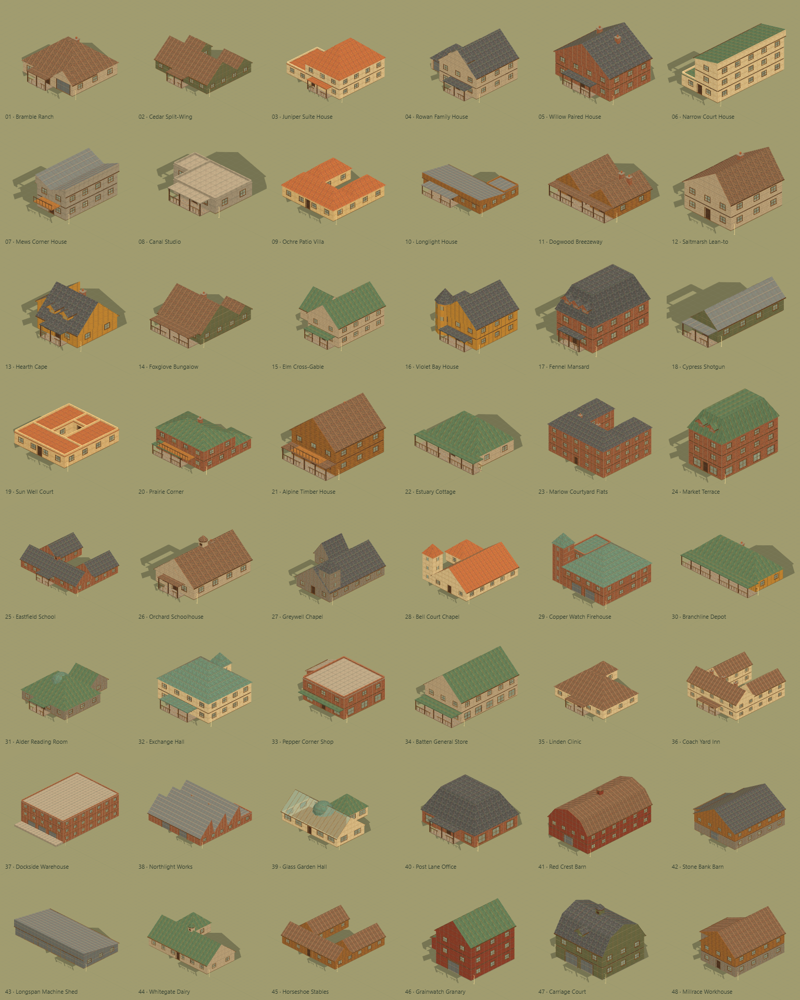
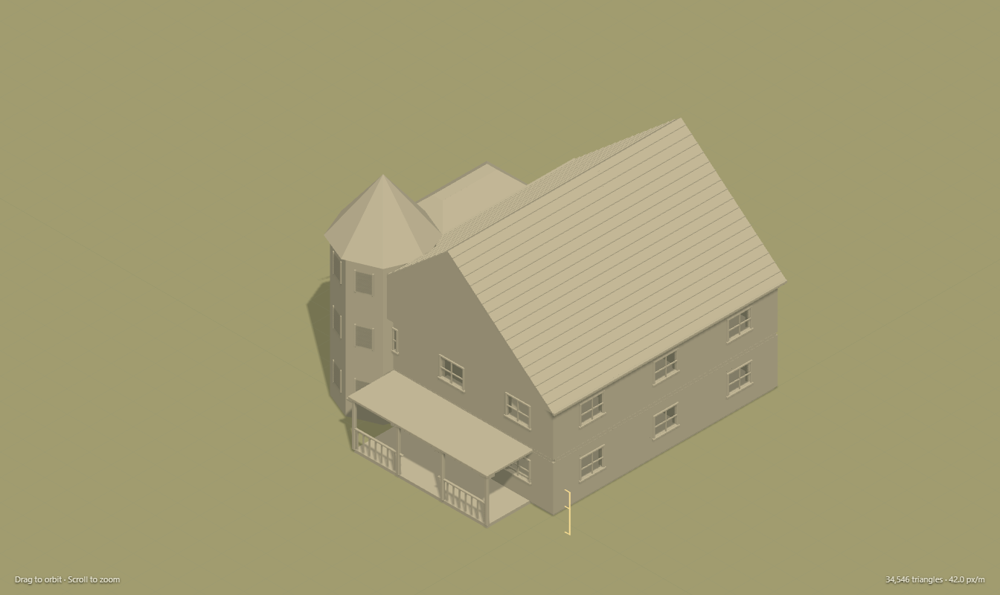
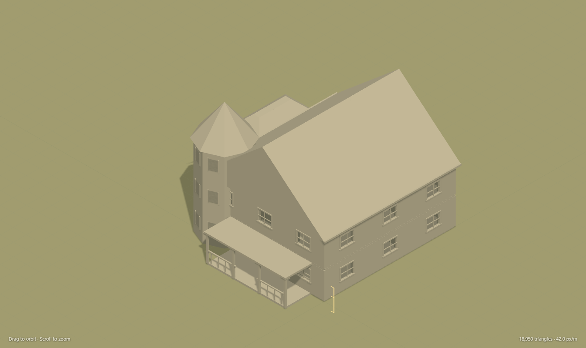
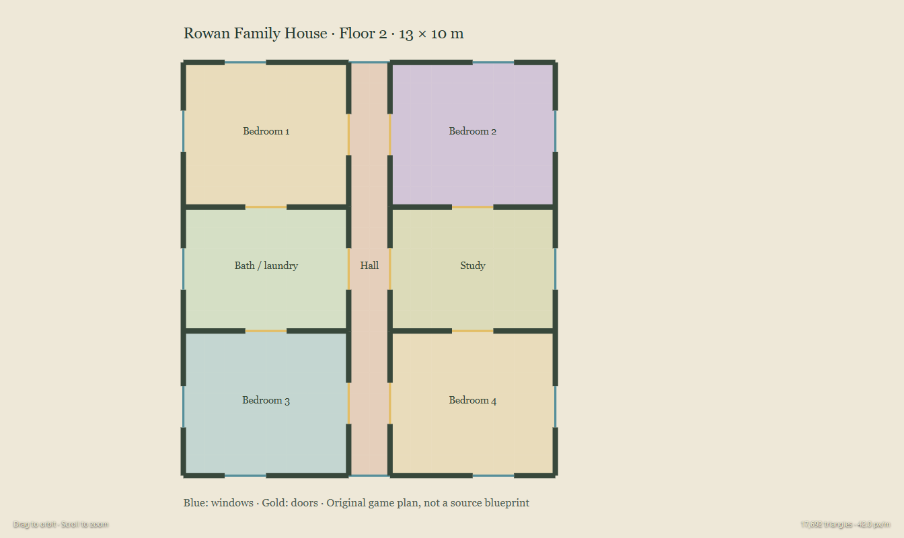
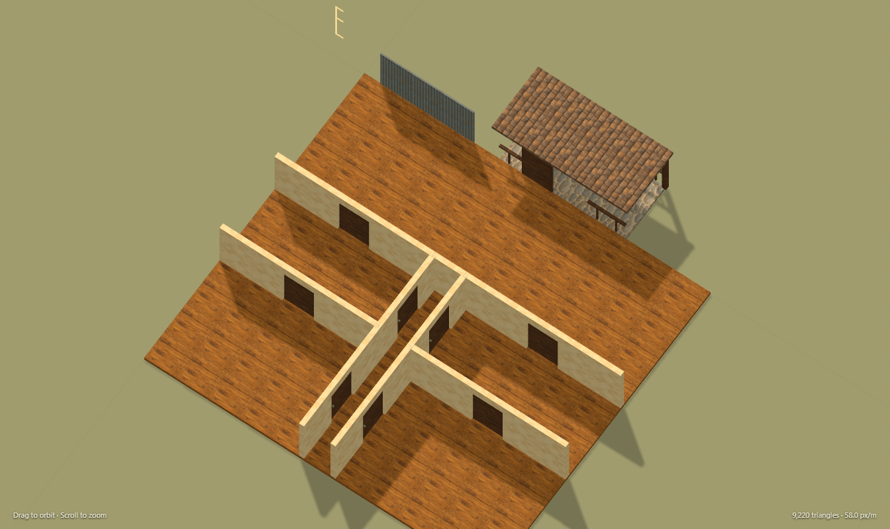

# Building catalogue review — 2026-10-28

The first original architecture collection contains 48 buildings, grouped into 24 homes, eight civic buildings, eight commercial buildings and eight farm/utility buildings. Its 77 floors contain 409 described rooms. The models, atlas and room descriptors are available in the Nautilus package and local gallery; consumer game adoption remains explicit.

## Reference and originality review

The source notebook records 24 public starting points: 22 opened, two unavailable, 159 successfully saved media files and 11 explicit plan/exterior pairs. Twenty contact cards were visually inspected. Saved media includes measured drawing covers, sections, elevations and site sheets as well as floor plans; the count is not a count of distinct houses. Public preview observations supplied modern ranch, two-storey, separate-suite and narrow-infill vocabulary. Library of Congress measured records supplied barn, mill, chapel, school, depot, warehouse, store and historic-house vocabulary. Additional contextual sources include NDSU's farm-plan index. The unavailable records are excluded from model dependencies.

Every building has an authored name, explicit source IDs and its own geometric recipe. Differences include the mass dimensions and combinations, roof form, exterior openings, room grid, trim, attachments and materials. These are original game-scale arrangements rather than measured reconstructions. Source photos/drawings stay in ignored review artifacts. No third-party reference image is shipped as a model texture or included in the ZIP.

## Form and paint review

The detailed procedural source preserves bevel planes, roof relief, denser railings and more detailed curved fittings. The game derivative retains the footprint, room/opening descriptors, hinge placement and native dimensions while removing secondary geometry. This architectural workflow preserves a reproducible source recipe rather than a hand-sculpted mesh file.

The comparison above uses Violet Bay House at matched 225° azimuth, 35° elevation and 42 CSS px/m. Native gameplay checks also used 45°/30°/58 px/m on the eight inspected examples; this fixed scale intentionally crops some larger buildings, while **Fit model** provides the full silhouette. The 48-card sheet fits each building independently and should not be used to compare physical size.

The final 16-swatch atlas was refined to reduce photographic micro-noise and strong wear. Both original generated outputs and exact prompts are preserved. The selected texture is version two, 1254 × 1254 pixels. Metre-scale UV clipping avoids the stretched triangular gable patterns caught in the first review. The same technique covers hip faces and curved details. Atlas borders use small insets; repeating units and mipmaps remain visible at close range, so this is an illustrated shared material set rather than unique hand-painted light/shadow for every facade.

The final sheet shows readable roof and material groupings across gambrel barns, mansard houses, courtyard buildings, sawtooth works, glazed conservatory, chapel towers, turreted house and low pavilions. Subjective preference: the quiet version-two colors support AFT-style painted characters better than the busier first atlas. Repeated facade windows and generic room grids are an intentional catalogue-level simplification; hero architecture may need a dedicated facade and room pass.

## Accuracy, efficiency and narrative

| Criterion | Observation and recommendation |
| --- | --- |
| Accuracy | Real exterior window/door holes, explicit slab spacing, floor/stair geometry and room boundaries improve spatial coherence over solid exterior props. The 2 m wall height and 1.65 m doors deliberately preserve AFT/Nautilus scale rather than typical construction dimensions. Decorative towers/dormers have surface detail without a fully described interior. Use the shared contract for these games; validate stair clearance and openings through each game's adapter before playable adoption. |
| Efficiency | Measured geometry: game 763,402 triangles total; detailed source 1,358,208; reduction 43.8%. Individual game buildings range 6,226–42,822 triangles. Raw `.bin` geometry is 69.89 MiB. Meshes group surfaces by kind, floor and material; hinge nodes remain separate. Prefer the game derivative for ordinary scenes. These are geometry/file measurements, not CPU, GPU or city-scale frame-time benchmarks. Distant buildings still need instancing/culling and further LODs. |
| Narrative | The broad typology makes suburbs, town centres, farms and industrial districts visibly distinct. Prefer the painted game mesh for AFT and Farmyard settlement dressing. Tinderbox benefits from retained floors/openings and detachable presentation groups, but fuel, heat, fire spread and destruction must be supplied by its own adapter. The detailed source is useful for close authoring and later hero assets; it should not be the default settlement mesh. These are visual recommendations, not automatic game migrations. |

No donor design or pin changed. The work uses the pinned AFT renderer only in build/review tools; consumers pass their own Three.js instance. Headless architectural data remains independent of any renderer.

## Validation evidence and remaining scope

Six meaningful architectural tests cover deterministic original footprints and native dimensions, descriptive room reachability, mitered corners, real ray-tested apertures, source/game descriptor preservation, door hinges, finite vertices/unit normals/bounded UVs across all 48 models, and metre-scale gable/hip UVs. The export checker verifies all hashes, recipe agreement, references, glTF graphs, finite accessors, buffer bounds and blueprint equality; tracked-file checks run in CI.

The isolated Edge 156.0.4314.50 review rendered all 48 painted models and checked all 77 SVG floor views and their room labels. It captured eight rear/native views and eight interior cutaways, matched source/game grey views, an upper-floor plan, opening-door interaction and a 390 × 844 mobile layout. Model, geometry and room-data downloads returned successfully. There were zero JavaScript/resource errors and no mobile horizontal overflow. It used software WebGL for correctness; no frame-rate claim follows. [Machine-readable evidence](building-catalog/browser-checks.json) preserves the counts, bounds, captures and hashes. The disposable browser and HTTP server were closed through their supported APIs in `finally`.

The complete repository checks are `npm run check -- --tracked`, `npm test`, `npm run test:upstream` and `npm run build`. The normal build includes the local gallery and regenerates the model exports. No Sites publication or consumer pin update is part of this delivery.

Unfurnished interiors, descriptive room graphs and ornamental volumes do not establish navigation, egress, collision, fire behavior or structural integrity. Those require consumer validation. Exported glTF door pivots are retained, but no glTF animation clip is supplied. The shared atlas is dynamically lit albedo; inspect it under the consumer's actual lighting. This is a substantial first collection, not an exhaustive census of free web plans.
