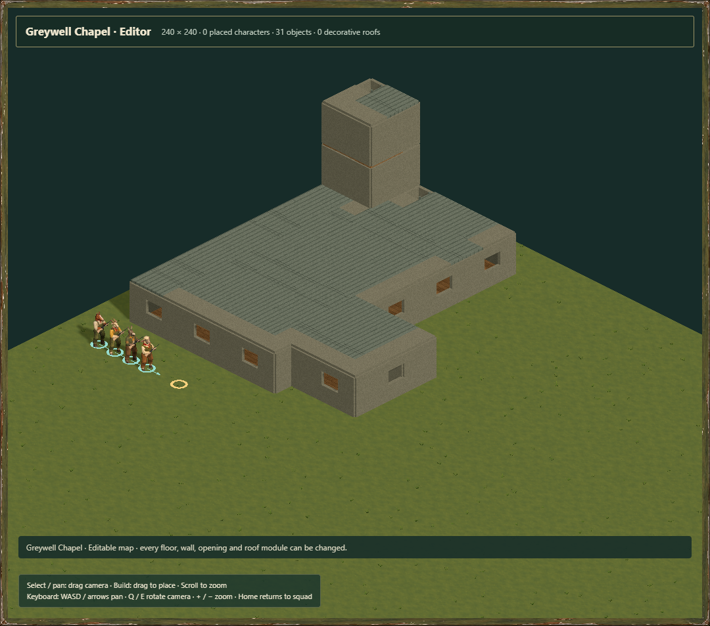
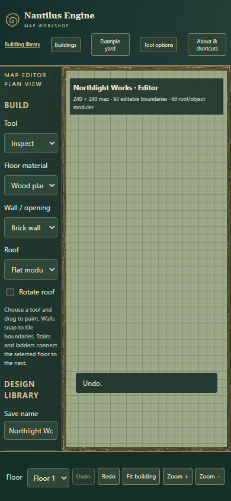

# Native building editor review — 2026-10-28

The architecture collection has been rebuilt with the game's native editor brushes: 48 valid full maps and 48 reusable sector blocks. Dockside Warehouse uses a one-metre plot border so its native dimensions and loading apron fit without cropping or shrinking. The constructions use 27,318 brush calls, 85 occupied floor layers including newly usable tower storeys, and native roof caps with ladder access.

## Accuracy, efficiency and narrative

| Criterion | Native editor construction | Detailed architecture mesh |
| --- | --- | --- |
| Accuracy | Uses actual tile occupancy, solid/opening edge rules, native door opening, stairs/ladders and ordinary map validation. Half-grid room boundaries move up to 0.5 m on the one-metre grid; source dimensions remain at metre scale. Towers become usable grid rooms. Complex roof profiles and curved/ornamental details are simplified. | Preserves the original sculpt profiles, material directions and decorative forms, with finer geometry. Its descriptive room data does not itself establish game movement or fire behavior. |
| Efficiency | Uses the existing editor/world data and native rendering paths. There are 192 map/block/recipe/report files totalling about 23.5 MB before ZIP compression. No external display meshes are attached to maps. These are data counts; no settlement-scale CPU/GPU improvement was measured. | Original game meshes total 763,402 triangles across the collection; that geometry count is not directly comparable with the native editor's generated/instanced terrain and boundary workload. |
| Narrative | Prefer the editable native versions for tactical spaces, ordinary game interactions and settlement authoring. They make doors, floors and roof access actionable. Painterly native materials maintain the game's existing palette. | Prefer the art sources for silhouette development, close exterior reference and later hero architecture where the extra roof/ornament detail matters. |

Recommendation: use the native versions as the editable shared map foundation. Preserve the art study as visual reference and an optional later presentation layer. Tinderbox still needs its own fuel, heat, destruction and collision adapter; native map compatibility alone does not supply those systems or migrate a consuming game.

## Checks

Four meaningful native-building tests cover validation and ordinary reachability for all 48 buildings; deterministic native construction and source preservation; actual map-editor wall/window/floor changes with exact undo, redo and JSON reload; and reusable blocks placed into full maps with roofs, stairs and boundaries intact. Reachability checks every authored interior and roof cell using cardinal movement, unlocked-door opening and explicit stairs/ladders, without relying on window or wall climbing.

The browser review uses isolated Edge with software WebGL. Northlight Works and Greywell Chapel render through the actual native editor scene, with no imported building mesh. A brick boundary was changed to a window through the editing document and undone. A rejected unsaved-replacement prompt preserved the original design. The plan presentation passed real pointer painting, undo/redo, saved-copy creation, persistence across reload, native JSON export/import, rejection of malformed input without losing the current design, reusable-block opening and undoable block placement. The mobile header and controls remain visible at 390 × 844. There were no JavaScript or failed-resource errors in the reviewed flows. These checks establish correctness, not hardware frame rate.

The normal build applies recorded adaptations to the built editor entry: a native building URL, conservative unsaved-work reporting, and selection of the complete 3D editor or shared-controller plan presentation. Original vendor bytes and donor pins remain intact. The plan presentation uses the same patched Nautilus IndexedDB namespace as the 3D editor. It offers the architectural editing subset; it does not claim all scenery, character, connection or generation tools from the full 3D workshop.

The retained user preview is a read-only local HTTP helper with an actual 30-minute timer and a private STOP marker. Each lifetime is registered with the helper-lifecycle utility. Disposable review browser/server processes stop through their supported close APIs and have cleanup receipts; application-managed user tabs are retained for review.

Machine-readable native exports are under `assets/buildings/editor`; browser evidence is [recorded here](editor-buildings/results.json). The repository checks are integrity/source tracking, 33 local tests, 32 pinned-upstream tests and build. No game pin, live donor checkout, main branch or Sites publication is changed by this work.
