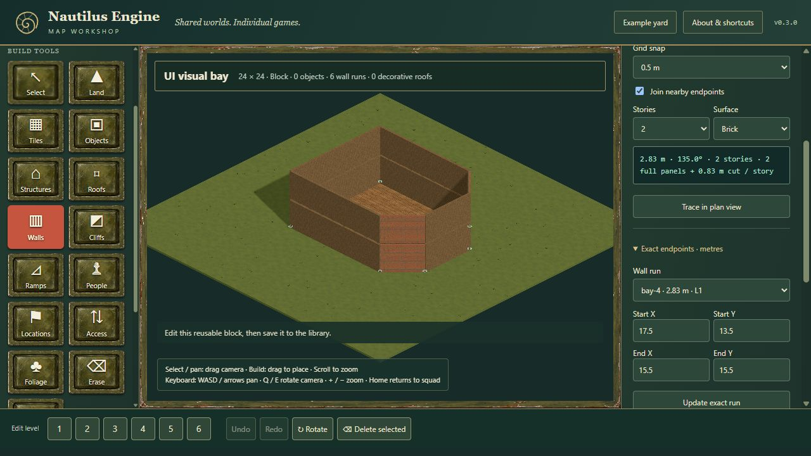
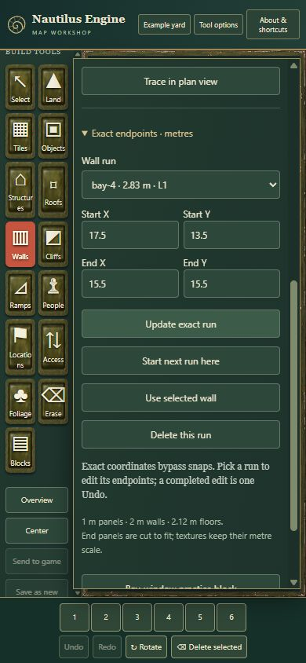

# Wall runs UI audit

Reviewed 2026-10-28 for candidate **NE-cc52f89-wall-runs**, using the existing contribution at full commit `cc52f89de6333a1d94e2dfe45d47d1317369fac0` (parent `d3c577fbf78974dc0a20660d46748a83758fd51f`). The UI branch was advanced to that fixed object before review. Donor and other worker checkouts were not edited. This report covers the UI patch above that contribution; the architect owns shared build/package integration and combined wall/halo acceptance.

## Findings and fixes

| Finding | Result |
| --- | --- |
| The Send to game handler claimed “Playtest opened” before an asynchronous adapter settled, leaving rejection unhandled | Await the adapter result, retain the existing busy guard during the handoff, and announce success only after resolution. Rejection is displayed instead of success. |
| Generation and handoff errors were written behind the open Settings modal | Mirror the existing status into a polite live region in the sticky Settings heading. The active controls and their feedback remain visible together. |
| Opening/importing a wall document initially omitted its wall count until another edit | Guard both initial-open and changed-document count adaptations. A saved six-run block reports six runs immediately after opening, without an edit. |
| The wall scene passed `wall-brick` to a renderer whose brick surface is named `brick` | Use the run's material identifier directly. Brick now uses the pinned brick courses; wood and concrete pixel arrays remain exactly unchanged. Concrete deliberately retains the source's default surface; no explicit concrete branch was invented. |
| Exact-length edits accumulated unused cut-width geometry until final scene disposal | After removing old instances and constructing the current groups, dispose/delete owned geometry absent from those groups. Still-used full panels stay shared. Hidden walls retain no cut cache. |
| Repeating an unchanged drawing mode rebuilt the same instance groups | Rebuild only on a drawing-mode transition; document/view rebuilds retain their existing path. |
| Both Y fields had the same accessible name, and a busy exact placement could fail silently | Label Start Y and End Y separately and display rejected exact-operation feedback, including the loading guard. |

No shared build-file change is required by this patch. The guarded changes remain in `tools/editor-wall-adapter.mjs`; original vendor bytes are unchanged.

## Browser acceptance evidence

Windows, Codex in-app browser, Nautilus 0.3.0, Node.js `v24.15.0`. Desktop 1280 × 720 and responsive 390 × 844. These are functional/visual observations, not CPU/GPU benchmarks.

| Action | Observed result |
| --- | --- |
| Real pointer drag in plan view | Added `(2.5, 8.5) → (5.5, 11.5)`: 4.24 m, 45°, one story, four full panels plus a 0.24 m cut. The practice block went from six to seven runs. |
| Draw another run near an existing endpoint | Added `(3.5, 14.5) → (5.5, 11.5)`: 3.61 m with “endpoint joined”; endpoint priority correctly overrides the angle snap. Count became eight. |
| Undo and Redo the joined run | Seven and eight runs respectively, one history step each. |
| Click the drawn wall with Select, then Copy selected settings | Selected `wall-1` and loaded its exact coordinates/material/story settings. |
| Edit exact endpoints/material/stories | Updated the same run to endpoint `(5.25, 11.75)`, brick and five stories, retaining eight runs. Undo restored `(5.5, 11.5)`, wood and one story; Redo restored the edit. |
| Try endpoint X = −1 in a block | A clear 24-metre-footprint error; run count unchanged. |
| Escape after a valid preview | The local browser fixture dispatched the editor's pointer/key sequence: 16 preview vertices before Escape, zero afterward; exported blueprint and undo length unchanged after pointer-up. Pointer capture alone was stubbed for synthetic input. Physical pointer placement was tested separately above. |
| Save, browser reload, Load selected | All eight runs returned; `wall-1` retained its exact endpoint, brick and five stories. |
| Export JSON, New block, import that exported file | All eight IDs and measurements returned through the actual file chooser. The exported fixture is preserved in local audit artifacts. |
| Initial open after the final build | Loaded `UI visual bay` and immediately saw “Block · 0 objects · 6 wall runs”; no subsequent edit was needed. |
| Boundary visibility after the resource fix | Hide/show boundaries restored the authored bay; the current view rebuilt successfully. |
| Phone drawer | Exact update, next-run, selection and delete controls were reachable by scrolling. Document width 390 px; drawer client/scroll width both 273 px, with no horizontal overflow. Start Y and End Y have distinct accessible names. This was responsive browser testing, not a physical touch-device test. |
| Generate from a saved boundary-touching run | Refused with “Angled wall connections across generator seams are not supported yet; place those blocks manually.” The message remained visible in the Settings heading. |
| Actual browser `sendToGame()` without capability | Refused `nautilus-wall-runs-v1`; host callback count zero. Blueprint and history unchanged. |
| Actual browser `sendToGame()` with deliberately declared capability | Host callback count one; received one run with endpoint `[33.5, 33.5]`; returned the acceptance receipt. The real Send to game button also completed successfully. Blueprint and history unchanged. |
| Capable host returns a rejected Promise | The real Settings button showed “UI audit: host declined map” in the modal, with no new unhandled rejection. The initial pre-fix console failure was intentionally reproduced and is not a post-fix success claim. |

The same-origin local host fixture exercises the actual editor bridge. It is a test consumer, not evidence that AFT, Farmyard or Tinderbox integrates oriented movement, sight, projectiles or fire. [Structured host results](assets/2026-10-28-wall-runs-ui-host.json) retain call counts, endpoints and state/history checks. The ignored local replay source is `artifacts/ui-wall-audit/host-harness.html` in this UI worktree.

[Visible seam refusal](assets/2026-10-28-wall-runs-ui-seam-refusal.jpg) and [asynchronous handoff rejection in Settings](assets/2026-10-28-wall-runs-ui-handoff-rejection.jpg).

## Focused regression and required checks

`tests/editor-wall-scene.test.mjs` imports the actual scene class with the build's explicit aliases, without constructing a DOM or WebGL renderer. It checks the actual DataTexture pixel arrays against the pinned donor surfaces; performs 40 different exact-length rebuilds; verifies a two-entry current full/cut cache, reuse of the shared full geometry, and one disposal event per retired cut; then hides walls and verifies that all 41 created geometries were disposed. Four drawing-mode calls with two transitions cause exactly two rebuilds. This is an ownership/resource regression, not a measured GPU-memory or frame-time comparison.

All required checks passed after the runtime fixes:

- `npm run check`: 534 immutable source files, dependency closure and headless boundaries verified.
- `npm test`: 37 passed, including the three focused material/resource tests.
- `npm run test:upstream`: 32 passed.
- `npm run build`: Nautilus 0.3.0 with nine recorded build patches; no shared build source edited.

Material SHA-256 values after the fix: brick `489f372491395fc1f41c4440c6d3e19e12d6488aa1e9e18f5cee2c774e51d653`; concrete `575c2b60b793673858c7ff2372cbe9282c89cb67da385f6d7ecced87738fab6c`; wood `485f29ae003579522ed51ecfe4f61a23557fa31c4430f445de2bbae9469e0d55`. The regression confirms exact preservation of the previous concrete and wood arrays.

## Evaluation and recommendation

**Accuracy:** Retain the contribution's measured endpoints and native kit dimensions. The UI changes neither physical dimensions nor collision math. Matching the inherited brick texture fixes a presentation mismatch; it does not establish real-world architectural or material fidelity.

**Efficiency:** Prefer disposing unused owned cut geometry and retaining only widths needed by the current view. The regression measures cache entries and disposal events. Avoiding repeated mode rebuilds also removes redundant allocation work by code inspection. No CPU/GPU timing, FPS, or dense-map memory advantage was measured.

**Narrative:** Subjective preference: keep the existing painted industrial workshop and measured tracing controls. Correct brick surfaces help the angled bay belong to the same material family as square walls. Feedback beside Settings actions prevents a silent refusal or a false success story. Separate exact coordinate names improve clarity without replacing the UI.

**Recommendation:** Accept this bounded UI patch alongside the architect's headless/art review. Favor optional wall runs for Tinderbox-style angled architecture while retaining convenient grid walls for square tactical layouts. Material-phase continuity, facade miters and other art finishing remain explicit follow-up work. Unsupported generated seams continue to refuse clearly. No consumer pins, new house catalog, donor source or Sites audience changed.

## Helper retirement

Both task-created browser tabs were closed and the responsive override cleared. Registered preview PID 67180 (creation FILETIME `134376429173113331`) was stopped through its private STOP file. The owning exec session exited 0; process absence and zero listeners on port 4537 were verified at `2026-10-28T07:04:29Z`. No disposable audit helper remains running. Source/restart records, the local harness, export fixture and cleanup receipt were retained; restarting is deliberate.

## Evidence hashes

| File | SHA-256 |
| --- | --- |
| `2026-10-28-wall-runs-ui-desktop.jpg` | `be37cf9672b6fb99fa5ab8c841b3cbc2f2a2d79585f4adb67397eacf03798d1e` |
| `2026-10-28-wall-runs-ui-mobile.jpg` | `df155448cf636db4f3cacb852cf0aa639803393748a8c5d2b046cdf72f14da7d` |
| `2026-10-28-wall-runs-ui-seam-refusal.jpg` | `327ac74a693f168e8dbfb7451a9ffda91881d2593d2d30501fd23158f4d6dd55` |
| `2026-10-28-wall-runs-ui-handoff-rejection.jpg` | `e857e1198f043c70c1742c983f4fc7ab7844bcefe527c4e151648ca74629f4c3` |
| `2026-10-28-wall-runs-ui-host.json` | `89dfc8bb6db9b6741dba44cfa7d8549fd7082c17b96d86bcf0e066adc447ca31` |
