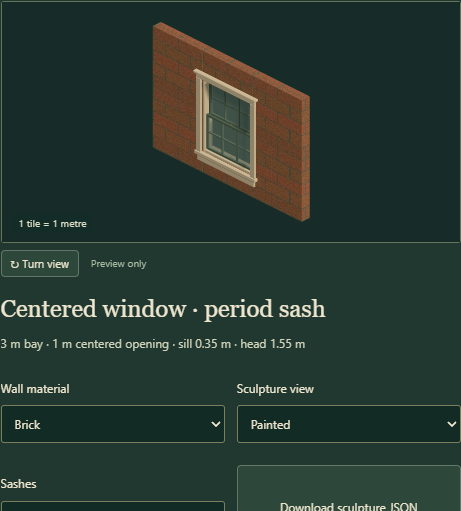
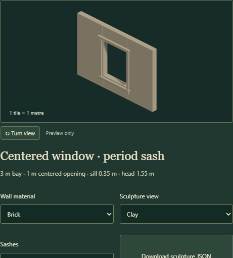

# Centered window bay sculpture review

## Sources and recommendation

The user requested windows centered between two wall segments, with traversal work later. Prefer a real 1 m opening between equal native 1 m panels, with separate fixed frame, sashes and glass. This makes a reusable art component now and preserves measured anchors for later placement and character work. No actor rules or map schema extension is implemented in this step.

The compact profile preserves AFT `781246a668c723d5a4c5463e70534cc04b6a5641`, `dist/tactics/hybrid-geometry.js`: wall height 2 m, thickness 0.16 m, aperture 1 m wide from 0.85 to 1.55 m. The period profile preserves the taller aperture from Tinderbox `6693bfa3fea2edec77649d830de5ac68ba4c1a50`, `src/art/gross-housing.js`: 0.35 to 1.55 m. The new sash and frame geometry is engine-owned. Original upstream files, pins and whole-building recipes are unchanged.

## Accuracy

The two panels remain equal and unscaled. Both openings share the existing head height, native wall dimensions and 2.12 m story interval. The frame models two sash tracks, meeting rails, separate panes, fixed jambs and projecting trim instead of painting a window onto a solid wall. The period profile is preferred provisionally for Tinderbox's period houses; the compact profile remains appropriate for compatibility with the existing tactical room kit.

These are compressed game-scale openings inherited from the donor art, not a claim of matching a particular historical blueprint or modern building regulation. No new blueprint reference is inferred. The tall window's frame-clear opening is 0.92 × 1.12 m; the compact one is 0.92 × 0.62 m. Actual character clearance and actions need a separate geometry/gameplay review.

## Efficiency

The compact model contains 35 solids / 1,284 triangles; the period model contains 47 solids / 1,556 triangles (measured from generated geometry). Each uses one tiny existing wall-paint texture. The renderer shares five materials within a model and borrows injected host materials. All pieces retain separate identities; it does not build a second character/biome/machinery preview world. A future map renderer should batch or instance repeated pieces while preserving their semantic groups. These counts are geometry measurements, not a frame-time benchmark. Live-world batching and animation performance have not been measured.

## Narrative

Six-over-six panes, a projecting sill, cream casings and a muted green sash fit the period-house direction (subjective visual preference). The shorter two-over-two version keeps the current tactical kit recognizable. A clay view and removable sashes make the centered opening and depth visible during art review. Keeping both source-sized profiles is preferable to stretching either mesh to simulate the other.

## Validation

Geometry checks verify equal panels, exact source-sized openings, copied headless data, closed bevel seams, outward winding, unit normals, physical bounds, continuous wall UV density, and rays through the exposed opening from both faces at 0°, 45° and 90°. Rays also confirm that the flanking panels, sill wall and lintel remain solid. Material and lifecycle checks verify original wall pixels, disposal of owned resources and preservation of borrowed resources. Library checks require preview-only discovery without a substituted legacy map prop.

The isolated Edge 156.0.4314.50 software-WebGL review passed with 14 captures and no browser or resource errors. It exercised both profiles in wood, brick, clay, exposed-aperture and opposite-face views, plus concrete, JSON download, two close/reopen cycles, switching between native and sculpture renderers, and a 390 × 844 viewport. The map export remained byte-identical and mobile controls had no horizontal overflow. Software rendering establishes visual correctness, not GPU performance. Selected captures and the full capture-hash report are preserved in [assets/window-sculptures](assets/window-sculptures/browser-checks.json); the reproducible review writes all captures to `artifacts/window-kit`.

`npm run check -- --tracked`, `npm test` (114 tests), `npm run test:upstream` (32 tests) and `npm run build` passed. All 603 pinned source files and the existing 48-building export hashes remain intact. Temporary browser/server helpers closed through Playwright/HTTP finally handlers; their process exits and released listening port were verified. Restart/source-hash records and cleanup receipts remain under `artifacts/window-kit`. No preview service is retained.
