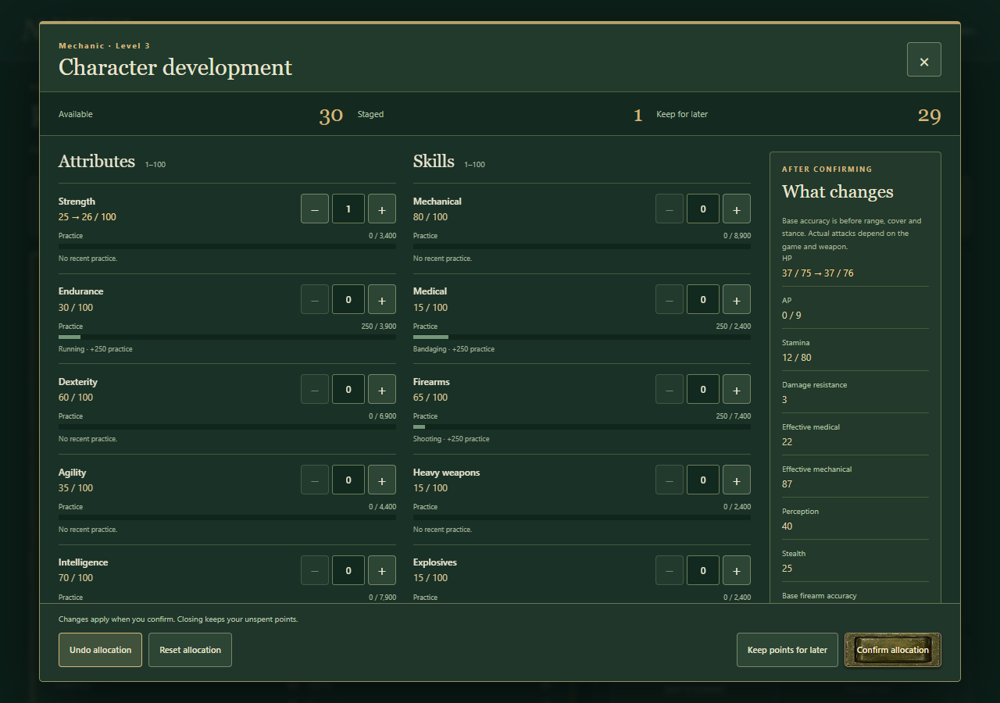
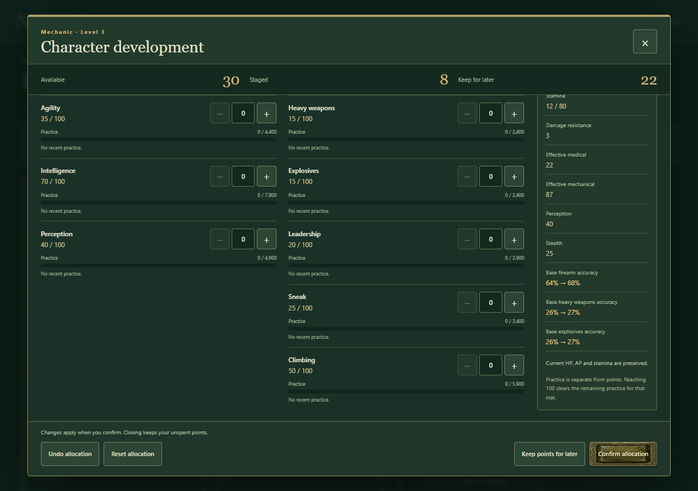

# Basic progression design review

## Scope and evidence

The user chose a traditional RPG foundation: practice improves used skills, kills/objectives supply character XP, XP requirements increase, and levels award 15 freely assignable stat points. The later species/class perk brainstorm is explicitly deferred. The existing 14-stat contract and derived formulas govern this tranche.

Reviewed baseline: Nautilus main `3cba6838a1926e7cc1611ffddf13d70aeceea5c7`. [AFT reference bytes](2026-10-29-basic-progression.sources.json) were read at full commit `b23334cb77f82e2373b9552b0d8752271a18326e` without changing its checkout. Its progression uses 25 XP per eligible guard death, 100 XP per level, 3 points/level and level 10 cap, plus downtime training. Nautilus's previous portable rules supply point spending but no earning layer. No new donor bytes are imported.

## Practice and mission growth

**Accuracy:** stat-specific practice represents the activity performed more directly than kill-only XP. Endurance fits running under the existing stamina formula. Practice thresholds and rapid level allocations remain deliberate RPG abstractions; no claim of physiological calibration is made. Consumers must distinguish confirmed outcomes from animations, previews and duplicate notifications.

**Efficiency:** bounded arithmetic/counters and saved event receipts are evaluated only on committed progression actions. From code/design inspection, this should avoid per-frame work; no CPU benchmark or hardware performance claim is made. Durable receipt validation/copying has a size cost and explicit capacity, which must be measured at representative save sizes before expanding the limits.

**Narrative:** subjectively, practice supports recognizable specialties while15 chosen points retain player control and allow a new direction. Objective and shared-encounter policies let medics/scouts develop without last-hit competition. The consumer decides participation; the engine does not fabricate a universal mission scheduler.

**Recommendation:** use the new optional basic profile for the requested Nautilus foundation. Preserve existing donor behavior until each game reviews an exact adoption pin. Start with running, explicit weapon use and bandaging rather than generalizing every action or adding class/species trees. Test growth pace in real missions before treating the initial 100*level XP curve and practice thresholds as final balance.

## Persistence and authority

**Accuracy:** a strict progression bundle records actual XP, stat progress and spent resources without constructor normalization. It represents RPG state, not real biology.

**Efficiency:** one atomic bundle provides clear revision and receipt validation; its copying cost is bounded but unmeasured. A host may use a storage transaction without introducing a renderer or clock into the core.

**Narrative:** banking points and preserving wounds/fatigue prevents menu use or loading from becoming a recovery exploit. The development panel shows the player's choices and their actual derived effects.

**Recommendation:** keep character-v1 and portable map saves unchanged. Adopt an independent progression schema/capability, immutable profile IDs and explicit future migrations. Commit the current character and progression ledger together; UI previews never authorize writes.

## Acceptance

The reviewed runtime is frozen at `ae3153e233bb9666778fe20d2e5bd1b803db87fb`. Accepted source commits and file hashes are in [architect verification](evidence/basic-progression/verification.json).

- Integrity/headless closure checks pass with 603 immutable donor files unchanged.
- All 254 engine tests and 32 inherited editor regressions pass. This includes 13 focused progression cases plus 3 public/installed-boundary cases.
- The static 0.7 build checks 365 module paths and records the progression profile/source hashes.
- [Character browser acceptance](evidence/basic-progression/acceptance.json) covers practice, multi-level rewards, allocation/undo/reset/confirm, banking, caps/overspend, actual baseline accuracy previews, strict saves, import/reload, duplicate delivery, imported ID collisions, keyboard/focus, 320/390px layouts and 200%-equivalent reflow.
- [Editor browser acceptance](evidence/basic-progression/editor-acceptance.json) covers authoring, procedural roofs/generation, undo/redo, save/import/export, capability rejection and every schema URL.
- [Cleanup verification](evidence/basic-progression/cleanup-verification.json) confirms exact task process lifetimes exited and both ports 49760/49761 were released. No helper is retained.

Independent review found one full-journal preview/commit mismatch. Fixed source `27f0a763a55db1be31704bc4ecf289dbb5e74fa7` shares the capacity guard, with a regression proving unchanged state and continued original-command replay at 4096 receipts. No other correctness or integration blocker remains.

The initial profile explicitly supports 4096 committed rewards/allocations and rejects further new commands at capacity; no archival/migration is implemented. Games must plan their outcome granularity and review an explicit extension for longer campaigns. Rates remain illustrative. This is an optional engine contract and reference host; no consumer pin or production game is changed.

