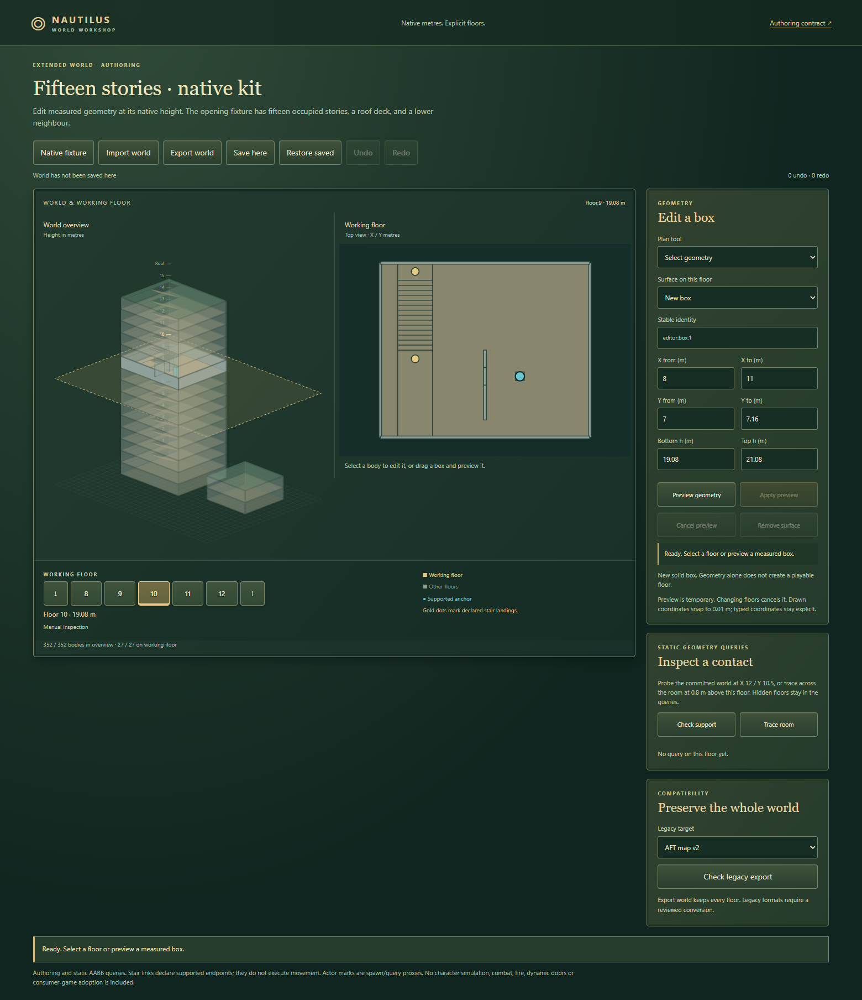

# Native-height world authoring review

Implementation checkpoint: `df1333616a20a881b56f1cad3d10f5881baa9dd8`, on `codex/extended-world-editor`, from reviewed main `ddfd43cf4b156eeb82b5c27772fe977ec10b0633`. World interface: `fbb57293805ecae34569ab3dd9f689ffea53beb0`; navigation interface: `e0977e785857277a1c59acc1134ada5156a3fa4b`. Their source bytes are unchanged. The evidence commit adds this report and captures; it does not change the reviewed runtime. Package exports, capability registration, release/version, main-editor launch and deployment belong to architect integration.

## Authoring result

Build Nautilus, serve `dist/`, and open [examples/extended-world.html](../../examples/extended-world.html). This entry is built-only and independent of the legacy editor's keyboard/controller. The existing builder copies every module, stylesheet and JSON dependency. The [implementation map](../extended-world-authoring-map.md) documents commands, storage, bounds, history and design choices.

The fixture preserves fifteen occupied stories at indices 0–14, with a separately declared roof-access deck at **31.8 m**. The neighbour roof is **4.24 m**, the ground slab extends to **−0.12 m**, and explicit 2.12 m datums retain separate `floor:9` / `floor:10` identities. The 70,224-byte canonical save holds 352 authored box bodies, two supported actor anchors and fifteen stair links; no per-floor dense grid is allocated.

The host provides measured min/max box edits and rectangle drawing, preview/apply/cancel, removal with reference validation, bounded undo/redo, native JSON import/export, browser save/restore and manual floor navigation. Authoritative queries retain hidden floors. A floor change cancels an armed preview or active drag without committing it or adding history. Legacy map/block export reports refusal and creates no truncated file.

## Checks and visual review

All four repository gates passed: tracked provenance/module check, **297 tests**, **32 upstream tests**, and build (**378 module paths**). Ten focused editor/fixture tests also passed. Exact commands and log hashes are in [delivery-gates.json](evidence/extended-world-editor/delivery-gates.json).

`node tools/review-extended-world.mjs` passed in isolated Edge, against the clean implementation commit above. It records source module hashes, the complete fixture/floor/actor data, build provenance hash, saved export hash, contact results, seven capture hashes, and zero browser/resource errors in [acceptance.json](evidence/extended-world-editor/acceptance.json). The reviewer visually inspected the final desktop and 320 px captures, including the larger fitted floor plan and feedback next to the form. SVG rendering uses no WebGL or animation loop; no GPU performance claim follows.

The ten browser workflow groups cover:

1. Preview cancellation across floors 9→10 and rejection of the old apply token.
2. A measured high-floor edit, undo/redo and out-of-bounds rejection preserving redo.
3. Actual pointer drawing and a floor switch while the pointer is held; late release commits nothing.
4. Corrupt saves and a missing saved floor identity preserving current geometry/history.
5. Editing a closed high-floor door leaf into an explicit open static pose; contacts change from the leaf to the actor proxy, and the downloaded JSON matches committed state.
6. Full page reload and explicit browser restore reproducing the saved world and selected floor exactly.
7. Native file import and unsupported legacy import refusal preserving the current document.
8. Both legacy export targets refusing eleven unrepresentable floor positions without changing the world.
9. Confirmed supports on floors 9/10, low/tower roofs and a floor-14 contact through the full hidden geometry snapshot.
10. Five manual labels, input focus protection, preview cancellation and no horizontal overflow at 320 px with reduced motion; all five floor targets are at least 44 × 44 px.

[320 px authoring capture](evidence/extended-world-editor/native-phone-320.png) · [Open static door pose](evidence/extended-world-editor/native-high-door-open.png) · [Roof access datum](evidence/extended-world-editor/native-roof-deck.png)

## Scope and limits

Prefer explicit native support/landing records and query boxes for this first authoring tranche: they preserve dimensions and expose unsupported semantics. Thin stair treads leave the native headroom that repeated filled visual wedges would obstruct. These are accuracy judgments within the authored kit, not architectural/structural certification. The small sparse save is measured; CPU, movement and textured-renderer performance are unmeasured. The low roof and selected-floor cutaway improve vertical readability in this fixture (subjective editorial judgment).

This is a **static AABB/segment/downward-support provider with semantic stair endpoints**. Links do not execute routes; treads between datums do not invent playable floors. Actor marks are spawn anchors and query proxies, not adopted rigs or saved runtime characters. A door edit is another authored static pose. Movement, capsule sweeps, dynamic doors, falling/injury, combat/AP, animation, fire, perception and consumer adoption remain separate work. The source decorative fifteen-story game asset was not bound or declared playable here.

SVG drawing is capped at 1,600 bodies per view and discloses shown/total counts; the complete saved/query world is retained. History is bounded by both 64 snapshots and 16 MB of serialized history. Browser storage remains subject to browser quota; exporting native JSON is available. Importing a new document resets edit history. Furniture/window branches and consumer pins are unchanged.

## Helper cleanup

The bounded review used its own server and isolated browser, with a four-minute expiry and a finally path. Supported browser/HTTP close completed at `2026-10-29T16:27:46.926Z`. [The cleanup receipt](evidence/extended-world-editor/cleanup-receipt.json) records runner PID 74596, browser PID 56788 and port 62089. [Fresh verification](evidence/extended-world-editor/helper-verification.json) matched each PID plus creation time, confirmed both original lifetimes exited and found the port released. No preview service is retained. The committed runner, its module/source hashes and the stateless restart metadata remain available; restarting the local review is deliberate.
