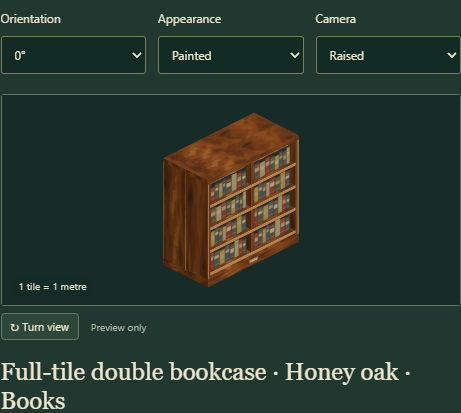
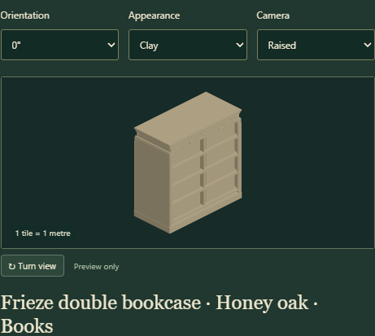
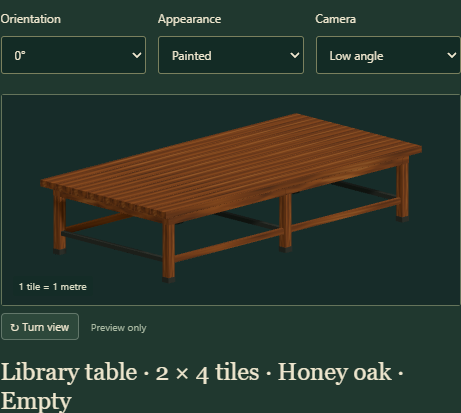
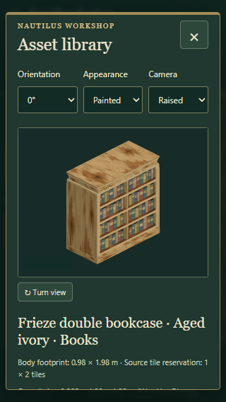
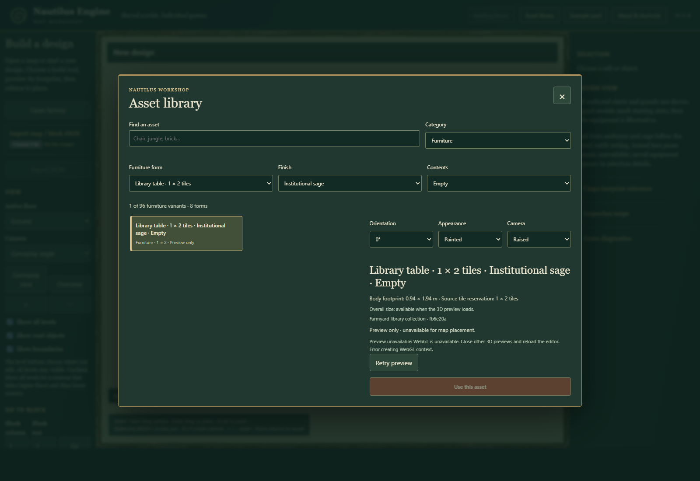

# Library furniture editor acceptance

Reviewed on 29 October 2026. Base: `581258aa506798dca3909bfd41ec39d3ee23b550`. The separately reviewed API dependency is `bfe26a01086726e3dfdc0ae20755675f36f4d080`; its source is Farmyard `fb6e20aa6e7d0cfe8793b4b7f693552d69a3a18b`, collection `library-furniture/3`. Only this furniture collection is included in this intake.

## Result

**Asset library → Furniture** discovers eight forms × six finishes × empty/books: 96 variants. The editor has 440 entries and the generated public catalogue has 501, including the existing 61 buildings. Furniture IDs retain their own namespace and Farmyard source pin. Search composes with form, finish and contents filters. Cold-start discovery is independent from workshop renderer/tool initialization.

Previews use the real API factory, the existing host Three and workshop lighting. They preserve native geometry and source placement offsets. Overall size comes from current visual bounds; body footprint and source tile reservation remain separate. Camera turns leave dimensions unchanged; actual model quarter turns swap the relevant dimensions, tiles and offsets. Displayed overall measurements agree with the rendered bounds to four decimal places.

The [usage and design assessment](../editor-furniture.md) records accuracy, efficiency and narrative recommendations. These are visual borrowing/inspection tools. The editor offers no furniture placement or save extension; game collision, navigation, inventory, fire and halo support remain explicit consumer work. Paint rows are solid source geometry, so painted gaps between book spines are not physical openings. No hardware or scene-scale performance claim is made.

## Measured examples

Stocked models at zero rotation, in metres. Visual extents below are measurements of the real generated geometry, rounded to four decimals; body dimensions are source declarations.

| Form | Declared body W × H × D | Source tiles W × D | Overall visual W × H × D |
| --- | --- | --- | --- |
| Tall bookcase | 0.94 × 1.9 × 0.46 | 1 × 1 | 0.94 × 1.9 × 0.4675 |
| Wide bookcase | 1.94 × 1.9 × 0.46 | 2 × 1 | 1.94 × 1.9 × 0.4675 |
| Low bookcase | 1.94 × 0.98 × 0.46 | 2 × 1 | 1.94 × 0.98 × 0.4675 |
| Double-sided bookcase | 1.94 × 1.9 × 0.88 | 2 × 1 | 1.94 × 1.9 × 0.895 |
| Full-tile plain | 0.98 × 1.9 × 1.98 | 1 × 2 | 0.995 × 1.9 × 1.98 |
| Full-tile frieze | 0.98 × 1.98 × 1.98 | 1 × 2 | 0.995 × 1.98 × 1.98 |
| Reading table | 0.94 × 1.18 × 1.94 | 1 × 2 | 0.94 × 1.16 × 1.94 |
| Communal table | 1.94 × 1.18 × 3.94 | 2 × 4 | 1.94 × 1.16 × 3.94 |

## Checks and evidence

The four project gates passed: `npm run check -- --tracked`, `npm test` (230 tests), `npm run test:upstream` (32 tests), and `npm run build` (356 module paths). The installed headless and optional furniture-renderer package proofs also passed. Integrity checks retain all 603 existing source files, twelve furniture source files and the 48 original building export hashes. Fourteen new editor tests cover generated discovery, combined filters, independent preview data, current bounds/offsets across 64 form/content/turn cases, camera fitting, material ownership, lazy load/cancellation, retry, cold metadata and obsolete callbacks. Existing map editing/history, roofs, buildings and consumer checks remain in the complete suite.

The [browser report](editor-furniture/acceptance.json) records runtime source hashes and both fixed dependency commits, 35 measured native poses, all 44 capture hashes and the following acceptance:

- Lazy factory/texture loading after the first furniture selection; no optional factory requests during ordinary workshop/library startup.
- Filter counts: form 12, finish 16, contents 48, form + finish 2, exact combination 1; empty results retire a filtered-out selection.
- All eight forms in paint/clay and empty/books, six finishes, both double-case faces, four actual quarter turns and unobstructed rays below both empty table sizes.
- Delayed obsolete resolve/reject after a newer selection, close/reopen, a deliberately failed real book-atlas request followed by successful retry, metadata discovery while the real main controller reports loading, and cold WebGL-unavailable metadata/search/filters. Cold browsing also handles missing character controls without losing metadata.
- Unchanged document export, revision, changed flag, undo/redo counts and browser storage after inspection.
- Keyboard selection, Escape focus restoration, reachable Close and no horizontal overflow at 1280 × 900, 390 × 844 and 320 × 568. The effective 200% layout case uses a 640 × 450 CSS viewport corresponding to a 1280 × 900 reference viewport.

There were zero unexpected browser/resource errors. The report retains the expected injected atlas failure and cold WebGL startup failure explicitly. This isolated Edge 156 software-WebGL run establishes visual correctness rather than GPU performance. Preview controls were moved above the model after visual review; failure hides the unused canvas so source, dimensions, availability and Retry remain visible.

The [cleanup receipt](editor-furniture/cleanup-receipt.json) and [exact-process verification](editor-furniture/helper-exit-verification.json) confirm browser/server shutdown and port release. No helper is retained. Runtime/review sources, source hashes and restart records are preserved locally; `node tools/review-editor-furniture.mjs` reproduces the review after building.

