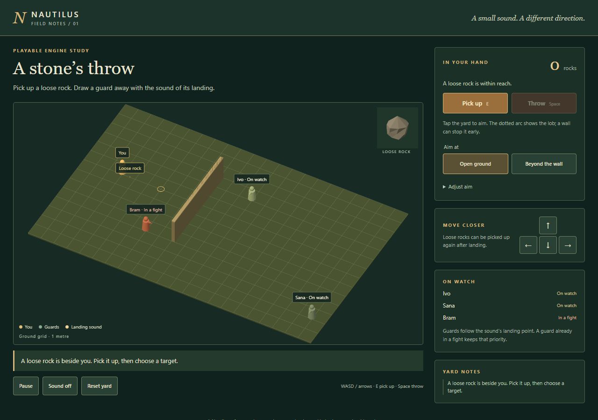
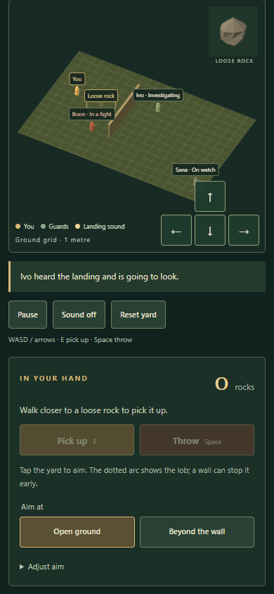
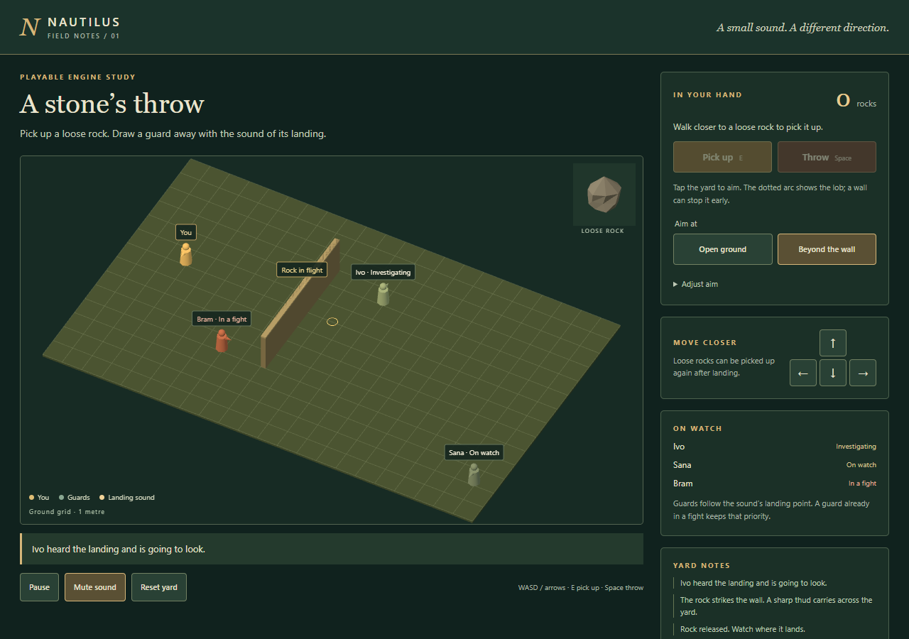

# Rock distraction reference consumer

This playable reference consumer is based on reviewed main
`8e962a233189129b8063001b2ee96a28403d2290`. It demonstrates a complete pickup,
throw, confirmed impact and guard-investigation loop without changing any donor
game, portable map/save schema, furniture, or the artist's fort kit.

## Frozen dependencies and owned files

- Core: `aff83ed8acb97daa7f512fb5529754377f0d48b1` plus quiet-settling checkpoint
  `2ba340fffdd723e28c66b5a5f5089f3c420a1053`.
- Model: exact original bytes from
  `9029dc11f4611ca46ea886ec9c03cbb6c0cfe3c5:packages/item-visuals/rock.js`,
  imported separately in `183a5559b36edf06b0bbcd2615d1e61c705a4f62`.
- UI owns the four flat `examples/rock-distraction*` files,
  `tools/review-rock-distraction.mjs` and this review/evidence.
- Architect owns release, public exports, package/distribution, build-provenance
  wiring and combined integration. No moving worker files were imported.

The example imports the shared Three entry and host-supplied rock factory. Ground
rocks retain the .055 m physical radius; a separate close view shows the actual
same model at native scale. The yard contains ground and one bounded wall.
Decorative boulders were removed so no visible solid lacks collision.

## Tested API binding and host responsibilities

The host uses `createRock({id,position})`, `openRock`, `serializeRock`,
`pickupRock(rock,command)`, `previewRockThrow(rock,command)`,
`throwRock(rock,command)`, `stepRock(rock,{dt:1/60,world})` and
`evaluateRockNoise(noise,listeners)`. See the core contract for full signatures.

Pickup commands carry explicit instance/revision/actor/command IDs, the canonical
standing-hand position and host pickup/capacity permission. Throw origin comes
from the canonical player, and only an accepted release removes the instance
from the consumer inventory. Commit compares the complete serialized source,
checks command receipts and copied inventory membership, then stores item and
inventory together before publishing events.

The consumer owns canonical positions, inventory, receipts, noise ledger, clock,
hearing permissions and guard routes. It retains fractional render time and
advances only fixed 1/60-second core inputs. It never feeds raw RAF fractions into
the core. The preview draws the returned trajectory and does not spend inventory
or emit sound.

Sweeps return sphere/surface contacts in native metres. The core receives complete
contact arrays during settling. Supporting wall tops are tagged ground, while
tangential/separating wall motion creates no new crossing. The first confirmed
noise receipt drives one thud, one visible ring at its actual height and a pure
hearing evaluation. No aim, release, quiet support contact or settled update
creates another cue.

The nearby idle guard routes around the wall, searches for three host seconds,
and returns. Far and engaged guards retain their state; an engaged guard keeps
its existing target. The investigation target is the impact point, never the
player position. Hearing is an explicit radius/permission example with no
acoustic attenuation model.

## Snapshots, controls and lifetime

The complete copied consumer snapshot includes core sidecars, inventory, command
receipts, original throw clocks, guard routes/timers, and impact ledger. Restore
checks core state/ownership, finite release clocks, guard homes/targets/headings
and search times, and event/note times. It rejects malformed values instead of
allowing JSON NaN-to-null conversion to alter behavior. This is a local reference
snapshot, not a multiplayer authority or general persistence framework.

Desktop supports WASD/arrows, E and Space plus ordinary buttons. Phones have walk
controls over the yard, tap aiming, pickup/throw and labelled aim adjustments.
Reset creates a fresh isolated yard. Sound starts only after a user gesture and
can be muted; no external audio asset is loaded.

Static, paused, hidden and offscreen states keep no perpetual RAF. Teardown
removes owned listeners/observers and disposes model instances, scene resources,
renderer/context and AudioContext. The isolated acceptance helper has a real
four-minute expiry, process identities/port record, and browser/server cleanup in
finally. It does not attach to an app-managed browser.

## Design evaluation

**Accuracy.** Prefer actual first swept contact and native heights over a target
or timer sound. The initial wall hit is followed by the core's quiet vertical
settling, preserving its original cue. Sphere-padded axis-aligned bounds and
90 Hz chord sweeps are bounded geometry approximations. Reach, lob and hearing
radius are game tuning, not calibrated physical acoustics or throwing skill.
No damage, horizontal rebound, drag, sliding or granular ground simulation is
claimed.

**Efficiency.** Prefer a fixed-step host, a small grid search only on investigation
and return transitions, cached unchanged UI/preview buffers, and event-driven
rendering when static. The shared model records 54 triangles, one mesh/material
and zero textures. These are code/model counts, not a CPU/GPU benchmark. Correctness
is reviewed using isolated software WebGL; hardware performance is unmeasured.

**Narrative.** Subjective preference favors restrained workshop styling and a
brief readable landing cue. Actual guard turning, walking, search and return make
the distraction useful to inspect. Preserving an engaged guard's priority makes
the limit clear without implementation-oriented player labels.

## Acceptance

Run the four required project gates, then:

```sh
node tools/review-rock-distraction.mjs
```

The runner uses isolated Edge on Windows and Chromium on Linux. It verifies the
shared native model, pickup/count, preview and moving flight, one thud/ring,
guard movement/search/return, far/engaged rejection, ground and wall re-pickup,
invalid actions, midflight and quiet-settling snapshot equivalence, eight negative
snapshot cases, reset, keyboard and touch, narrow layout and lifecycle disposal.
The wall case requires a final centre at .055 m with one original elevated cue.

The report contains the source commit and SHA-256 of the exact
`dist/build-provenance.json`. Optional source mode records that scope explicitly
with a null build hash. Runtime evidence and cleanup receipts are written under
`artifacts/rock-distraction/`; selected final evidence will be committed alongside
this review after the final acceptance run.

## Final UI acceptance results

Candidate `8d0724ac0ca9f02d8bb557de831bb6142be7be92` passed source checks,
all **213 engine tests**, all **32 upstream tests**, and build verification of
362 module paths. The final isolated Edge **156.0.4314.50** pass completed with no
browser/resource errors. Software WebGL establishes correctness, not hardware
performance.

[Acceptance data](evidence/rock-distraction/acceptance.json) records every check,
eight screenshot hashes, and built-provenance SHA-256
`8410036e4db53e202c248b57c20a06392afb4697d7965d838272783d20253854`.
[Verification](evidence/rock-distraction/verification.json) records frozen inputs,
project checks and verified helper cleanup.

The wall cue remains at `{x:9,y:6,h:1.7622121961422093}`; the reusable rock quietly
settles to centre height `.055`. One thud/ring is produced, the guard retains the
original elevated cue, routes around the wall, searches and returns. Ground and
wall re-pickup preserve the original instance. Midflight and quiet-settling
restores are equivalent; all eight malformed snapshots and empty/far/out-of-range
actions reject without inventory/rock changes.

Desktop keyboard movement and pickup/throw, phone tap controls at 390 × 844,
320 px narrow layout, reduced motion, reset, paused/offscreen frame retirement
and full teardown pass. Linux Chromium execution remains with combined CI.

The command exited 0. Its Node and isolated Edge lifetimes were verified exited,
port **58078** had zero listeners, and the
[cleanup receipt](evidence/rock-distraction/cleanup-receipt.json) confirms supported
browser/HTTP closure. No preview server or browser was retained.








