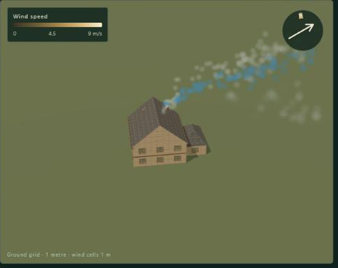
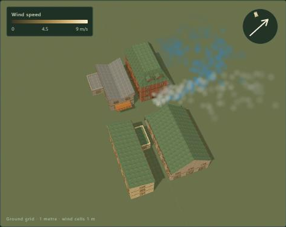

# Baked wind bearings and smoke: pre-registration and record

The question: a game cannot run the wind solver every frame, so it bakes mean fields at a few bearings and blends between them. How far does a chimney plume carried by that blend stray from one carried by the field solved at the exact bearing, and from live smoke in the running solver? And what does a tracer sample cost?

This file was committed **before** any plume path or timing below was measured. The code under test is commit `b295604` (`packages/wind-core/bearings.js` and `smoke.js`). Results are appended under [Results](#results); the sections above them do not change after the run. Any departure from the protocol is listed under [Deviations](#deviations).

## Protocol

**Sites.** The reference page's `single` (Rowan family house) and `street` (four buildings, a canyon about 3.3–5 m wide and 5.5–9.5 m tall) layouts, built as on the page: 1 m cells, `windDomain` with equal margins on every side (3H and 2H, lids 3H and 2.5H, minimum 8 m), so one grid serves every bearing.

**Wind.** 6 m/s at 10 m, z0 = 0.25 m (rough), surface-layer gusts at gain 1 (length scale 20 m, 32 modes, seed 1), pressure tolerance 2e-4, MacCormack advection. Bearings are meteorological (from), as in `docs/wind-field.md`.

**Runs.** One solver run per bearing and seed: 1 flow-through of warm-up (the longer horizontal side over 6 m/s), then 12 flow-throughs of averaging. Snapshots of the running mean after 1.5, 3, 6 and 12 flow-throughs are the bakes `bakeWindBearings` would return for `average` = 1.5, 3, 6 and 12. One run per site is checked bit-for-bit against `bakeWindBearings` itself.

- The 16 bearings 0, 22.5, …, 337.5. Their even members form the **8-set**; all of them form the **16-set**.
- The 8 bearings 11.25 + 45k: the 16-set's midpoints, and quarter points of the 8-set.
- Seed 2 at 22.5° and 202.5°, for the noise floor.
- `single` only: 225° at 3 m/s and at 9 m/s, for speed scaling.

**Sources.** A source is the centre of the first air cell above the highest solid cell in a column.

- `single/roof`: the column at the house's footprint centre.
- `street/roof`: the column at the footprint centre of the market terrace, the page's smoke building.
- `street/street`: 1.5 m above the ground at x = 5 m, midway across the air gap between the two rows. This is a fire in the street.

The page's own street source (0.3 m above the bounding box) lies inside a voxelized roof cell, which is why the protocol defines sources from the solid mask.

**Plume.** The plume is a `createSmoke` ensemble of 400 puffs released together at t = 0. They have jitter 0.15 m, spread 0.12 m²/s, rise 1.1 m/s and riseTime 5 s, the page's settings, from seed 1 in every arm. So the arms share their random numbers. Puffs are blocked by each arm's own solid mask (`windFieldSolid`), and the uniform arm has none. The smoke step equals the solver's step, dt ≈ 0.134 s. The plume path is the ensemble centroid C(t). The centreline, one puff without jitter or spread, is reported as a secondary result.

**Window.** Every arm is compared at the same steps, up to T_end. T_end is the last step before the truth centroid comes within 2 m of a horizontal side or the lid, capped at 20 s. L_end = |C_truth(T_end) − source| is the travel.

**Truth.** The exact-bearing field at 12 flow-throughs, seed 1.

**Arms** (A is the bake's averaging in flow-throughs):

| Arm | Field |
| --- | --- |
| slerp, linear, keep-speed (A = 3, 12) | `blendWindBearings` of the 8-set or 16-set at the target bearing |
| nearest | the 8-set bake counter-clockwise of the target (a midpoint has no nearer one) |
| uniform | the log-law inflow at the target bearing, no buildings: the fallback the wind doc names |
| noise floor | the same bearing, seed 2 against seed 1, at equal A |
| live | the running solver's instantaneous field. Every 1 s of averaging, a batch of 100 puffs (seed 1000 + batch) is released and tracked for 12 s. The live mean path is the mean of the batch centroids; the live scatter is their RMS distance from it. |

**Metrics.** D_end = |C_arm(T_end) − C_truth(T_end)|, in metres, in 3D. The others are D_end / L_end, D_max (the largest separation up to T_end), and the heading error at T_end (the horizontal angle between C − source for the two arms). Medians are over the 8 target bearings of a set, per site and source.

**Controls.**

- Null control: the truth against a bit-identical copy must give D = 0 exactly.
- Positive control: nearest must separate.
- Non-finite centroids are counted and must be zero.

**Timing.** These runs are not part of the test suite.

- Rig: AMD Ryzen 7 5800X, Node 24.15.0, Windows 11. The background load is recorded at run time.
- 10⁶ positions are drawn in the `single` domain, then 3 warm-up passes and 9 timed passes. The result is ns per sample: median, minimum and maximum.
- Arms:
  - E1: `sampleWindField` on a blended field.
  - E2: the two neighbours sampled and blended per call.
  - E3: the uniform log law.
  - E4: the live `solver.sample`.
  - E5: `createSmoke.step` per puff per step, at 1,000 puffs.
  - E6: `blendWindBearings` per call, for each blend.

## Predictions

| | Prediction | Confidence |
| --- | --- | --- |
| P1 | Interpolation beats snapping. Median D_end of nearest-8 is more than 2× slerp-8's (A = 12) for every site and source. | High |
| P2 | Baking beats the uniform fallback. Median D_end of uniform is more than 2× slerp-8's (A = 12) for every site and source. | Medium. Least sure for `single/roof`, whose plume rides mostly free stream. |
| P3 | Restoring the free stream helps. Slerp-8's median D_end is below linear-8's (A = 12) everywhere, and keep-speed is within ±25 % of slerp. | Medium-high |
| P4 | More bearings help. Slerp-16 at its midpoints has a smaller median D_end than slerp-8 at its midpoints (A = 12). | High |
| P5 | Size. Slerp-8 (A = 12) median D_end / L_end is at most 0.05 for roof sources and at most 0.10 for the street source. | Medium |
| P6 | Averaging limits a default bake. The A = 3 noise floor exceeds slerp-8's median D_end at A = 12. The A = 12 noise floor is half the A = 3 floor, ±40 %. | Medium. The gusts' σu ≈ 1.7 m/s and a ~3 s integral time leave about 0.7 m/s in a 3-flow-through mean. |
| P7 | Baked smoke stays within the live plume's meander. \|slerp-8 (A = 3) − live mean\| at T_end is below the live RMS scatter at T_end for at least 7 of the 8 target bearings, per site and source. | Medium |
| P8 | Speed scales. 225° at 3 m/s is exactly half of 6 m/s in every snapshot. At 9 m/s against 1.5 × the 6 m/s bake, D_end is below the A = 12 noise floor. | High; medium |
| E1–E6 | E1: 15–60 ns. E2: 1.7–2.5× E1. E3: below E1. E4: 2–5× E1. E5: 100–500 ns per puff, so 1,000 puffs take under 1 ms a step. E6: linear and slerp 0.2–1.5 ms per 10⁵ cells; keep-speed at most 3× linear. | Medium |

## Decision rules

- **R1, the default blend.** Slerp, unless keep-speed's pooled median D_end (8-set midpoints, A = 12) is more than 10 % lower, or linear's is lower than slerp's.
- **R2, the bearing count.** Recommend 16 if slerp-16's median D_end is under half of slerp-8's and slerp-8's exceeds the A = 12 noise floor. Otherwise recommend 8, with its error stated.
- **R3, the default averaging.** Keep `average` = 3 if the A = 3 noise floor is at most slerp-8's median D_end (A = 12). Otherwise raise it to the smallest of 6 or 12 that is, and state the extra bake time.
- **R4.** Where P2 fails, the record says that for that kind of source the uniform fallback is as good as a bake.

## Results

**When and how.** Runs on 2026-11-04 from 10:36 to 11:22, then compare at 11:23 and timing at 11:25, with `07660ab`. The compare added a supplementary live readout, marked below, before it ran. Rig: AMD Ryzen 7 5800X (16 threads), Node 24.15.0, Windows 11. Other sessions held the machine at up to 100 % during the runs, but nothing in a run depends on time. The numbers are in `evidence/wind-bearings-smoke/` (`results.json`, `timing.json`, `runs.json`).

**Integrity.**

- 54 runs, with no unconverged step.
- The instrument's 3-flow-through bake equals `bakeWindBearings` value for value on both sites: 297,600 and 313,200 values.
- The null control gives exactly 0 for all three sources. No centroid was non-finite.

### The answer

The bake bearings are 45° apart, and the target bearings sit halfway between them. Default (linear) blends of 12-flow-through bakes give these results against the field solved at the exact bearing:

| Source | Plume ends from the exact-bearing plume, m (median) | As a share of travel | Heading error | Travel |
| --- | --- | --- | --- | --- |
| Single house, chimney | 3.4 | 10.5 % | 1.7° | 32 m in 6.5 s |
| Street, terrace roof | 4.1 | 12.3 % | 2.8° | 30 m in 5.1 s |
| Street, fire at ground level | 6.3 | 18.1 % | 6.4° | 32 m in 17.5 s |

For comparison:

- Snapping to the nearest bake puts the plume 12–22 m off, at a 22–31° heading.
- The uniform fallback puts it 8.1, 4.5 and 49 m off.

**Against live smoke.** About 110–130 live plumes were released in the running solver at the same bearings.

- A practical 3-flow-through bake ends this far from the live plumes' mean path:
  - roof sources: linear 4.5–4.7 m, slerp 5.5–5.9 m;
  - street fire: linear 9.8 m, slerp 11.5 m.
- Live plumes wander around that mean by 9.3–9.5 m RMS (roofs) and 13 m (street).
- The exact-bearing mean field itself is 1.9 m (roofs) and 7.0 m (street) from the live mean.

So baked chimney smoke stays well inside the wander of live smoke. In the street it sometimes does not.

### Predictions

| | Outcome | Measured (single roof, street roof, street fire) |
| --- | --- | --- |
| P1 | **Held** | Nearest-8: 12.6, 12.3, 21.6 m. Slerp-8: 4.4, 4.1, 7.6 m. |
| P2 | **Failed** for both roof sources | Uniform: 8.1, 4.5, 49.0 m. That is ×1.85, ×1.08 and ×6.4 slerp-8's error. |
| P3 | **Failed** | Linear is below slerp at all three (3.36, 4.05, 6.32 m against 4.39, 4.12, 7.62 m). Keep-speed is within 0.5–7 % of slerp. |
| P4 | **Failed** for the street fire | Slerp-16 at its midpoints: 2.65, 3.78, 11.66 m. Slerp-8 at its midpoints: 4.39, 4.12, 7.62 m. The two sets were scored at different bearings. At the same bearings (the 8-set's quarter points), 16 beats 8 everywhere: 4.00 → 2.65, 4.52 → 3.78, 14.23 → 11.66 m. |
| P5 | **Failed** | Slerp-8 is off by 13.8 %, 11.6 % and 18.4 % of travel. The registered bounds were 5 %, 5 % and 10 %. |
| P6 | **Failed** | The noise floor at A = 3 is 3.7, 9.3 and 10.4 m; at A = 12 it is 2.8, 7.9 and 9.2 m (ratios 0.76, 0.85 and 0.88, not 0.5). It exceeds slerp-8's error only for the two street sources. |
| P7 | **Failed** for the street fire | Slerp (A = 3) is inside the live scatter at 7 of 8, 8 of 8 and 5 of 8 bearings. |
| P8 | **Held** | At 3 m/s, half the 6 m/s bake in all 297,600 values at every averaging. At 9 m/s against 1.5 × the 6 m/s bake: 1.5 m, below the 2.8 m noise floor. The largest field difference is 2.4 m/s; the turbulent flow amplifies the rounding. |
| E1 | **Missed**, narrowly | 64 ns (registered range 15–60) |
| E2 | Held | 149 ns, 2.31× E1 |
| E3 | Held | 14 ns |
| E4 | Held | 211 ns, 3.3× E1 |
| E5 | Held | 360 ns per puff per step: 0.36 ms for 1,000 puffs |
| E6 | **Failed** | Per call over 99,200 cells: linear 0.70 ms, slerp 1.92 ms, keep-speed 8.74 ms (12.4× linear) |

Timing load was 15–44 % on the registered timing run; a repeat at 100 % load gave E1 85 ns and E2 743 ns. Sampling two fields per call is the arm most hurt by contention, because it reads twice the memory.

### Decision rules

- **R1: linear.** Pooled medians: linear 4.05 m, slerp 4.53 m, keep-speed 4.53 m. The library default changes from slerp to linear.
- **R2: 8 bearings.** Slerp-16 at its midpoints pools to 4.40 m, not under half of slerp-8's 4.53 m.
- **R3: `average` stays 3.** The pooled noise floor at A = 3 is 3.73 m, at most 4.53 m.
- **R4: the single house's chimney and the street's terrace roof.** For a plume released above the roofs, the uniform log-law wind is about as good as a bake by this metric. A bake earns its keep for smoke below the roofs.

### What the misses say

1. **Linear wins by a cancellation, not a virtue (P3).** A chimney plume rides its own building's wake, and the wake turns with the wind. Blending the wakes of two bake bearings 22.5° to either side leaves the bisector faster than the true single wake. Linear's chord deficit, 7.6 % at the midpoint, slows it back. Slerp's exact free stream should still win for sources upwind of buildings or on open ground; that was not measured here.
2. **The error is along the path, not across it (P5).** Every blend points roof smoke within 1.7–2.8° of the exact bearing, against 22° for snapping. What is off, by 10–14 %, is how far along that line the smoke has gone. For smoke direction, 8 bearings and a blend suffice.
3. **A bake carries the seed of its gusts (P6).** This is a supplementary diagnostic, not registered.
   - Two seeds at the same bearing give mean winds aloft (the top 40 % of the domain) that agree in direction within about 1°.
   - Their speeds differ by 6 % (house, 22.5°: 7.71 against 7.27 m/s) and 15 % (street, 22.5°: 7.71 against 6.59 m/s), even after 12 flow-throughs.
   - An exact-bearing bake at 3 flow-throughs is 1.8–3.8 m from the same bearing at 12.
   - The likely cause is a few of the 32 synthetic gust modes running slower than the window (that is a hypothesis), so a longer average barely helps. Averaging several seeds should.
4. **A street fire's path forks (P4, P7).** At six of the eight 16-set targets, the exact-bearing bake at 3 flow-throughs is 10.9–18.0 m from its own 12-flow-through mean. Two seeds at 22.5° end 13–19 m apart at every averaging. The canyon sends smoke one way or the other on small differences. That uncertainty belongs to the site and the solver, not to the bake. Neither more bearings nor longer averaging removes it.

### Visual review

These judgments are subjective. The pictures are the page's own renderer in the app's browser pane, which was hidden, so frames were driven through `windFieldReview.advance`. In both, the wind is from 248°, between the 225° and 270° bakes. The blend is linear, the blue smoke is baked, and the white smoke is live, from the same sources.

- **The house.**  The baked plume leaves the chimney as a narrow ribbon along the line the live plume follows on average. The live plume puffs out and wanders around it. The direction is the same; the live one is restless and the baked one calm. [With streaks](assets/2026-11-04-wind-bearings-smoke-page.jpg).
- **The street.** The source is the street-level fire.  The two plumes take different ways out of the canyon. The live smoke runs out of the street's east end, and the baked smoke climbs over the north row. This is the fork the numbers describe: the live scatter for this source is 13 m RMS and up to 48 m. Here it decides which building the smoke hangs over.

### Tables

The tables give D_end in metres. Each cell is the median over the 8 targets, then the largest, the median share of travel and the median heading error.

**The 8-set at its midpoints (22.5° + 45k)**

| Arm | single/roof | street/roof | street/street |
| --- | --- | --- | --- |
| linear-12 | 3.36 (max 7.68; 10.5 %; 1.7°) | 4.05 (max 12.52; 12.3 %; 2.8°) | 6.32 (max 25.87; 18.1 %; 6.4°) |
| slerp-12 | 4.39 (max 10.45; 13.8 %; 1.7°) | 4.12 (max 14.47; 11.6 %; 2.8°) | 7.62 (max 28.23; 18.4 %; 6.6°) |
| keep-speed-12 | 4.41 (max 10.47; 14.0 %; 1.7°) | 4.07 (max 13.98; 11.8 %; 2.9°) | 7.11 (max 26.82; 17.7 %; 6.6°) |
| linear-3 | 4.21 (max 9.47; 13.3 %; 2.4°) | 5.50 (max 12.02; 14.9 %; 3.8°) | 9.31 (max 22.27; 28.9 %; 10.5°) |
| slerp-3 | 5.49 (max 12.58; 17.3 %; 2.5°) | 5.89 (max 13.81; 16.7 %; 3.7°) | 9.02 (max 28.53; 34.8 %; 11.5°) |
| keep-speed-3 | 5.33 (max 12.49; 16.8 %; 2.5°) | 5.86 (max 13.73; 16.1 %; 3.7°) | 8.87 (max 27.87; 33.2 %; 11.0°) |
| exact-3 | 1.81 (max 4.71; 5.7 %; 1.1°) | 1.79 (max 13.11; 5.9 %; 1.2°) | 3.79 (max 12.40; 11.7 %; 3.8°) |
| nearest-12 | 12.57 (max 18.19; 39.3 %; 22.7°) | 12.32 (max 24.45; 41.7 %; 21.6°) | 21.65 (max 36.82; 66.5 %; 30.5°) |
| uniform | 8.13 (max 14.73; 25.5 %; 1.3°) | 4.45 (max 14.53; 11.4 %; 3.8°) | 49.02 (max 80.41; 120.9 %; 15.8°) |

**The 16-set at its midpoints, and the 8-set at the same bearings (11.25° + 45k)**

| Arm | single/roof | street/roof | street/street |
| --- | --- | --- | --- |
| linear-12, 16-set | 2.14 (max 4.11; 6.5 %; 1.4°) | 3.80 (max 11.83; 14.7 %; 3.1°) | 11.29 (max 14.22; 38.0 %; 12.5°) |
| slerp-12, 16-set | 2.65 (max 4.53; 8.1 %; 1.5°) | 3.78 (max 12.33; 14.9 %; 3.1°) | 11.66 (max 15.19; 38.1 %; 12.8°) |
| linear-12, 8-set | 3.43 (max 4.90; 10.3 %; 1.1°) | 3.26 (max 11.31; 12.7 %; 4.7°) | 12.33 (max 23.98; 39.3 %; 13.5°) |
| slerp-12, 8-set | 4.00 (max 5.95; 13.0 %; 1.5°) | 4.52 (max 13.06; 13.2 %; 4.0°) | 14.23 (max 25.99; 46.7 %; 15.5°) |
| exact-3 | 3.81 (max 7.69; 10.8 %; 2.4°) | 2.94 (max 6.95; 12.5 %; 2.3°) | 13.97 (max 17.95; 44.4 %; 13.5°) |
| nearest-12, 16-set | 6.87 (max 8.92; 21.6 %; 11.5°) | 8.45 (max 12.45; 28.5 %; 14.9°) | 13.89 (max 25.03; 53.4 %; 19.4°) |
| uniform | 6.24 (max 17.28; 20.9 %; 1.3°) | 6.78 (max 15.16; 19.3 %; 4.8°) | 63.00 (max 80.01; 228.2 %; 20.8°) |

**Windows.** T_end and L_end are medians, with their range:

- single/roof: 6.5 s (5.0–7.4) and 31.9 m.
- street/roof: 5.1 s (3.9–8.8) and 30.3 m (21.9–52.5).
- street/street: 17.5 s (7.4–20.0) and 32.3 m (22.4–42.3).

**Centrelines.** The centreline (one puff, no jitter or walk) agrees with the ensemble at the 8-set midpoints: linear-12 3.57, 4.29 and 8.13 m; slerp-12 4.63, 4.20 and 8.41 m.

**Noise floor** (D_end in m at 22.5° and 202.5°):

| Source | A = 1.5 | A = 3 | A = 6 | A = 12 |
| --- | --- | --- | --- | --- |
| single/roof | 2.52, 4.25 | 3.06, 4.39 | 3.07, 3.25 | 3.33, 2.31 |
| street/roof | 2.90, 0.88 | 16.52, 2.12 | 18.32, 0.26 | 14.88, 0.89 |
| street/street | 11.55, 14.05 | 19.13, 1.72 | 12.81, 1.42 | 16.36, 2.08 |

**Live smoke** (8-set midpoints; distances in m, median with the largest):

| Source | Batches | Live scatter at T_end | Slerp, A = 3, to live mean | Linear, A = 3, to live mean (supplementary) | Uniform to live mean (supplementary) | Exact bearing to live mean |
| --- | --- | --- | --- | --- | --- | --- |
| single/roof | 108 | 9.25 (6.51–10.86) | 5.93 (15.57); 7 of 8 inside | 4.71 (12.52); 7 of 8 | 8.43 (17.72); 4 of 8 | 1.92 (3.09) |
| street/roof | 131 | 9.47 (7.33–15.28) | 5.48 (11.27); 8 of 8 | 4.47 (12.12); 7 of 8 | 4.02 (10.45); 8 of 8 | 1.91 (16.94) |
| street/street | 131 | 13.06 (6.39–47.80) | 11.48 (58.06); 5 of 8 | 9.75 (59.82); 5 of 8 | 31.74 (59.16); 1 of 8 | 6.96 (68.74) |

**Bake cost.**

- On a quiet machine (13 % load, the first probe), a step took 89 ms for the house's 99,200 cells and 133 ms for the street's 104,400. A default bake (1 + 3 flow-throughs: 320 steps for the house, 370 for the street) is then about 30 s and 50 s per bearing, or 4 and 7 minutes for 8 bearings in one thread.
- Under the runs' load a step took 228 and 232 ms (medians).
- The page baked 8 bearings in 8 workers in 297 s with the machine at 100 %.
- An 8-bearing set is 10.3 MB in memory and 13.8 MB as JSON (1.72 MB per bearing). Decoding it takes 125 ms.

**Diagnostics** (not registered):

- **E6, interleaved.** Interleaving the three blends call by call evens linear and slerp out: 1.49 and 1.54 ms. The registered gap came from call order and compiler state. Keep-speed stays 8× dearer (12.5 ms), from two `Math.hypot` calls per cell.
- **Mean wind aloft.** In the top 40 % of the domain, its direction is within 0.5° (median) of the bearing for the house and 1.1° for the street, at most 2.2° and 7.2°. That is also where the seed's speed bias shows.

## Deviations

1. **The smoke `blocked` rule changed after registration (2997727), before any run.** The registered code refused any step that ended in a solid. A source inside a coarse voxel (the street page's own default is one) could then never emit a puff that moves. 2997727 refuses only a step from air into a solid. Every registered source is the centre of an air cell, and jitter keeps new puffs within 0.15 m of it, so every puff starts in air. From air the two rules decide every step the same way. The runs used `07660ab`, whose bearing and blend code is `b295604`'s.
2. **Readings the protocol left open, fixed in `07660ab` before the first run:**
   - For P8 at 9 m/s, T_end comes from the 9 m/s plume itself, by the registered rule.
   - Under R1, if both linear and keep-speed qualify, the lower one wins.
   - R1–R3 name no source, so they pool all three (24 targets; the noise floor's 6).
   - A noise floor per source is the median, here the mean, of its two bearings.
3. **The solver is `f3a52cd`'s plain advect-then-project step.** The advection–reflection option on `claude/wind-reflection` was not used.
