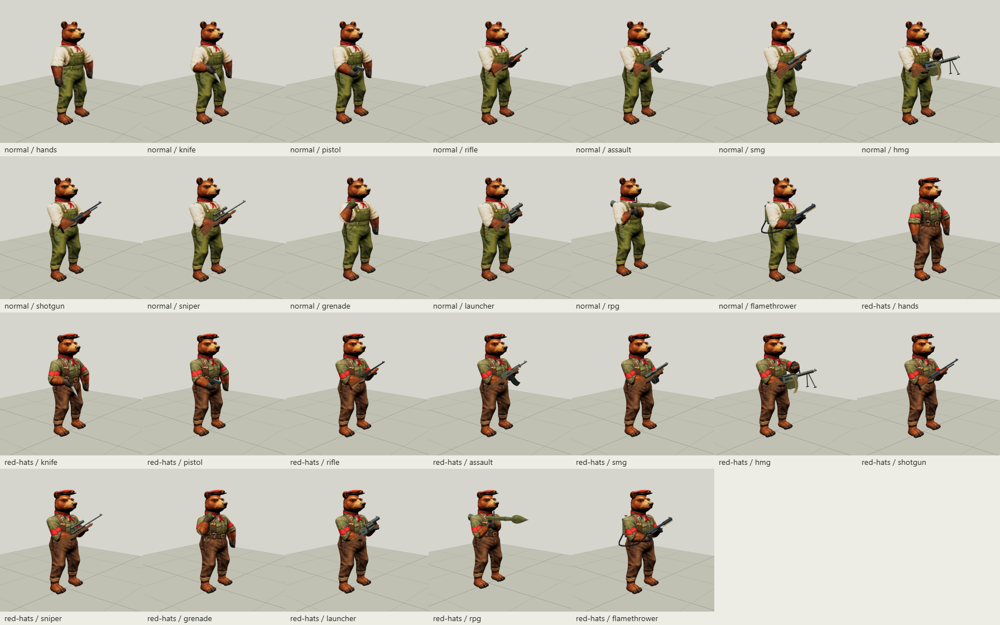

# Native bear provider and appearance acceptance

29 October 2026. Coder candidate on `codex/bear-provider`, based on reviewed engine v0.8.0 / `8c4670450cb2b38c1e1abd811d633c22de9e2b7c`. The contract checkpoint is `49b640a821dee2ff64c550c5a2184e35f810f7af`. Commission: the bear integration proposal at `1115871def96e8a9e5ddc239bf4ad5a5a7ff9829`. The containing Git commit identifies this complete candidate; evidence records exact runtime hashes instead of a circular self-commit hash.

## Implemented handoff

The optional public entries are `./actors/bear`, `./actors/bear/three` and `./appearance`. This is a functioning source/package presentation provider and headless authoring contract, ready for architect and Editor review. Editor controls, workspace rendering/history integration, production game adoption and release selection remain their own work. No consumer pin, main merge, package version or Sites audience changed.

The provider preserves the source bear, normal/Red Hat painting, cap fit, all thirteen equipment choices, native scale and declared motion families. Instances have independent geometry/materials/skeletons/equipment, explicit motion ownership, host-owned world placement and clocks, cancellable creation, retryable resource loads and complete close paths. It shares the existing Three r180 instance and borrows the host renderer. Optional speaking uses the exact pinned bear head. See the [public contract](../../bear-provider.md) for supported families, units and equipment restrictions.

Appearance document v1 keeps real bear Guard/NPC records beside unchanged legacy map/block JSON. Strict schema/capability negotiation, placement/update/remove/inspect/rotation, preview/apply, undo/redo, import/save, block capture/rotation/placement and deterministic ID remapping preserve outfit, weapon, role, heading and bounded opaque authored character data. The golden workflow keeps `hp:37`, `ap:0`, `stamina:6.5` and future data unchanged. Legacy APIs and the Tinderbox adapter reject a complete appearance envelope rather than discard its actors. Appearance-bearing generation is explicitly deferred; there is no implicit legacy downgrade.

## Source and adaptation findings

Source is fixed AFT `4f5f53917990ec03b2f14c65f067e4b99ec8fcaa`, imported from Git objects. [The source audit](source-closure.json) and snapshot provenance account for 72 original files / 11,877,195 bytes, including eight runtime resources / 11,312,307 bytes. Original vendor bytes, the old AFT pin and all twelve existing rig source identities remain unchanged. [Generated adaptation records](adaptations.json) identify every source/output hash and patch.

The first audited plan has 54 source modules. Implementation found `animal-prone-motion.js` to be a horse-only study: it remains archived/generated for that audit but is excluded from the executed and packaged closure. The actual provider reaches 53 adapted modules. Bear prone uses supported posture/crawl, and unsupported `prone-aim` rejects. No game-world, navigation or journey wrapper is imported.

Necessary integration corrections are explicit:

- Package-relative manifest URLs replace implicit page-relative cap/grenade loading, and the grenade dispatcher forwards the resolved texture.
- Projection failure restores borrowed renderer state and releases partial GPU resources. Actor/provider close releases late transferred textures while borrowed textures/weapons survive.
- The bear wrapper remains its skeleton owner; the redundant idle-actor wrapper is excluded. Cap donor skeletons are released. Borrowed HMG/RPG carry state and original parenting/transforms are restored after motion stops; concurrent leases reject.
- Managed native pose/equipment/motion operations run synchronously in an isolated local frame. Host translation, yaw and parent transforms stay unchanged, and native diagnostics remain local. No detachment spans an asynchronous load.
- Rifle-sequence teardown restores original inverse-bind matrices as well as geometry/skin attributes. The donor's default rebind otherwise recalculates the old skeleton inverses from the last animated pose and breaks later idle/equipment changes. The selected rifle is bound explicitly rather than using a detached default rifle.
- History includes the live document in its 16 MB serialized budget, so accepted undo/redo transfers remain bounded. A full history refuses the next edit atomically until deliberately cleared.

The original actor/height intake is still sealed and byte-preserved. Its historical test prohibited every actor export. Active regression checks now explicitly allow only the two reviewed bear entries while continuing all original source/rig/building checks and keeping those older proposed binding files out of distribution.

## Measurements and visual review

[WebGL evidence](webgl-acceptance.json) records Node v24.15.0, Windows, Edge 156.0.4314.50 and ANGLE SwiftShader software rendering. Viewports are 1600 × 1100 and 390 × 844. The narrow viewport is a responsive check, not a physical phone performance claim. All 26 source/installed-package outfit/equipment renders have identical pixel hashes and bounds. Seven motion captures, optional speaking, rapid selection cancellation/reopening, browser appearance history/save, no-WebGL metadata and an existing horse reference pass with zero console/resource errors.

The placed Red Hat RPG bear retains position `[100,6.36,-40]` and yaw `0.7` through equipment replacement and crawl. Its two carry contact errors are below `3e-16` m. Node coverage additionally compares origin and transformed/parented actors across equipment and motion families, deterministic seeks, exact surfaces/inverse-bind data, native limb lengths, concurrent actors, cancellation, failure/retry and exactly-once skeleton/bone-texture/geometry disposal.

Measured native clearance, without rescaling:

| Fixture | Measurement / implication |
| --- | --- |
| Normal standing body | Top 1.67085 m; cannot stand beneath the old 1.65 m prototype lintel |
| Red Hat standing visual | Top 1.69190 m; retains headroom under the standard 2 m ceiling |
| RPG carry | Visual X span 1.18896 m; a one-tile body anchor does not reserve the full weapon |
| Grounded normal rifle prone | Body bottom 0.012 m, top 0.81787 m in the named 1 m clearance fixture |
| RPG crawl | Body bottom 0.006 m, top 0.75500 m; visual X span 1.92331 m |

These are actual skinned local AABBs, not swept collision, navigation or universal door-fit claims. Native kit stories remain 2 m walls + 0.12 m slab. Source roof/descent clips use their original local prototype ledge frame; consumers must bind their actual floor heights and committed transitions deliberately.

Retained images include [rear normal](captures/rear-normal.png), [rear Red Hat](captures/rear-red-hats.png), [grounded prone](captures/motion-posture.png), [placed RPG crawl](captures/placed-rpg-crawl.png), [narrow layout](captures/narrow-provider.png) and [existing horse](captures/existing-horse.png). Visual inspection confirms retained head/cuff/tail painting, original clothing identities, cap placement and native weapon silhouettes. This is a subjective visual judgment supported by comparable captures.

## Validation and reproduction

Passed repository gates: `npm run check -- --tracked`, `npm test` (**381/381**), `npm run test:upstream` (**32/32**) and `npm run build`. `npm run test:package` passes an actual offline headless installation and existing pinned consumer conformance. The focused bear source/provider/appearance suite is **24/24**, including deterministic golden files, sealed headless imports and a check tying retained visual evidence to the current runtime hashes. The unchanged no-bear generation/authoring regressions pass; bear-bearing generation rejects unsupported input.

[Offline bear package proof](package-proof.json) passes all 26 combinations, all eight actual resource byte streams, optional speaking, appearance preservation and zero owned resources after close. Compatibility archive: 28,898,695 compressed bytes / 38,016,780 unpacked bytes / 259 files. Core discovery/appearance excludes adapted renderer modules and bear image/mesh payloads; renderer/compatibility profiles include the complete dynamic resource envelope. Counts describe this package, not a frame-rate benchmark.

Reproduce with `node tools/adapt-bear.mjs`, `node tools/prove-bear-package.mjs`, then `node tools/review-bear.mjs` with the existing Playwright runtime available. The browser tool verifies source/installed runtime hashes before testing, serves nested unrelated host URLs, and owns a hidden browser/server with a real five-minute expiry plus `finally` shutdown. [Cleanup evidence](cleanup.json) confirms both original helper processes exited and the port was released; no preview remains running. An earlier review's favicon 404 was fixed before the successful acceptance runs.

## Design recommendation

**Accuracy:** prefer the native bear fit, painting and anchors for AFT/Farmyard bear scenes. Measurements demonstrate retained metre scale and explicit clearance limits; they do not establish biomechanical realism. Preserve the original local traversal clips as presentation compatibility, with host geometry determining valid motion.

**Efficiency:** prefer the lazy optional provider over importing AFT game-world wrappers. The bounded module/resource counts and package sizes above are measured. Shared raw images/masks and per-instance mutable rigs follow code inspection; no hardware FPS, mobile memory or CPU improvement is claimed. Representative physical-device costs remain future consumer acceptance.

**Narrative:** regular and Red Hat bears retain their authored clothing, cap and equipment identities, which is the preferred visual result for AFT/Farmyard scenes. Factions, casting, statistics, costs, confirmed impacts, rewards, turns and Tinderbox fire simulation remain game-owned. The separate negotiated appearance envelope is preferred over species substitution because it preserves original legacy files and authored bear identity. Adoption status: coder candidate implemented and checked; architect/Editor integration and game adoption remain separate.
