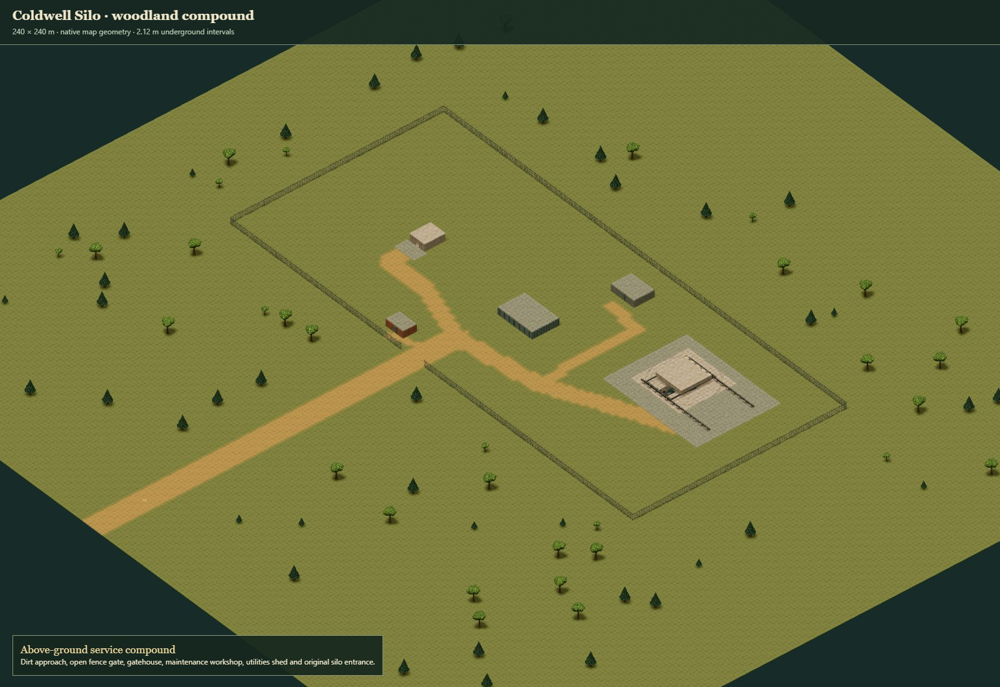

# Coldwell surface and required-companion review

The reviewed map uses Nautilus's actual native inspection renderer, standard painted materials, props and edge geometry. The original silo is placed at the preserved native metre scale; a custom infill joins square terrain to its round boundary without filling the shaft or stair openings. See the [site drawing](../../../maps/coldwell-site/site-plan.svg), [browser results](browser-review.json), [compatibility audit](compatibility.json) and [delivery gates](checks.json).

| Decision | Accuracy | Efficiency | Narrative / recommendation |
| --- | --- | --- | --- |
| Native portable surface plus required curved/deep companion, versus flattened legacy silo | Preserves source dimensions, 23 height positions, round boundaries and signed local heights. The surface is an original fictional compound, not historical grounds. | Reuses the existing map renderer and demand-controlled floor views. Game query/navigation cost remains unmeasured and unimplemented. | Prefer the preserving pair for Farmyard intake. Flattening would remove the location's defining interior and give the receiver false confidence. Adoption remains deferred until the owner binds every required feature. |
| Existing tree/ground/fence kit versus a new environment art system | Existing tree variants preserve their recorded trunk footprints and canopy overhang. The layout keeps a clear road and planting buffer. This is a game-scale landscape rather than a botany survey. | 78 placements and existing instancing/materials; no new per-frame landscape simulation. Counts are evidence, not a physical-phone performance claim. | Prefer shared standard assets for this modest surface. The open approach, gate and small support buildings give Farmyard useful spaces while keeping the silo readable; this is an artistic judgment. |
| Explicit common frame translation versus clamping or rescaling at import | A +0.5 m horizontal offset preserves integer-centred tile edges in nonnegative world bounds. +46.64 m vertical offset retains the basement depth. No independent collision rescale. | Constant rigid transform; no measurements imply broader gameplay performance. | Prefer the explicit reversible binding for every consumer, with the original coordinates retained in the companion. |

The focused tests exercise actual surface validation, deterministic tree/road generation, paths to interiors/access approaches, reserved apertures, infill polygon area, reversible coordinates, the released height schema, required-capability refusal, source file hashes, RLE equivalence and native edits/undo/redo/reload. The real pinned Farmyard importer accepts an empty flat control and rejects the site's unsupported features; the audit records actionable refusal rather than exporting a reduced substitute.

The browser captures include the whole surface, plan, entrance, silo pad with cover closed/open, support interiors, full underground cutaway and a selected floor window. The two initial viewer attempts exposed an incorrect texture base URL; that was corrected to the built engine's actual base path, and the successful review has no browser/resource errors. Render statistics in the saved report describe this isolated Edge/SwiftShader workload, not a phone FPS budget. The independent vector site drawing is captured as well.

`helper-cleanup.json` verifies the exact owned process lifetimes and released ports, including failed attempts. No browser, HTTP server, donor game runtime, deployment or permanent watcher is retained. Farmyard production loading, movement, visibility, projectile queries, doors and deep traversal require a separate owner-reviewed adoption.
