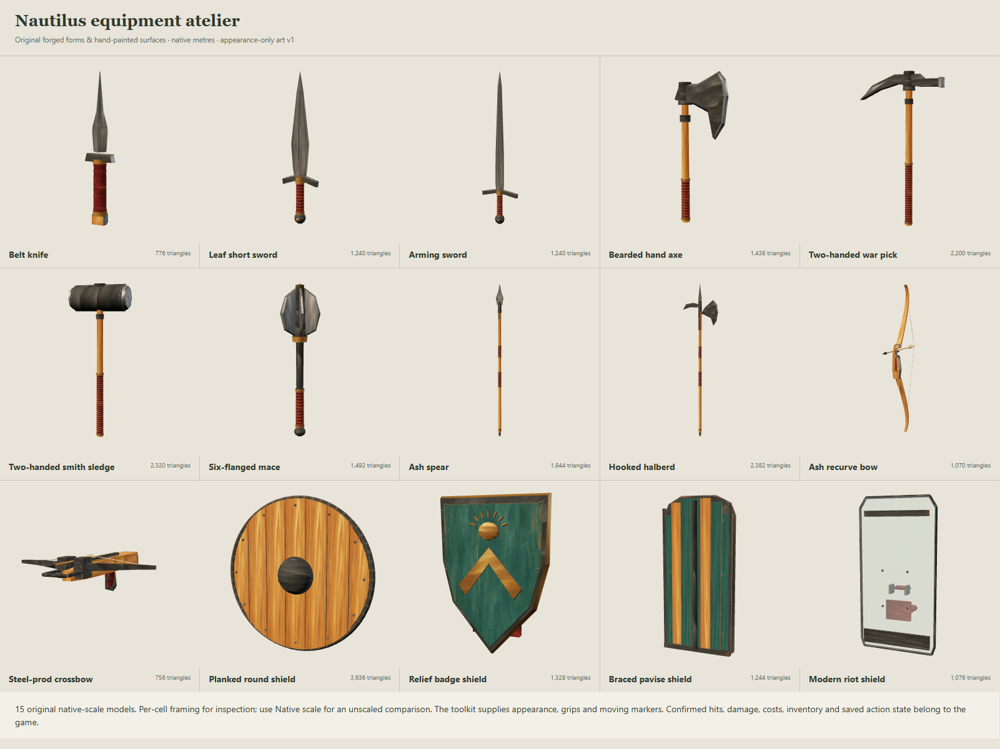

# Fantasy equipment artist checkpoint

All 15 canonical IDs are implemented as original native-metre models. Engine base: `796c1e73644a30a3061d2f38b3bcccab49519453`. Builder: the existing Nautilus Artist. Ownership is limited to the equipment art package/assets/tools, its focused test and this art review. No donor/worker imports, gameplay, public registry, consumer pins, shared examples or Sites changes are included.

Use [the component usage card](../../../../packages/fantasy-equipment-art/README.md) for imports, grip transforms, exact support/limits, persistence and ownership. [Source review](source-review.json) records per-ID metadata and actual renderer counts for **27 views**. [WebGL lifecycle evidence](browser-lifecycle.json) measures two instances of each ranged form, 41 draw samples, stable native node/buffer identities, rejected poses, neighbour survival and final zero geometry/texture allocation. The original painting source, [exact prompt](../../../../assets/fantasy-equipment/source/paint-prompt.json), packing tool and [SHA-256 provenance](../../../../assets/fantasy-equipment/provenance.json) are retained.

The review includes all individual weapon close views, four shield front/back pairs, [finish/back contact sheet](shields-front-back.png), [loaded articulation sheet](ranged-states.png), [whole roster scale](native-scale.png) and larger native comparisons for [blades](native-scale-blades.png), [tools](native-scale-tools.png), [long arms](native-scale-long-arms.png) and [shields](native-scale-shields.png). The existing goat remains scale 1, height 1.649517536 m. These are actual source-browser renders, not concept drawings or stand-in silhouettes. They demonstrate native object proportions; the Coder owns held poses and action-authoritative use.

| ID | Standard triangles | Mesh batches | Materials |
| --- | ---: | ---: | ---: |
| knife | 776 | 5 | 5 |
| short-sword | 1,240 | 4 | 4 |
| sword | 1,240 | 4 | 4 |
| axe | 1,438 | 5 | 5 |
| pick | 2,200 | 5 | 5 |
| blacksmith-hammer | 2,320 | 5 | 5 |
| mace | 1,492 | 4 | 4 |
| spear | 1,944 | 5 | 5 |
| halberd | 2,382 | 5 | 5 |
| bow | 1,070 | 14 | 6 |
| crossbow | 756 | 12 | 6 |
| round-wood-shield | 3,636 | 4 | 4 |
| emblem-metal-shield | 1,328 | 5 | 5 |
| tower-shield | 1,244 | 6 | 6 |
| riot-shield | 1,076 | 5 | 5 |

Every instance owns one synchronous 512-square RGBA paint texture; no external image loading or second Three occurs. Metal/wood/wrap/faction finishes share the original painterly atlas. Clear riot material uses tint/alpha rather than a texture to preserve visibility. The `opaque` variant keeps a real transparent eye band. Native resource evidence: retained host baseline **1 geometry/1 texture**; two bows **29/3**, retiring one **15/2**, retiring both **1/1**; two crossbows **25/3**, one **13/2**, both **1/1**. Only host retirement returns to **0/0**. Thus the art's cleanup leaves borrowed host resources alive.

Focused tests pass **25/25**, covering determinism, exact rest bounds, UV isolation, catalogue copies, native resources/sockets, continuous poses, strict errors, finish variants, same-instance buffer retention, two-instance isolation, real Three observer failures/reentry, injected allocation rollback, outward closed limb shells and clear projectile channels. Full combined engine gates and installed-package/gameplay proofs belong to the authorized Coder after fixed-art review; this checkpoint does not claim production game adoption.

Visual review corrected concave head triangulation/UV bounds, tower board coverage, connected rear standoffs, stock/limb face winding and real arrow/bolt clearance. Functional forms are deliberately restrained: forged edges and fittings carry shape, while brushwork/wood grain stay in the skin. Recommended for native tactical scale (subjective visual assessment). Geometry is deterministic authored delivery mesh, without an inflated sculpt/reduction claim. Ranged limbs use a small visual bend profile, not structural physics. Clear glass has no refraction or damage simulation. No first-person animation, collision provider or automatic hit is supplied.

All disposable review servers/browsers close through supported APIs and bounded watchdogs. [Source cleanup receipt](cleanup-receipt.json), [lifecycle cleanup receipt](lifecycle-cleanup-receipt.json), and `helper-verification.json` record closure and native identity/port checks. Earlier disposable runs are preserved under ignored local `artifacts/fantasy-equipment-art-review/helper-*.jsonl`; none is retained as a preview.

The handoff is a fixed local commit on `codex/fantasy-equipment-art`, for Architect review and Coder import. It is intentionally not merged, published or independently pushed under this delegated delivery request. Runtime distribution needs the equipment package's five JavaScript modules plus its guide; no generated source file outside the committed package is required. Original master PNG and authoring/review tools can stay source-only.

Architect accepted art checkpoint `654f648e8936376358cf57e5733db0a2dad3b760` and independently passed its 25 focused tests. The subsequent declaration-only follow-up supplies adjacent `catalogue.d.ts` / `three.d.ts`, this guide update and a strict ES-only type consumer/tool. [Type evidence](types-proof.json): TypeScript 5.9.3, strict NodeNext, exact optional properties, no DOM/Three type dependency, preserved concrete host node types and 13 rejected-call controls. Accepted JavaScript, geometry, paint and all 27 images remain byte-identical; browser/full-engine reruns are not required for this follow-up.
