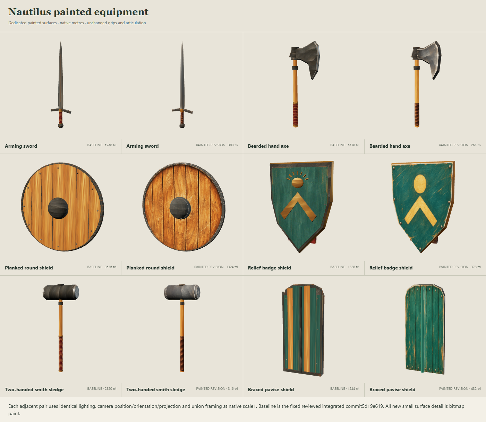

# Painted equipment revision

Finished original art-only candidate from reviewed integrated base **`5d19e6198b25e14ef98caf8dbad04ba739f96506`**, tree `4504277cc6576a7c425c1c6668aa82041403c4bc`. The 15 canonical forms, native scale, main/off grip transforms, socket names/orientations, finishes and ranged pose contract are preserved. The two-handed pick remains two-handed through the unchanged combat definition and native adapter. No gameplay, timing, costs, damage, actor motion, saves, consumer pins, exports, package registration, old worktrees or historical ledgers are edited.

Each adjacent pair has identical lighting and camera position/orientation/projection. Union framing and scale 1 keep comparison honest. [Source camera/native evidence](source-review.json) records six matched pairs and 20 final views. [Final roster](contact-sheet.png), [shield fronts/backs/finishes](shield-front-back.png), [draw/load sheet](ranged-states.png), [native armed](native-armed.png), [two-handed pick/sledge/halberd](native-two-handed.png), [native ranged](native-ranged.png), and [11m game-distance view](game-distance.png) are actual shared-Three source-browser renders. Representative individual closes cover sword, axe, sledge, bow, crossbow, round shield, painted badge, tower shield and both riot treatments.

Wrap ridges, tiny rivets/studs, fullered/engraved overlays, raised board pieces, small decorative insignia mesh and nonessential surface fittings are removed. New registered head faces, grip/shaft islands, stock top/side faces, shield fronts/backs and fittings carry painted recess shadows, grind/bevel highlights, wear, grain, seams, fasteners, stitches and the gold insignia. The badge sun/chevron is entirely painted. Shields use continuous bodies with painted joints/braces. Functional grasps/standoffs/padding, true head/blade form, major guards/bosses, the pavise rib, real apertures and moving string/limbs/projectiles retain depth.

Original [paint sources/prompts/UV index](../../../../../assets/fantasy-equipment/painted-v2/README.md), [UV crop/island manifest](../../../../../assets/fantasy-equipment/painted-v2/uv-layout.json), [notice](../../../../../assets/fantasy-equipment/painted-v2/NOTICE.md), and [SHA-256 provenance](../../../../../assets/fantasy-equipment/painted-v2/provenance.json) are retained. This is original built-in imagegen bitmap work registered to explicit UVs, rather than repeated generic material patches. Source PNGs are build inputs; per-model pages are deterministically packed/quantized and losslessly decoded into owned RGBA pixels. The clear riot panel carries painted fasteners in its alpha skin; the opaque finish retains its real clear viewing band. Existing standard materials use subdued metallic response for the painted highlights; no shader/pooling/physics/ballistics feature is introduced.

| Standard ID | Triangles before → after | Batches before → after |
| --- | ---: | ---: |
| knife | 776 → 152 | 5 → 4 |
| short-sword | 1,240 → 300 | 4 → 4 |
| sword | 1,240 → 300 | 4 → 4 |
| axe | 1,438 → 264 | 5 → 4 |
| pick | 2,200 → 282 | 5 → 4 |
| blacksmith-hammer | 2,320 → 316 | 5 → 4 |
| mace | 1,492 → 612 | 4 → 4 |
| spear | 1,944 → 336 | 5 → 4 |
| halberd | 2,382 → 424 | 5 → 4 |
| bow | 1,070 → 510 | 14 → 13 |
| crossbow | 756 → 756 | 12 → 12 |
| round-wood-shield | 3,636 → 1,324 | 4 → 3 |
| emblem-metal-shield | 1,328 → 378 | 5 → 3 |
| tower-shield | 1,244 → 432 | 6 → 3 |
| riot-shield | 1,076 → 664 | 5 → 3 |
| **15 standard forms** | **24,142 → 7,050** | **88 → 73** |

[Actual measurements](measurements.json) also report per-finish material/mesh counts and texture bytes. Standard triangle reduction is 70.8%; batch reduction 17.0%. Each instance still owns **one 512-square RGBA texture, 1,048,576 bytes**, with 1,398,100 bytes including mip levels. All 18 model/finish choices now have distinct pages. Embedded source grows from **699,865 to3,459,139 bytes**; deterministic gzip sizes are **249,685 to2,413,233 bytes**. That is the measured storage cost of substantially richer unique painted artwork. These are actual byte/count measurements, not FPS claims. Double-sided glass can require an extra pass, so batches are not a draw-call guarantee.

Accuracy: original silhouettes, apertures, native hand paths and motion are retained; small depth cues become visual paint. Efficiency: triangle/batch reductions and unchanged per-instance texture allocation trade against larger encoded source. Narrative: coherent brushwork, wood/steel wear and flat painted insignia better match Nautilus's native characters/vehicles (artist judgment). This is the preferred tactical art treatment under the user's revised direction. First-person close inspection still sees a finite512-square painted page; no new collision, refraction, structural or ballistic fidelity is implied.

[Focused validation](validation.json) passes 29 tests: deterministic geometry, registered UV bounds, palette/LZ pixel hashes for 18 distinct pages, strict bad IDs/finishes/poses,190 baseline marker samples over both load states and 41 draw values, visual bounds, two-instance isolation, repeated disposal, actual throwing/reentrant Three disposal observers, partial allocation rollback, outward limb shells and clear projectile paths. Fixed baseline reference bytes come from Git objects, not a moving worker checkout. Runtime declarations and all gameplay/source pins remain unchanged.

[Native WebGL proof](browser-lifecycle.json) checks 164 ranged draw/load states with stable meshes/anchors/position buffers. Both owners retire to the retained host resource baseline, then only the host returns to 0 geometry / 0 texture. The actual native goat adapter is exercised without modifications: 11 held subjects remain scale 1 and have maximum grip error under 1e-5 m, including the corrected two-handed pick and moving bow support. No art observation grants an attack, cost or hit.

No preview service is retained. [Review receipt](review-cleanup.json), [lifecycle receipt](lifecycle-cleanup.json) and [native PID/creation-time/port verification](helper-verification.json) cover all four recorded review lifetimes. One initial inline launch failed before identity metadata because the shared helper required a source script path; its supported `finally` cleanup was awaited before command exit. Subsequent runs use durable recorded scripts. No unrelated process was stopped.

Reproduce: `node tools/fantasy-equipment-art/painted-v2/measure.mjs`; `node tools/fantasy-equipment-art/painted-v2/bake.mjs`; `node --test tests/fantasy-equipment-art.test.mjs tests/fantasy-equipment-painted-v2.test.mjs`; `node tools/fantasy-equipment-art/painted-v2/review.mjs`; `node tools/fantasy-equipment-art/painted-v2/verify-browser.mjs`; native PowerShell `verify-helpers.ps1`; then `node tools/fantasy-equipment-art/painted-v2/validate.mjs --repack`. Browser launches are hidden, recorded, bounded and closed in `finally`.

Delivery is one fixed **local** commit for Architect visual review. Coder stays idle until that acceptance and owns the successor registration/installed-package proof and required four gates. Specifically add the new internal `paint-layout.js` and current painted-v2 provenance/notice to the package closure; headless/native public entries and API remain unchanged. Runtime uses no external PNG fetches. No main merge, push or Sites change occurs at this partly registered art checkpoint.
