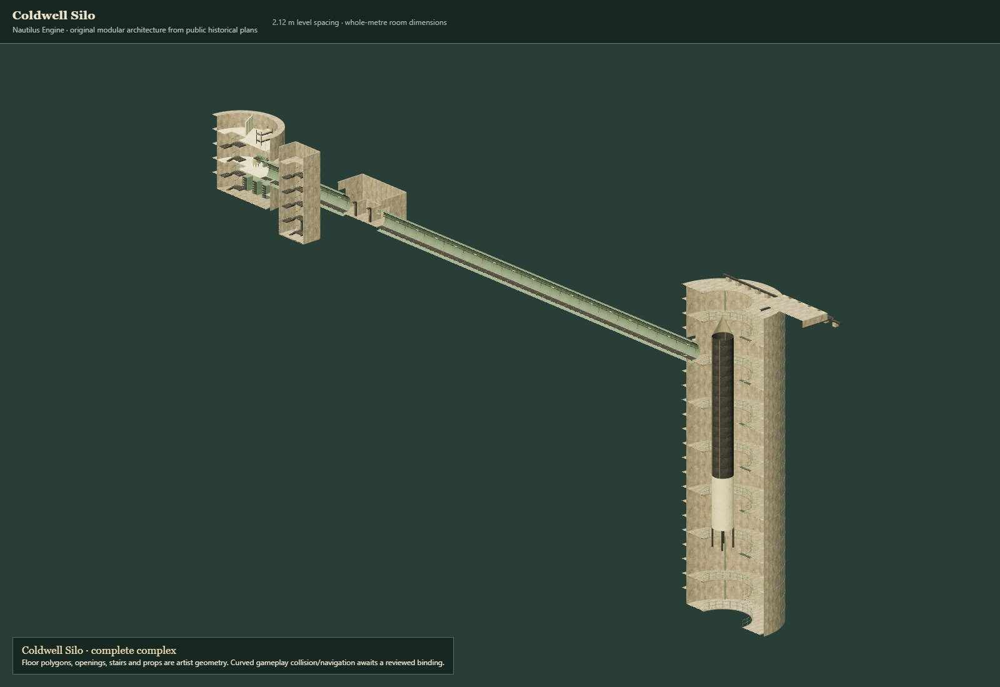

# Coldwell Silo visual and contract review

The [native review viewer](viewer.html) exercises the original artist provider; [independent export viewer](export-viewer.html) uses official Three r180 GLTFLoader. The saved [browser report](browser-review.json) covers all 15 assets, all 23 height windows, UI floor controls, keyboard focus, independent door poses, cover travel, source/game comparison and standard export readback. There were no browser errors or failed resource requests. The initial prototype had a missing favicon; that was corrected before the successful final reviews.

| Comparison | Accuracy | Efficiency | Narrative and recommendation |
| --- | --- | --- | --- |
| Round walls with clipped metre cells versus stair-stepped square room outlines | Round sectors preserve documented circular massing and clear voids. Full tiles stay native; boundary cells explicitly record their polygons. Maximum main-shaft chord deviation is 4.56 mm in the game mesh. | More geometry and a future polygon query cost than square panels. Query cost is unmeasured. | Prefer curved artist geometry for this silo's distinctive shafts and capsule. Subjective visual review finds the round silhouette more readable. Keep square panels for straight partitions and corridors. Curved gameplay intake remains deferred. |
| Historical proportions versus literal reconstruction | Textual dimensions are rounded; the source drawing shortens the long cableway, so it is not used as a scale ruler. 2.12 m levels replace irregular real levels. Exact deck heights, stairs and rooms are explicitly adapted. | Fixed native intervals simplify floor selection and placement; no simulation-cost measurement is claimed. | Prefer this explicit adaptation for tactical exploration. A museum reconstruction would need additional measured drawings and different vertical assumptions. |
| Detailed source versus game profile | Same authored layout and envelope; reduced curve facets, rod sides and chamfers. Bounds agree within 25 mm across all modules; typically exact. No independent height scaling. | Full complex: 428,704 source triangles, 163,300 native game triangles, a 61.9% reduction. Portable glTF uses 301,306 triangles because repeat UV seams are baked. | Prefer native game meshes in the game renderer and retain source meshes for sculpt revisions. Use glTF for interchange and art tools; it is not the cheapest runtime representation. |
| Whole complex versus nearby floor window | Geometry is retained in authoring; rendering chooses a window without flattening or merging floors. Cutaway planes can hide part of a stair and are a presentation aid. | Measured isolated Edge/SwiftShader submission: 260 calls / 159,976 triangles in the overview; 31 calls / 32,140 triangles for the B5 shaft view. These are workload counts, not FPS or a device budget. | Prefer floor-window rendering for play, with overview for authoring. Keep the source whole; streaming/query performance still needs consumer measurements. |
| Signed basements versus nonnegative world contract | Native Y stays −46.64…0 at occupied datums. Separate +46.64 m translation is reversible and preserves B labels without strict-schema extensions. | Only 23 floor records; no general basement/terrain implementation is introduced. | Follow the architect's height binding. The empty world reference proves height compatibility only. It must never be presented as an integrated playable world. |

Visual inspection included the complete complex, capsule control and living decks, grid boundaries, access stairs, lock, wall aperture, cableway, all repeat modules and source/game cabinet captures. The native stair module was inspected uncut to verify both flights and landings. A surface stair-well opening, cover frame/track clearance and service-bridge railing gaps were corrected after visual inspection; geometry/export/browser checks were rerun afterward. The painterly atlas reads consistently across cream concrete, seafoam steel, ivory paint and charcoal metal. This is an artistic assessment, not a material-aging simulation.

The [Khronos audit](export-audit.json) reports zero glTF errors and warnings for all 15 models. Its informational NPOT image notice is expected for the unchanged 1254 × 1254 atlas. The independent loader compares all moving-part matrices and overall bounds at closed, half and full poses; atlas-rendered samples also match, with no pixels differing by more than five channel units. Its comparison uses an identical fixed camera and lighting, not image-file similarity alone.

The focused tests verify actual floor polygon area and holes, threshold overlap, the surface stair opening and a ray through the upper midway landing's head space, tread top heights, wall-opening ray tests, source/game finite attributes and winding, independent poses, native-to-world clip planes, ownership/disposal, glTF buffers, motion envelopes and file hashes. These checks do not constitute a general swept actor-clearance solver. The immutable world-core validation passes a serialized height-reference round trip. Mandatory repository gates are recorded in [checks.json](checks.json). [Helper cleanup](helper-cleanup.json) verifies exact process lifetimes and released review ports; no preview helper is retained.

Source: [NPS museum nomination](https://npgallery.nps.gov/NRHP/GetAsset/NHLS/92001234_text), PDF pages 5, 6 and 25. Newly authored choices and dimensional conversions are recorded in [references.json](../../../art/silo/references.json). No original plan pixels are redistributed.
